# Gradient-Based Optimization for Image Classification

**CSE473 — Computational Intelligence | Fall 2026 | Milestone 1 (Phase One)**  
Faculty of Engineering, Ain Shams University

An experimental study of six gradient-based optimizers on Fashion-MNIST using a custom **Leaky-GELU CNN**. The goal is not simply to maximize accuracy, but to understand the interaction between optimization mathematics, hyperparameters, numerical stability, generalization and computational cost.

| Experimental runs | Completed | Numerical divergence | Test evaluations | Trainable parameters |
|---:|---:|---:|---:|---:|
| 66 | 64 | 2 | 18 | 475,434 |

**Main result:** Adagrad achieved the highest observed mean test accuracy (92.207%, SD 0.318 percentage points). Momentum achieved the lowest mean test loss and the fastest mean training time among the selected configurations. RMSprop had the lowest test accuracy variation across three seeds. Adam provided a competitive accuracy/time compromise. These are empirical findings for the tested configurations, not universal rankings.

## Contents

- [1. Problem definition and objectives](#1-problem-definition-and-objectives)
- [2. Dataset and preprocessing](#2-dataset-and-preprocessing)
- [3. CNN architecture and design decisions](#3-cnn-architecture-and-design-decisions)
- [4. Activation functions](#4-activation-functions)
- [5. Loss, initialization and gradient monitoring](#5-loss-initialization-and-gradient-monitoring)
- [6. Optimization algorithms](#6-optimization-algorithms)
- [7. Experimental methodology](#7-experimental-methodology)
- [8. Baseline experiment](#8-baseline-experiment)
- [9. Learning-rate investigation](#9-learning-rate-investigation)
- [10. Momentum investigation](#10-momentum-investigation)
- [11. Batch-size investigation](#11-batch-size-investigation)
- [12. Adaptive hyperparameters](#12-adaptive-hyperparameters)
- [13. Epoch-budget and overfitting analysis](#13-epoch-budget-and-overfitting-analysis)
- [14. Multiple-seed stability](#14-multiple-seed-stability)
- [15. Independent test evaluation](#15-independent-test-evaluation)
- [16. Final engineering comparison](#16-final-engineering-comparison)
- [17. Discussion and limitations](#17-discussion-and-limitations)
- [18. Conclusion](#18-conclusion)
- [19. Reproducibility](#19-reproducibility)
- [20. Complete results archive](#20-complete-results-archive)
- [21. References](#21-references)

## 1. Problem definition and objectives

The task is supervised multiclass classification of grayscale clothing images. Given an image $x$, the CNN predicts one of ten categories. The network parameters $\theta$ are learned by minimizing the training cross-entropy objective:

$$\min_{\theta}\; \frac{1}{N}\sum_{i=1}^{N}\mathcal{L}(f_{\theta}(x_i),y_i).$$

The study investigates vanilla SGD, SGD with Momentum, Nesterov Accelerated Gradient, Adagrad, RMSprop and Adam. The same network, dataset split, initialization strategy and baseline training conditions are used to isolate optimizer behavior as far as practicable. Additional one-factor sweeps investigate learning rate, momentum, adaptive optimizer coefficients, batch size and epoch budget. Classification metrics, convergence, stability and resource use are compared. This README documents Phase One; the generative-model work of Phase Two is outside its scope.

## 2. Dataset and preprocessing

Fashion-MNIST contains 70,000 grayscale images of clothing in ten balanced categories. It is a more visually challenging alternative to handwritten-digit MNIST while retaining the same image dimensions.

| Property | Value |
|---|---|
| Original training / official test | 60,000 / 10,000 |
| Experimental training / validation / test | 50,000 / 10,000 / 10,000 |
| Images per class (train / validation / test) | 5,000 / 1,000 / 1,000 |
| Input | 1 × 28 × 28 |
| Split method | Stratified, seed 42 |
| Normalization mean / SD | 0.286276 / 0.353185 |
| Data augmentation | None |

| ID | Class | ID | Class |
|---:|---|---:|---|
| 0 | T-shirt/top | 5 | Sandal |
| 1 | Trouser | 6 | Shirt |
| 2 | Pullover | 7 | Sneaker |
| 3 | Dress | 8 | Bag |
| 4 | Coat | 9 | Ankle boot |

The official training partition is split into training and validation subsets. The official test set is reserved for final evaluation. Normalization statistics are computed exclusively from the training subset to prevent leakage. After conversion to a floating-point tensor in [0,1], pixels are standardized:

$$x'=\frac{x-0.286276}{0.353185}.$$

This centers and scales the input distribution, which can improve conditioning during training. A saved split and fixed normalization are used throughout. Training samples are shuffled; validation and test samples are not. No augmentation is used so that optimizer comparisons are not confounded by changing augmentation policies.

<!-- BEGIN DATASET FIGURES -->
#### Class Distribution

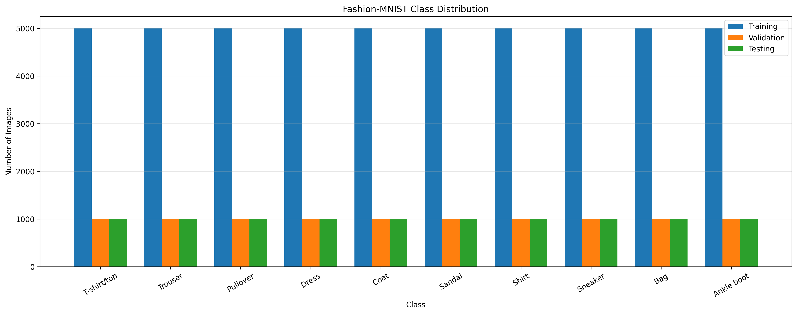

*The class-distribution plot checks stratification and balance across splits.*

#### Dataset Samples

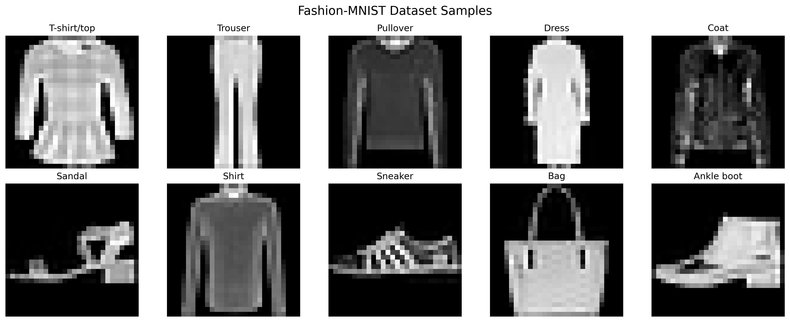

*Representative Fashion-MNIST images illustrate the input resolution and clothing categories.*

#### Normalization Comparison

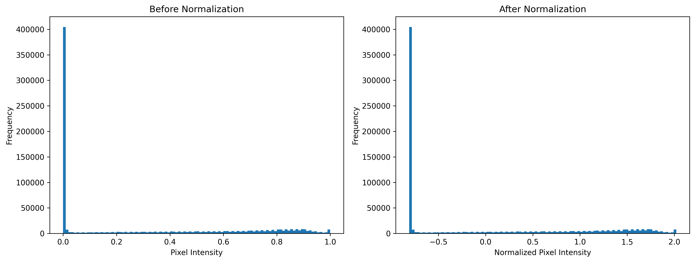

*The normalization plot illustrates the transformation using training-derived mean and standard deviation.*
<!-- END DATASET FIGURES -->

## 3. CNN architecture and design decisions

The **Leaky-GELU CNN** uses convolutional feature extraction followed by a fully connected classification head. All runs use this exact architecture; the activations were a design choice, not the subject of a controlled activation-ablation experiment.

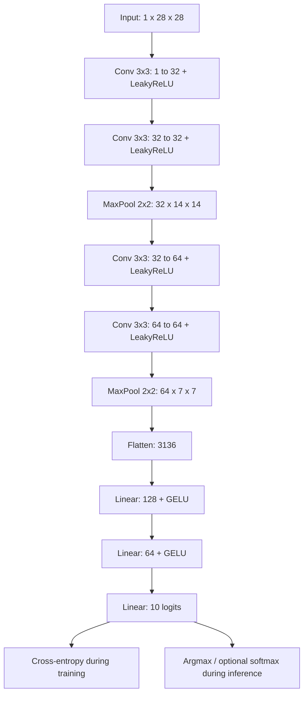

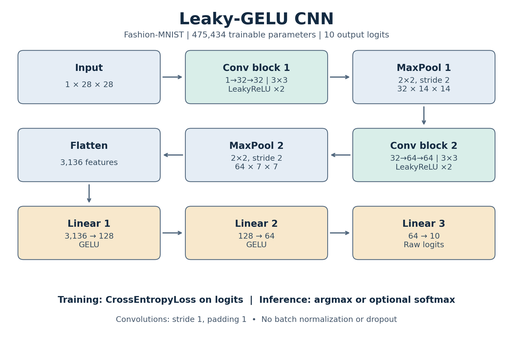

| Layer | Kernel / stride / padding | Output shape (excluding batch) | Activation | Trainable parameters |
|---|---|---|---|---:|
| Input | — | 1 × 28 × 28 | — | 0 |
| Conv 1 | 3 / 1 / 1 | 32 × 28 × 28 | LeakyReLU | 320 |
| Conv 2 | 3 / 1 / 1 | 32 × 28 × 28 | LeakyReLU | 9,248 |
| MaxPool 1 | 2 / 2 / 0 | 32 × 14 × 14 | — | 0 |
| Conv 3 | 3 / 1 / 1 | 64 × 14 × 14 | LeakyReLU | 18,496 |
| Conv 4 | 3 / 1 / 1 | 64 × 14 × 14 | LeakyReLU | 36,928 |
| MaxPool 2 | 2 / 2 / 0 | 64 × 7 × 7 | — | 0 |
| Flatten | — | 3,136 | — | 0 |
| Linear 1 | — | 128 | GELU | 401,536 |
| Linear 2 | — | 64 | GELU | 8,256 |
| Linear 3 | — | 10 | None (logits) | 650 |
| **Total** | | | | **475,434** |

For a convolution with kernel $k$, stride $s$, padding $p$ and dilation 1, the spatial output is

$$H_{out}=\left\lfloor\frac{H_{in}+2p-k}{s}\right\rfloor+1.$$

The 3×3 stride-1, padding-1 convolutions preserve resolution; downsampling is performed only by the 2×2 pooling layers. The convolutional parameter count is $(k^2C_{in}+1)C_{out}$ with bias. The linear parameter count is $(d_{in}+1)d_{out}$. For example, the first fully connected layer has $(3136+1)128=401536$ parameters. FP32 model weights alone occupy about 1.81 MiB, excluding gradients, activations and optimizer state.

**Design rationale.** The 32-channel stages learn local edge and texture patterns; the 64-channel stages can combine them into more abstract features. Two consecutive 3×3 convolutions expand receptive field while retaining intermediate nonlinearities. Pooling reduces spatial cost and provides limited local translation tolerance. The classifier compresses 3,136 features into 128 and then 64 features before producing ten logits. Batch normalization, dropout, weight decay, gradient clipping and learning-rate scheduling are deliberately absent in the controlled training design to simplify attribution of differences to the optimizers. This can increase overfitting or numerical instability, which is discussed later. The architecture is not claimed to be globally optimal.

## 4. Activation functions

### 4.1 LeakyReLU in the convolutional feature extractor

$$f(x)=\begin{cases}x & x\geq0\\0.01x & x<0\end{cases}$$

$$f'(x)=\begin{cases}1 & x>0\\0.01 & x<0\end{cases}$$

Unlike ReLU, LeakyReLU retains a nonzero gradient for negative inputs, reducing the risk that negative activations permanently stop contributing to learning. It is piecewise linear, inexpensive and useful in layers processing many feature-map elements. It does not guarantee the absence of vanishing gradients or exploding gradients. The derivative at zero is a convention at the kink.

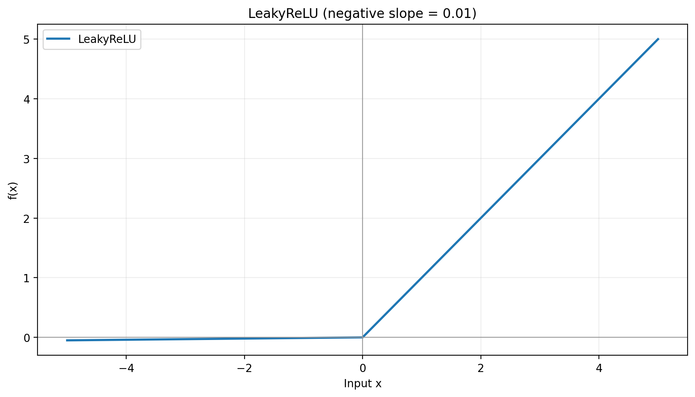

### 4.2 GELU in the fully connected classifier

$$\operatorname{GELU}(x)=x\Phi(x)=\frac{x}{2}\left[1+\operatorname{erf}\left(\frac{x}{\sqrt{2}}\right)\right]$$

$$\operatorname{GELU}'(x)=\Phi(x)+x\phi(x),$$

where $\Phi$ and $\phi$ are the standard normal CDF and PDF. GELU applies smooth, input-dependent gating rather than a hard threshold; it can retain small negative outputs and has a smooth derivative. The CNN uses PyTorch's default exact GELU in the 128- and 64-unit hidden layers. Its greater computational cost is limited to a small classifier head. For perspective, the four convolutional activations contain 75,264 values per image in total, versus 192 hidden classifier activation values. There is no mathematical requirement to use one activation at a particular layer size; the hybrid choice is a practical design hypothesis, not evidence that GELU outperforms LeakyReLU here.

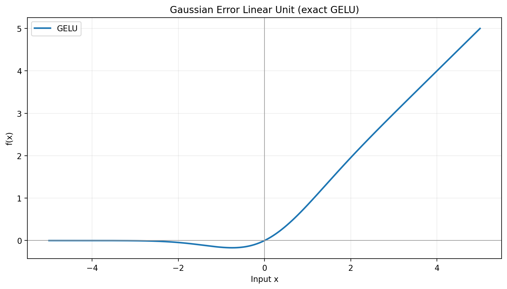

### 4.3 Activation and gradient comparison

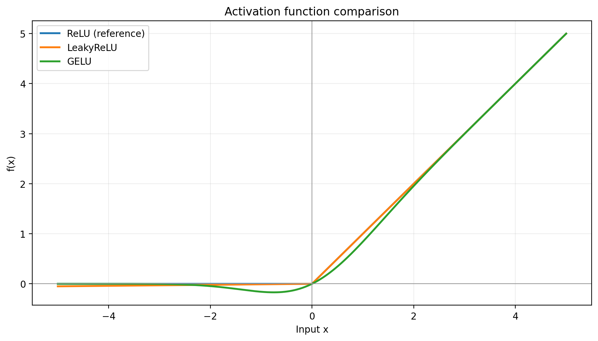

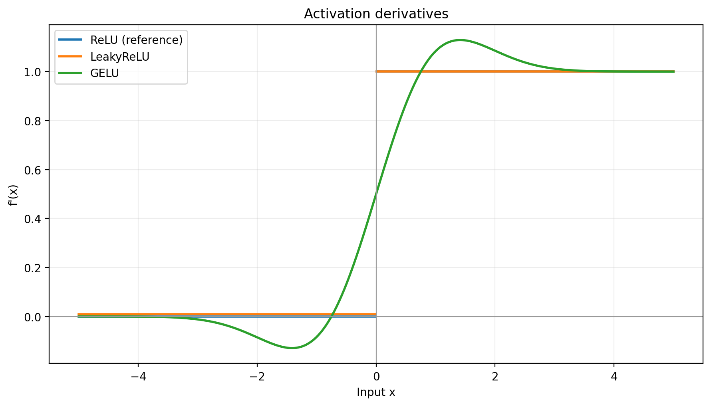

The theoretical curves compare ReLU (reference only), LeakyReLU and GELU. The LeakyReLU negative slope is 0.01; GELU has a smooth transition and a small non-monotonic region. The derivative comparison explains how the activation choice influences backpropagation, but is not a measurement of the network's actual gradient flow. Actual gradients are monitored during the experiments (Section 8).

### 4.4 Output logits and softmax

The final layer has no explicit activation during training. PyTorch `CrossEntropyLoss` combines log-softmax and negative log-likelihood numerically stably. For inference, softmax can be used to obtain class probabilities:

$$p_i=\frac{e^{z_i}}{\sum_{j=1}^{10}e^{z_j}},\qquad \hat{y}=\arg\max_i z_i.$$

Applying softmax before `CrossEntropyLoss` would be incorrect for this implementation. Argmax of logits and argmax of softmax probabilities produce the same predicted class (up to ties and numerical effects).

## 5. Loss, initialization and gradient monitoring

### 5.1 Cross entropy

For batch size $B$, logits $z_i$ and target class $y_i$:

$$L=-\frac{1}{B}\sum_{i=1}^{B}\log p_{i,y_i}.$$

Cross entropy is suitable for mutually exclusive multiclass targets and penalizes confident incorrect predictions. Accuracy and loss therefore need not move together. Training and validation loss are weighted by the number of samples in each mini-batch.

### 5.2 Weight initialization

| Layer group | Initialization | Rationale |
|---|---|---|
| Convolution | Kaiming normal, fan-in, negative slope 0.01 | Designed for rectifier-family activations; helps control activation variance |
| Fully connected | Xavier normal | Balances fan-in and fan-out variance as a reasonable starting point |
| Biases | Zero | Consistent, simple initialization |

$$\operatorname{Var}(W_{\text{Kaiming}})=\frac{2}{(1+a^2)\operatorname{fan}_{in}},\qquad \operatorname{Var}(W_{\text{Xavier}})=\frac{2}{\operatorname{fan}_{in}+\operatorname{fan}_{out}}.$$

Xavier is a design choice for the GELU classifier, not a claim of exact variance preservation for GELU. Seeds are set before fresh model construction so that identical seed/configuration comparisons begin with the same weights. The dataset split is fixed across all seeds.

### 5.3 Gradient monitoring and numerical safety

The training engine records global gradient L2 norm, maximum batch gradient norm, per-parameter L2 and RMS gradient norms, batch-loss standard deviation and maximum batch loss. For gradients $g_l$ in parameter tensor $l$:

$$G=\sqrt{\sum_l\|g_l\|_2^2},\qquad \operatorname{RMS}(g_l)=\frac{\|g_l\|_2}{\sqrt{n_l}}.$$

Per-epoch global and per-parameter metrics are averages of mini-batch measurements where applicable. RMS allows comparisons across differently sized tensors more fairly than raw L2. Batch-loss SD is a proxy for variability, not a direct measurement of gradient noise. Non-finite loss/gradient statistics trigger termination, and failed runs are preserved instead of discarded. Finite gradients do not guarantee stable weight updates; a run may finish while classification collapses.

## 6. Optimization algorithms

The project uses `torch.optim` implementations, configured through `src/optimizers.py`. No custom optimizer is claimed. Let $g_t=\nabla_\theta L_t$, $\eta$ be the base learning rate, and all squared gradients and divisions below be elementwise. The equations describe the settings used (no weight decay, dampening or additional optimizer variants).

### 6.1 Vanilla SGD

$$\theta_{t+1}=\theta_t-\eta g_t.$$

Uses the current mini-batch gradient and a fixed global learning rate. It has minimal persistent optimizer state and low update overhead, but can be sensitive to learning rate, curvature and noisy gradients.

### 6.2 SGD with Momentum

$$b_t=\mu b_{t-1}+g_t,\qquad \theta_{t+1}=\theta_t-\eta b_t.$$

Accumulation amplifies persistent directions and can reduce alternating directions. With a constant gradient and $0\leq\mu<1$, $b_t\to g/(1-\mu)$. This explains why a large momentum combined with a large learning rate may overshoot. Actual gradients change with weights and data, so the constant-gradient argument is illustrative only. PyTorch initializes its momentum buffer from the first gradient.

### 6.3 Nesterov Accelerated Gradient

For the PyTorch SGD convention used in this project:

$$b_t=\mu b_{t-1}+g_t,\qquad \theta_{t+1}=\theta_t-\eta(g_t+\mu b_t).$$

The classical intuition is a gradient correction associated with looking ahead along the momentum direction. This expression matches the PyTorch momentum-buffer formulation; it is not a separate second forward/backward pass. It can reduce some overshooting but does not guarantee stability at arbitrary learning rates.

### 6.4 Adagrad

$$s_t=s_{t-1}+g_t^2,\qquad \theta_{t+1}=\theta_t-\frac{\eta}{\sqrt{s_t}+\epsilon}g_t.$$

Accumulates squared gradients permanently. Parameters with frequently large gradients receive smaller subsequent scaling. With zero learning-rate decay and zero initial accumulator, the effective per-coordinate multiplier is non-increasing over time. This can help stabilize updates but may also slow learning excessively over long runs. The implementation uses $\epsilon=10^{-10}$.

### 6.5 RMSprop

$$v_t=\alpha v_{t-1}+(1-\alpha)g_t^2,\qquad \theta_{t+1}=\theta_t-\frac{\eta}{\sqrt{v_t}+\epsilon}g_t.$$

Exponential averaging prevents the squared-gradient accumulator from growing indefinitely as in Adagrad. The coefficient $\alpha$ controls memory of past gradients. A large $\alpha$ can increase the first-step scale: with $v_0=0$ and negligible epsilon, the first update magnitude is approximately $\eta/\sqrt{1-\alpha}$ per nonzero coordinate. At $\alpha=0.99,\eta=0.01$, this is about 0.1, providing a plausible explanation for the unstable baseline, not a direct measurement of all actual updates. The implementation uses $\epsilon=10^{-8}$ and no RMSprop momentum or centering.

### 6.6 Adam

$$m_t=\beta_1m_{t-1}+(1-\beta_1)g_t,\qquad v_t=\beta_2v_{t-1}+(1-\beta_2)g_t^2$$

$$\hat m_t=\frac{m_t}{1-\beta_1^t},\qquad \hat v_t=\frac{v_t}{1-\beta_2^t}$$

$$\theta_{t+1}=\theta_t-\eta\frac{\hat m_t}{\sqrt{\hat v_t}+\epsilon}.$$

Adam combines first-moment smoothing, second-moment scaling and bias correction. It is widely used because it is practical on many noisy, high-dimensional problems, but still requires tuning and is not guaranteed to generalize better. Here $\epsilon=10^{-8}$ and AMSGrad is not enabled.

### 6.7 State and complexity comparison

| Optimizer | Persistent tensor states per parameter | Scaling | Update complexity |
|---|---:|---|---|
| SGD | 0 | Fixed scalar LR | O(P) |
| Momentum | 1 | Fixed scalar LR; accumulated direction | O(P) |
| Nesterov | 1 | Fixed scalar LR; corrected direction | O(P) |
| Adagrad | 1 | Cumulative squared-gradient scaling | O(P) |
| RMSprop | 1 | Moving squared-gradient scaling | O(P) |
| Adam | 2 | First and second moments with bias correction | O(P) |

Here $P$ is parameter count. Scalar step counters and temporary buffers are not included in the state count. Real CUDA memory also contains weights, gradients, activations and implementation-dependent temporaries. The adaptive multiplier $\eta/(\sqrt{s_t}+\epsilon)$ (or the appropriate RMSprop/Adam second moment) is not itself the complete update; Adam additionally uses the bias-corrected first moment. This project studies adaptive coefficients and their observed performance, not a directly logged per-weight effective learning-rate trajectory.

## 7. Experimental methodology

| Baseline setting | Value |
|---|---|
| Optimizers | All six |
| Learning rate | 0.01 |
| Momentum | 0.9 (Momentum and Nesterov) |
| RMSprop alpha | 0.99 |
| Adam betas | (0.9, 0.999) |
| Batch size | 128 |
| Epochs | 20 |
| Seed | 42 |
| Loss | Cross entropy |
| Precision | FP32 |
| DataLoader workers | 4 |
| Convergence threshold | First recorded validation accuracy ≥85% |
| Selection rule | Best validation accuracy; tie-break using final accuracy and then final loss for overall configuration selection |

Every training run starts with a fresh model and optimizer. The training engine uses forward pass → loss → backward pass → gradient statistics → optimizer step, followed by validation. Best validation checkpoints are saved. No test information is used for hyperparameter selection. There is no early stopping (except numerical safety) or scheduling. The epoch-budget experiment reuses prefixes of the same training histories because the training policy is independent of the specified total number of epochs.

| Experiment | Configurations in analysis | New unique training runs |
|---|---:|---:|
| Baseline | 6 | 6 |
| Learning rate | 24 | 18 |
| Momentum | 8 | 6 |
| Batch size | 24 | 18 |
| Adaptive coefficients | 8 | 6 |
| Epoch budget | 24 history prefixes | 0 |
| Stability | 18 | 12 |
| **Total unique experimental runs** | — | **66** |

Reused baseline/default results are counted once in the total. The pilot and unit tests are separate. 64 experimental runs completed their 20 epochs; two stopped before completing the first epoch due to non-finite statistics.

### 7.1 Metrics and interpretation

| Metric | Definition / units |
|---|---|
| Best validation accuracy | Highest epoch-end validation accuracy (%) |
| Final validation accuracy | Accuracy at the final completed epoch (%) |
| Convergence epoch | First epoch-end measurement at or above 85%; not proof of persistent convergence |
| Convergence time | Cumulative train + validation times through the first qualifying epoch |
| Training time | Sum of recorded completed-epoch training times, including loading, transfer and monitoring overhead |
| Peak GPU memory | Maximum CUDA allocated memory (MiB), not total GPU occupancy; CSV column uses `_mb` |
| Throughput | Training images processed / recorded training seconds |
| Batch loss variability | Within-epoch standard deviation of mini-batch losses |
| Seed repeatability | Sample standard deviation across seeds (percentage points for accuracy) |

Blank convergence fields mean the threshold was not reached. In a divergent run, a recorded zero training time means zero completed epochs, not zero wall-clock work. Failed partial-epoch time/memory are not captured, so failed runs are excluded from completed-run timing comparisons.

## 8. Baseline experiment

**Purpose:** compare all six optimizers at the same learning rate, batch size, initialization seed and epoch budget before individual tuning.

| Optimizer | Best val acc (%) | Final val acc (%) | Final val loss | Best epoch | Train time (s) | Peak MiB | First ≥85% epoch | Time to target (s) |
|---|---:|---:|---:|---:|---:|---:|---:|---:|
| SGD | 91.71 | 90.94 | 0.2520 | 16 | 46.97 | 118.09 | 2 | 6.29 |
| Momentum | 92.82 | 92.82 | 0.3707 | 20 | 47.88 | 119.12 | 1 | 3.64 |
| Nesterov | 92.72 | 92.22 | 0.4010 | 10 | 48.26 | 119.12 | 1 | 3.67 |
| Adagrad | 92.88 | 92.84 | 0.3614 | 18 | 49.20 | 119.81 | 1 | 3.82 |
| RMSprop | 29.35 | 10.00 | 2.3027 | 1 | 48.27 | 119.12 | — | — |
| Adam | 89.03 | 10.00 | 2.3027 | 3 | 48.91 | 121.62 | 1 | 3.77 |

Adagrad leads peak and final accuracy, whereas SGD has the lowest final validation loss, measured training time and allocated memory in this controlled baseline. Adam reaches the 85% threshold and then collapses, demonstrating why first-passage speed should not be interpreted as lasting convergence. RMSprop never reaches the threshold. Both collapse to 10% accuracy, the uniform-chance accuracy level for ten balanced classes, with loss close to $\ln(10)=2.302585$. This is compatible with uninformative predictions; it does not establish the precise prediction distribution or cause. The LR sweep below isolates the effect of reducing the base LR.

<!-- BEGIN BASELINE FIGURES -->
#### Training Loss

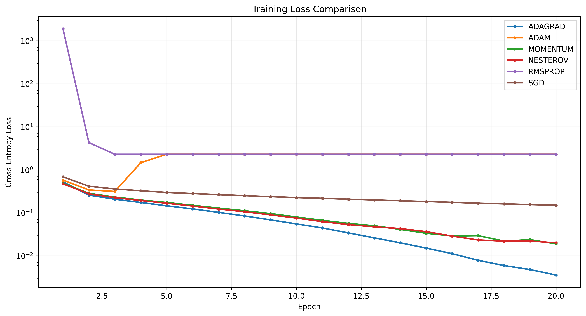

*Training loss across epochs. Compare the rate of objective reduction; a low training loss alone does not establish generalization.*

<details><summary>Measured curve statistics</summary>

| Optimizer | First epoch | Last epoch | Minimum (epoch) | Maximum (epoch) |
| --- | --- | --- | --- | --- |
| SGD | 0.68648 | 0.15048 | 0.15048 (E20) | 0.68648 (E1) |
| MOMENTUM | 0.489 | 0.018951 | 0.018951 (E20) | 0.489 (E1) |
| NESTEROV | 0.47241 | 0.020042 | 0.020042 (E20) | 0.47241 (E1) |
| ADAGRAD | 0.52518 | 0.0035664 | 0.0035664 (E20) | 0.52518 (E1) |
| RMSPROP | 1906.6 | 2.3034 | 2.3032 (E9) | 1906.6 (E1) |
| ADAM | 0.57733 | 2.3034 | 0.31398 (E3) | 2.3035 (E6) |

</details>

#### Validation Loss

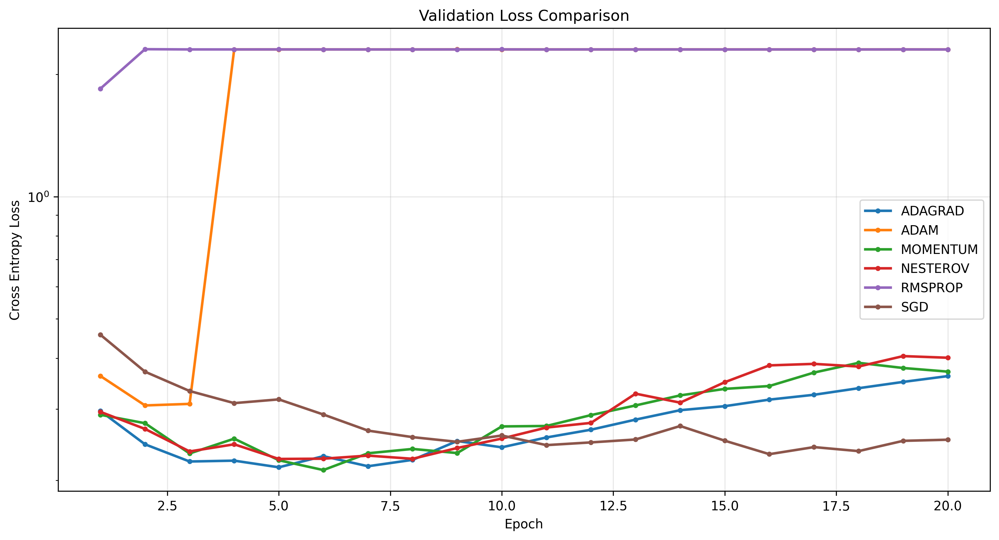

*Validation cross entropy. SGD has the lowest final baseline loss; Adam and RMSprop finish close to ln(10). The logarithmic axis accommodates large values.*

<details><summary>Measured curve statistics</summary>

| Optimizer | First epoch | Last epoch | Minimum (epoch) | Maximum (epoch) |
| --- | --- | --- | --- | --- |
| SGD | 0.45687 | 0.25198 | 0.23214 (E16) | 0.45687 (E1) |
| MOMENTUM | 0.29021 | 0.37071 | 0.21215 (E6) | 0.38964 (E18) |
| NESTEROV | 0.29509 | 0.40104 | 0.22595 (E5) | 0.40478 (E19) |
| ADAGRAD | 0.29652 | 0.36138 | 0.21549 (E5) | 0.36138 (E20) |
| RMSPROP | 1.8441 | 2.3027 | 1.8441 (E1) | 2.3063 (E2) |
| ADAM | 0.36161 | 2.3027 | 0.30603 (E2) | 2.3038 (E9) |

</details>

#### Training Accuracy

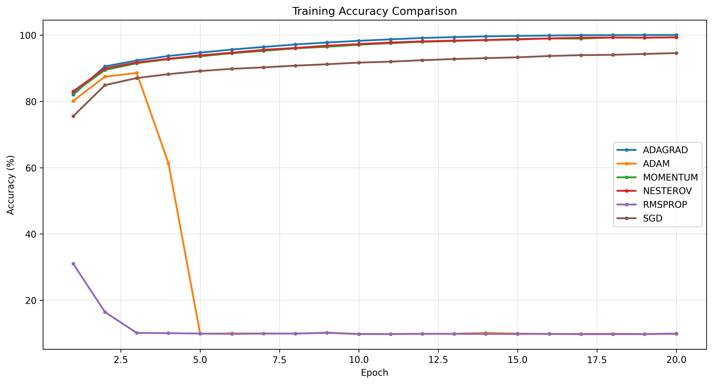

*Training accuracy over the full budget; compare with validation accuracy to distinguish fitting from generalization.*

<details><summary>Measured curve statistics</summary>

| Optimizer | First epoch | Last epoch | Minimum (epoch) | Maximum (epoch) |
| --- | --- | --- | --- | --- |
| SGD | 75.524 | 94.546 | 75.524 (E1) | 94.546 (E20) |
| MOMENTUM | 82.484 | 99.324 | 82.484 (E1) | 99.324 (E20) |
| NESTEROV | 82.996 | 99.27 | 82.996 (E1) | 99.27 (E20) |
| ADAGRAD | 82.004 | 99.996 | 82.004 (E1) | 99.996 (E20) |
| RMSPROP | 31.036 | 10.002 | 9.764 (E17) | 31.036 (E1) |
| ADAM | 80.132 | 9.832 | 9.832 (E20) | 88.542 (E3) |

</details>

#### Validation Accuracy

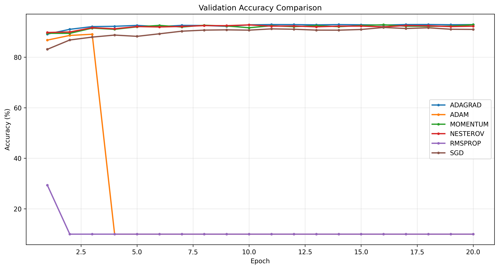

*Four optimizers end above 90%, while Adam and RMSprop end at 10%. Adam initially reaches the target and later collapses.*

<details><summary>Measured curve statistics</summary>

| Optimizer | First epoch | Last epoch | Minimum (epoch) | Maximum (epoch) |
| --- | --- | --- | --- | --- |
| SGD | 83.08 | 90.94 | 83.08 (E1) | 91.71 (E16) |
| MOMENTUM | 89.4 | 92.82 | 89.38 (E2) | 92.82 (E20) |
| NESTEROV | 89.72 | 92.22 | 89.72 (E1) | 92.72 (E10) |
| ADAGRAD | 89.08 | 92.84 | 89.08 (E1) | 92.88 (E18) |
| RMSPROP | 29.35 | 10 | 10 (E2) | 29.35 (E1) |
| ADAM | 86.72 | 10 | 10 (E4) | 89.03 (E3) |

</details>

#### Gradient Norm

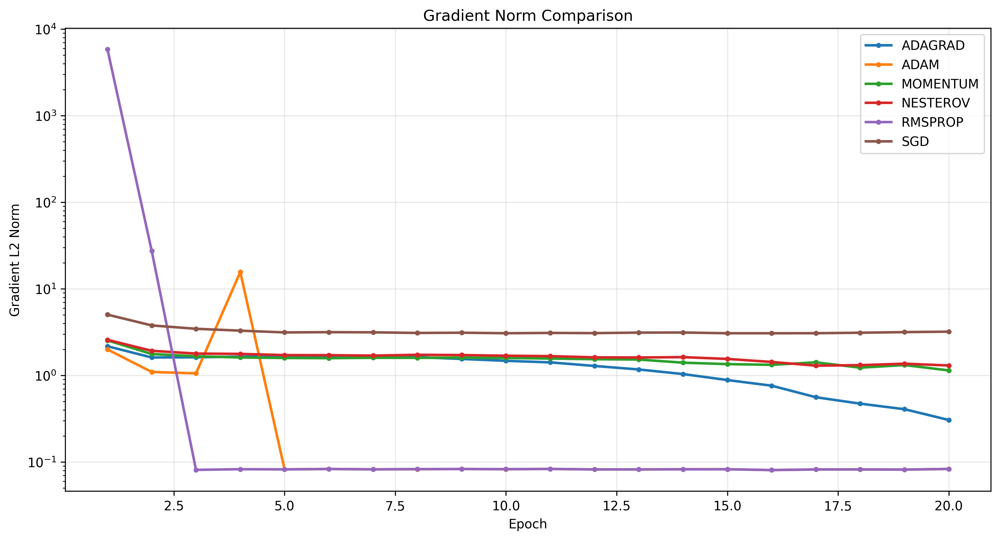

*Mean global gradient L2 norm by epoch (log scale). Large or vanishing norms are diagnostic indicators, not proof of a causal mechanism.*

<details><summary>Measured curve statistics</summary>

| Optimizer | First epoch | Last epoch | Minimum (epoch) | Maximum (epoch) |
| --- | --- | --- | --- | --- |
| SGD | 5.0431 | 3.2054 | 3.0724 (E16) | 5.0431 (E1) |
| MOMENTUM | 2.5425 | 1.1433 | 1.1433 (E20) | 2.5425 (E1) |
| NESTEROV | 2.5819 | 1.3041 | 1.2988 (E17) | 2.5819 (E1) |
| ADAGRAD | 2.1756 | 0.30617 | 0.30617 (E20) | 2.1756 (E1) |
| RMSPROP | 5862.9 | 0.08328 | 0.080839 (E16) | 5862.9 (E1) |
| ADAM | 1.9979 | 0.083295 | 0.080856 (E16) | 15.649 (E4) |

</details>

#### Training Stability

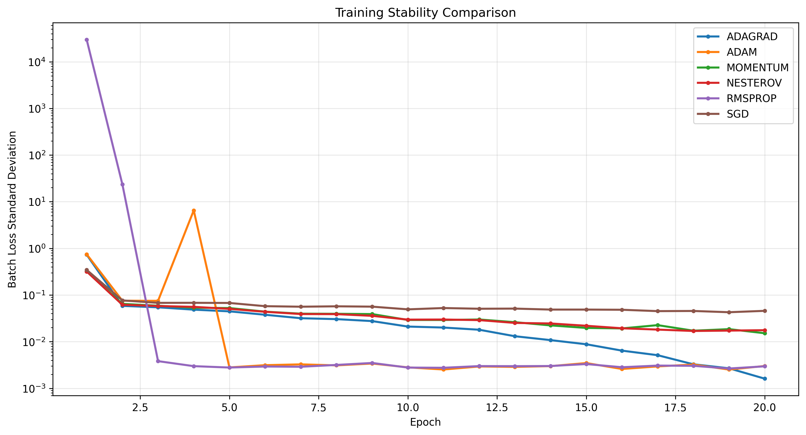

*Within-epoch batch-loss standard deviation (log scale); this measures loss variability, not gradient variance directly.*

<details><summary>Measured curve statistics</summary>

| Optimizer | First epoch | Last epoch | Minimum (epoch) | Maximum (epoch) |
| --- | --- | --- | --- | --- |
| SGD | 0.34535 | 0.045794 | 0.042747 (E19) | 0.34535 (E1) |
| MOMENTUM | 0.32047 | 0.015148 | 0.015148 (E20) | 0.32047 (E1) |
| NESTEROV | 0.319 | 0.017613 | 0.016944 (E18) | 0.319 (E1) |
| ADAGRAD | 0.73128 | 0.0016101 | 0.0016101 (E20) | 0.73128 (E1) |
| RMSPROP | 29842 | 0.0029614 | 0.002656 (E19) | 29842 (E1) |
| ADAM | 0.74765 | 0.0030082 | 0.0025227 (E19) | 6.5204 (E4) |

</details>

#### Best Accuracy

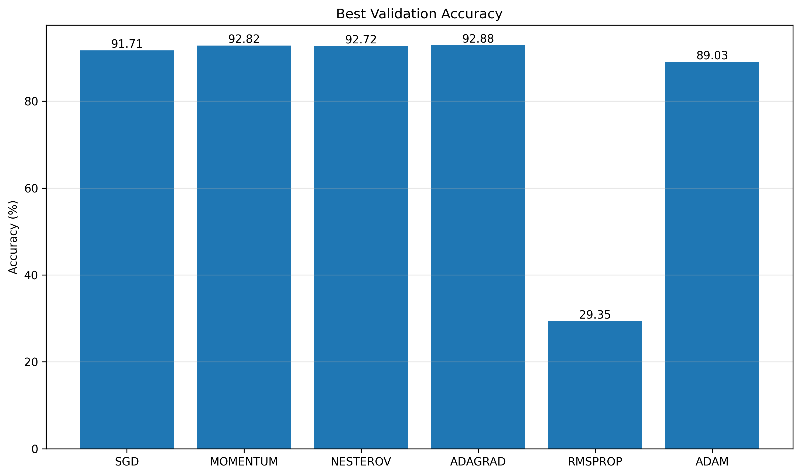

*Adagrad has the highest baseline peak accuracy (92.88%); Momentum is only 0.06 pp behind.*

#### Final Accuracy

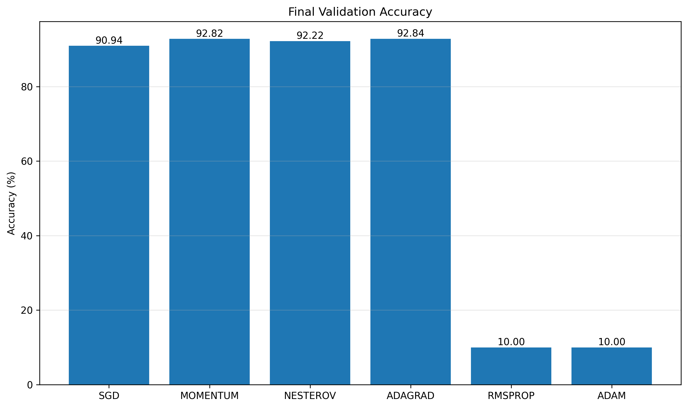

*Adagrad leads final accuracy (92.84%); Adam and RMSprop finish at chance-level accuracy.*

#### Training Time

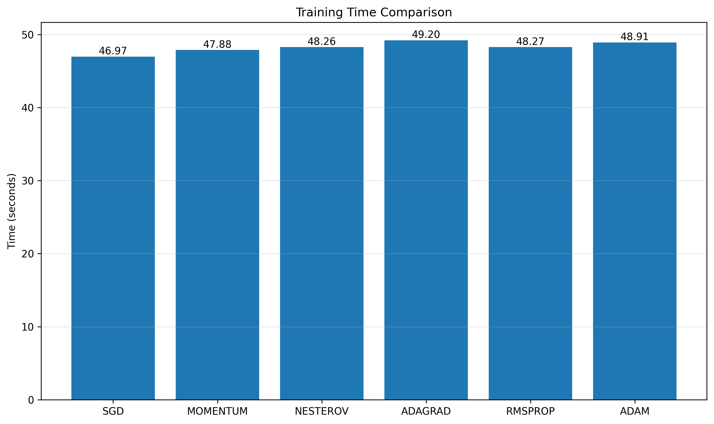

*SGD has the lowest measured baseline training time (46.97 s) with batch size and epoch count matched.*

#### Gpu Memory

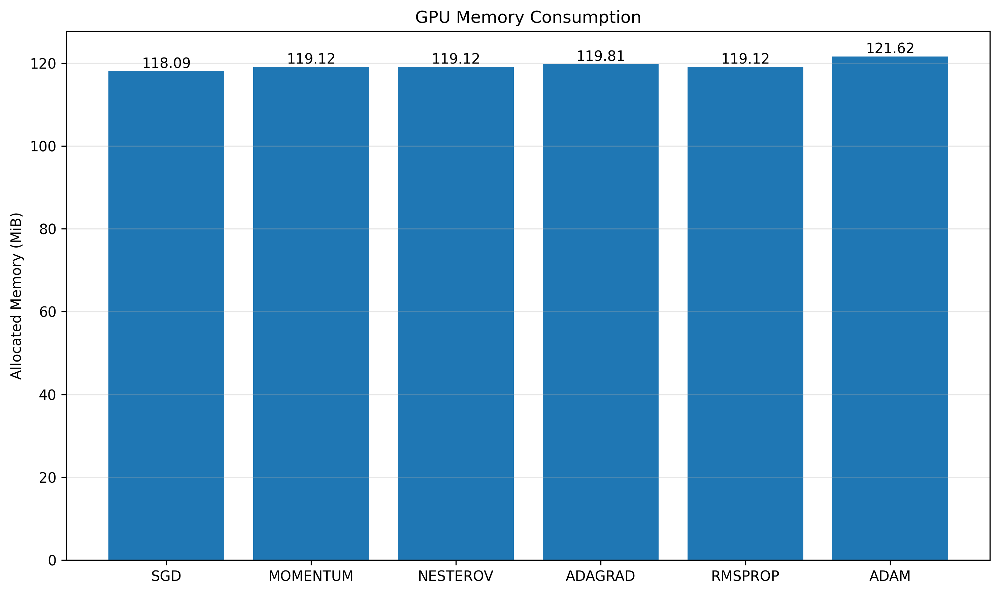

*SGD has the lowest allocated baseline memory; Adam has the largest, consistent with its additional optimizer state.*
<!-- END BASELINE FIGURES -->

## 9. Learning-rate investigation

The learning rate is varied across four logarithmically spaced values (three orders of magnitude) while the remaining baseline settings are unchanged. Six existing runs are reused and 18 new runs are executed.

| Optimizer | 0.0001 | 0.001 | 0.01 | 0.1 |
|---|---:|---:|---:|---:|
| SGD | 80.52 | 88.20 | 91.71 | **92.55** |
| Momentum | 88.29 | 92.16 | **92.82** | Diverged |
| Nesterov | 88.47 | 92.06 | **92.72** | Diverged |
| Adagrad | 86.20 | 91.47 | **92.88** | 67.08 |
| RMSprop | 92.60 | **92.95** | 29.35 | 10.00 |
| Adam | 92.49 | **92.95** | 89.03 | 10.00 |

*Values are best validation accuracy (%), not final accuracy.*

| Optimizer | Best tested LR | Peak accuracy (%) | Final accuracy (%) | Final loss | Best epoch |
|---|---:|---:|---:|---:|---:|
| SGD | 0.1 | 92.55 | 92.07 | 0.4262 | 15 |
| Momentum | 0.01 | 92.82 | 92.82 | 0.3707 | 20 |
| Nesterov | 0.01 | 92.72 | 92.22 | 0.4010 | 10 |
| Adagrad | 0.01 | 92.88 | 92.84 | 0.3614 | 18 |
| RMSprop | 0.001 | 92.95 | 92.18 | 0.4824 | 16 |
| Adam | 0.001 | 92.95 | 92.12 | 0.4132 | 14 |

Reducing LR from 0.01 to 0.001 improves RMSprop peak accuracy by 63.60 pp and Adam by 3.92 pp; both recover from 10% final accuracy to over 92%. Momentum and Nesterov diverge at 0.1 before the first epoch completes. SGD succeeds at the same scalar LR because its update rule does not accumulate momentum. Adagrad degrades at 0.1 and RMSprop records a very large final loss (859.052), despite completing the run. At low LR, SGD reaches only 80.52% at 0.0001 in the fixed training budget. The best accuracy LR need not minimize cross entropy: Momentum at 0.001 has final loss 0.2309; Adam at 0.0001 has final accuracy 92.39% and loss 0.2449.

**Stability intuition.** For a simple quadratic $L(w)=w^2$, SGD gives $w_{t+1}=(1-2\eta)w_t$. Stability requires $|1-2\eta|<1$, or $0<\eta<1$ in this example only. A sufficiently large update leads to oscillations of increasing magnitude. For real CNNs the local curvature varies and there is no single global bound from this toy model. The constant-gradient momentum limit scales like $1/(1-\mu)$, explaining a plausible risk when large LR and momentum are combined. Numerical divergence and finite training collapse are distinct failure modes.

<!-- BEGIN LEARNING_RATE FIGURES -->
#### Best Accuracy Vs Lr

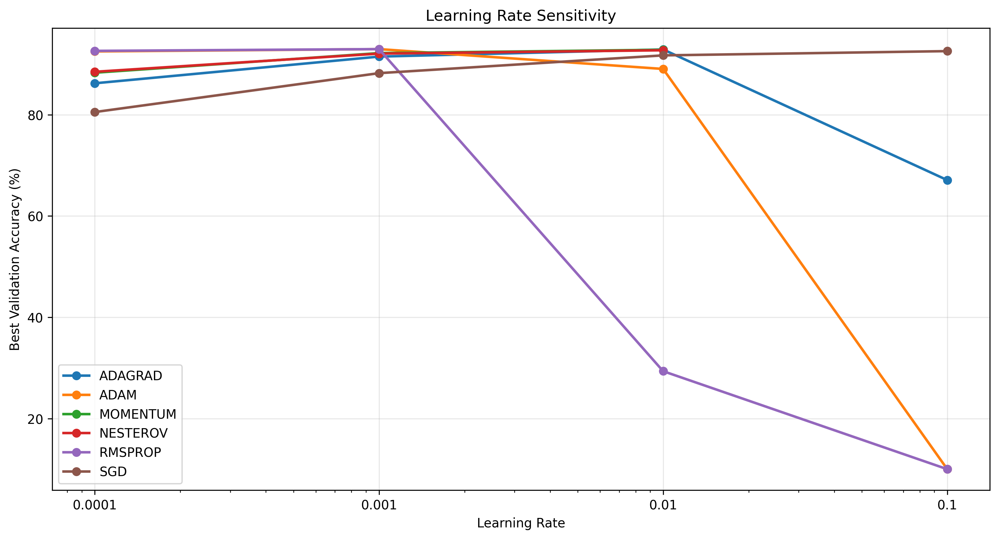

*Peak accuracy is LR-sensitive: SGD peaks at 0.1, whereas Adam and RMSprop peak at 0.001 among tested values.*

#### Final Accuracy Vs Lr

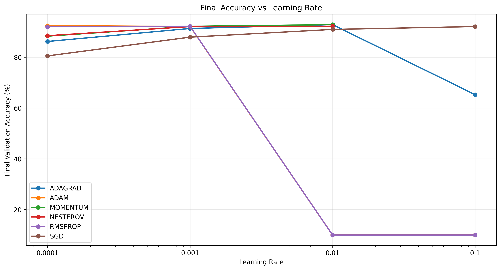

*Final accuracy exposes the finite collapse of Adam and RMSprop at 0.01 and 0.1. Missing points correspond to numerical failures.*

#### Validation Loss Vs Lr

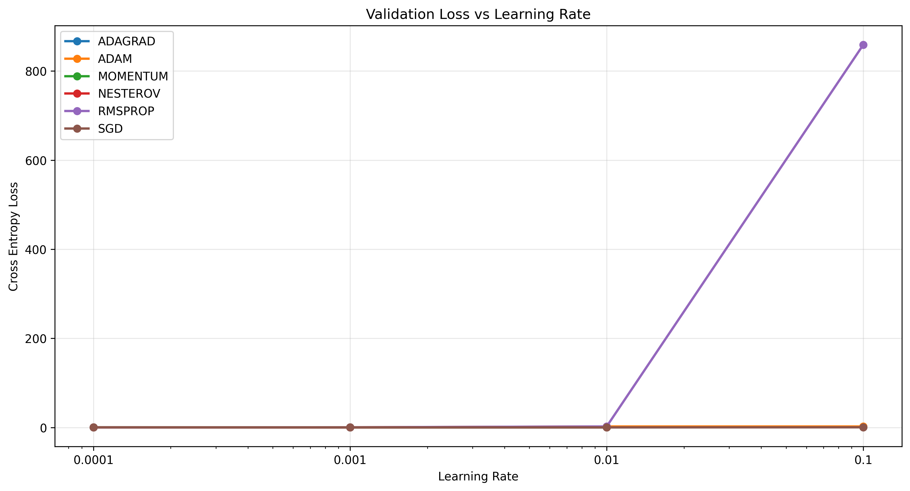

*The very high RMSprop loss at 0.1 can dominate the linear scale. A low final loss and a high peak accuracy need not occur at the same LR.*

#### Convergence Vs Lr

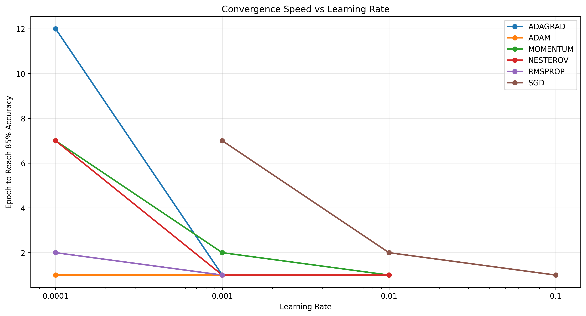

*Epoch of first validation accuracy at or above 85%. Missing points are unachieved targets or failed runs, not zero epochs.*
<!-- END LEARNING_RATE FIGURES -->

## 10. Momentum investigation

LR = 0.01, batch size = 128, seed = 42, 20 epochs. Only the momentum coefficient changes for Momentum SGD and Nesterov.

| Optimizer | Momentum | Peak accuracy (%) | Final accuracy (%) | Final loss | Best epoch | Train time (s) | First ≥85% epoch |
|---|---:|---:|---:|---:|---:|---:|---:|
| Momentum | 0.5 | 92.23 | 92.03 | 0.2600 | 18 | 47.50 | 1 |
| Momentum | 0.9 | 92.82 | 92.82 | 0.3707 | 20 | 47.88 | 1 |
| Momentum | 0.95 | 92.83 | 92.51 | 0.4164 | 7 | 47.83 | 1 |
| Momentum | 0.99 | 91.15 | 89.03 | 0.3395 | 5 | 48.04 | 1 |
| Nesterov | 0.5 | 92.23 | 91.70 | 0.2700 | 16 | 48.37 | 2 |
| Nesterov | 0.9 | 92.72 | 92.22 | 0.4010 | 10 | 48.26 | 1 |
| Nesterov | 0.95 | 92.49 | 92.21 | 0.3945 | 15 | 48.54 | 1 |
| Nesterov | 0.99 | 91.84 | 90.81 | 0.3053 | 12 | 48.60 | 1 |

All eight configurations complete. Momentum 0.95 gives the highest peak (92.83%) but 0.9 gives the highest final accuracy (92.82%). The 0.01 pp peak difference is negligible relative to the observed seed variation. Nesterov 0.9 is best by both accuracy criteria. At 0.99, final accuracy decreases for both methods. The approximate memory horizon $1/(1-\mu)$ increases from 2 to 100 updates across the tested range, which can preserve outdated gradient directions. A single run cannot prove this is the cause of the observed degradation. GPU allocation is 119.12 MiB for all eight runs because the momentum-buffer shape is unchanged. Lower momentum (0.5) minimizes final loss for both algorithms. The global selection later uses Momentum 0.95 because peak validation accuracy is the declared selection criterion.

<!-- BEGIN MOMENTUM FIGURES -->
#### Best Accuracy Vs Momentum

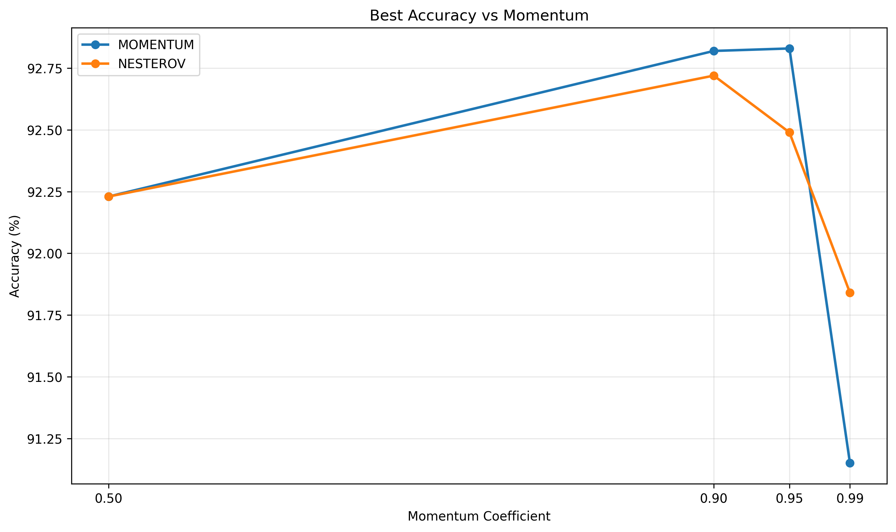

*Momentum SGD peaks at 0.95 and Nesterov at 0.9; the peak difference between Momentum 0.9 and 0.95 is only 0.01 pp.*

#### Final Accuracy Vs Momentum

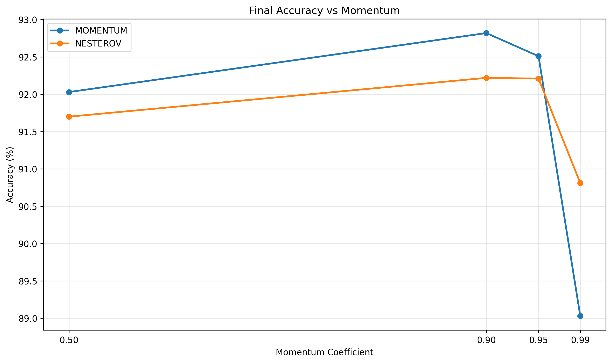

*Both methods achieve their best final accuracy at 0.9 and deteriorate at 0.99.*

#### Loss Vs Momentum

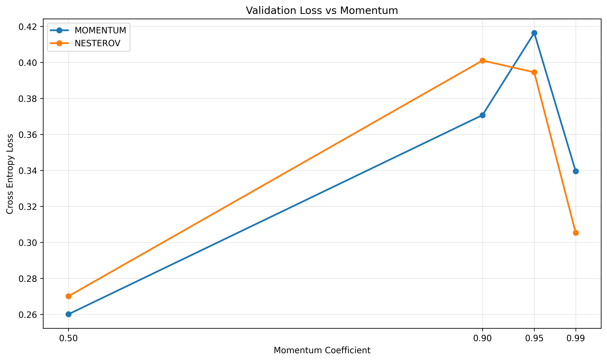

*Momentum 0.5 gives the lowest final cross entropy in both families, despite not maximizing accuracy.*

#### Time Vs Momentum

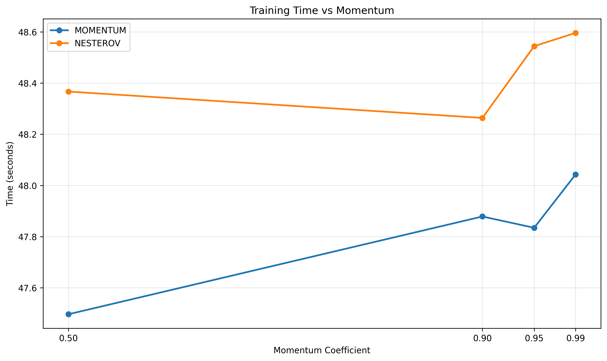

*Runtime changes little with the coefficient because the number of updates and buffer shape remain fixed.*
<!-- END MOMENTUM FIGURES -->

## 11. Batch-size investigation

The best LR from the earlier sweep is fixed separately for each optimizer. Batch sizes 32, 64, 128 and 256 are tested for 20 epochs. Momentum/alpha/betas retain baseline defaults in this sweep. This is a fixed-epoch experiment, not a fixed-update-budget experiment.

$$g_t=\frac{1}{B}\sum_{i=1}^B\nabla_\theta L_i,\qquad U=\left\lceil\frac{50000}{B}\right\rceil.$$

| Batch size | Updates per epoch | Updates in 20 epochs |
|---:|---:|---:|
| 32 | 1,563 | 31,260 |
| 64 | 782 | 15,640 |
| 128 | 391 | 7,820 |
| 256 | 196 | 3,920 |

| Optimizer | BS=32 | BS=64 | BS=128 | BS=256 |
|---|---:|---:|---:|---:|
| SGD | 92.40 | **92.66** | 92.55 | 92.23 |
| Momentum | 92.66 | 92.61 | **92.82** | 92.49 |
| Nesterov | 92.73 | **92.77** | 92.72 | 92.39 |
| Adagrad | **93.26** | 92.96 | 92.88 | 92.65 |
| RMSprop | **93.08** | 92.52 | 92.95 | 92.76 |
| Adam | 92.67 | 92.82 | **92.95** | 92.69 |

*Values are best validation accuracy (%). All 24 configurations complete.*

| Optimizer | LR | Best batch in sweep | Peak accuracy (%) | Final accuracy (%) | Train time (s) | Peak MiB |
|---|---:|---:|---:|---:|---:|---:|
| SGD | 0.1 | 64 | 92.66 | 92.66 | 54.41 | 69.61 |
| Momentum | 0.01 | 128 | 92.82 | 92.82 | 47.88 | 119.12 |
| Nesterov | 0.01 | 64 | 92.77 | 92.20 | 54.67 | 71.33 |
| Adagrad | 0.01 | 32 | 93.26 | 93.22 | 90.43 | 48.19 |
| RMSprop | 0.001 | 32 | 93.08 | 91.84 | 90.25 | 48.19 |
| Adam | 0.001 | 128 | 92.95 | 92.12 | 50.08 | 121.62 |

| Adagrad batch | Train time (s) | Images/s | Peak MiB | Final loss |
|---:|---:|---:|---:|---:|
| 32 | 90.43 | 11,058 | 48.19 | 0.3728 |
| 64 | 56.37 | 17,738 | 72.10 | 0.3753 |
| 128 | 49.20 | 20,325 | 119.81 | 0.3614 |
| 256 | 46.13 | 21,677 | 214.96 | 0.3192 |

Smaller batches generally produce noisier gradient estimates and more updates per epoch. Larger batches exploit parallel computation better and reduce optimizer-step overhead at the expense of larger activation allocations. In this sweep, increasing batch size improves measured throughput and reduces training time for each optimizer, while memory increases. SGD at BS=256 gives the highest throughput (22,089 images/s) and shortest training time (45.27 s) in this sweep. Adagrad at BS=32 gives the highest accuracy (93.26%) but takes roughly twice as long as large-batch configurations. The effect cannot be attributed uniquely to gradient noise because update counts also change. `updates_to_target` is an upper bound at epoch-end validation granularity, not a direct measurement of the exact update that first crossed 85%.

<!-- BEGIN BATCH_SIZE FIGURES -->
#### Best Accuracy

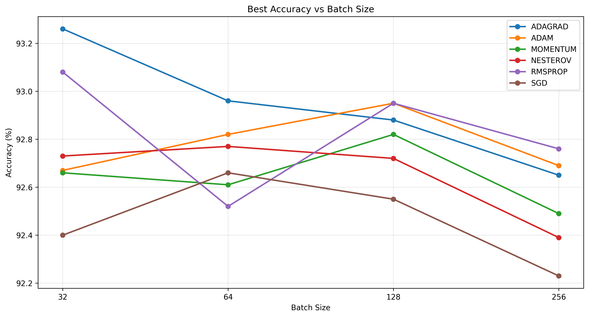

*Adagrad at BS=32 leads the sweep with 93.26% peak accuracy; the best batch differs by optimizer.*

#### Final Accuracy

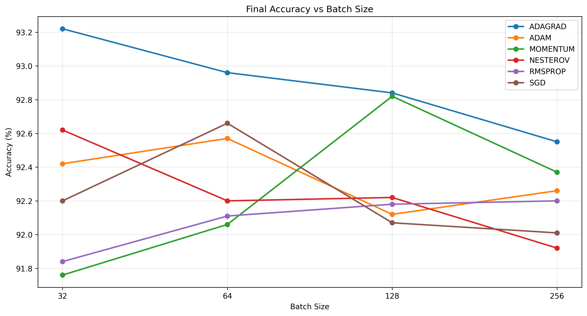

*Adagrad at BS=32 also leads final accuracy. RMSprop at BS=32 has a high peak but a lower final value.*

#### Validation Loss

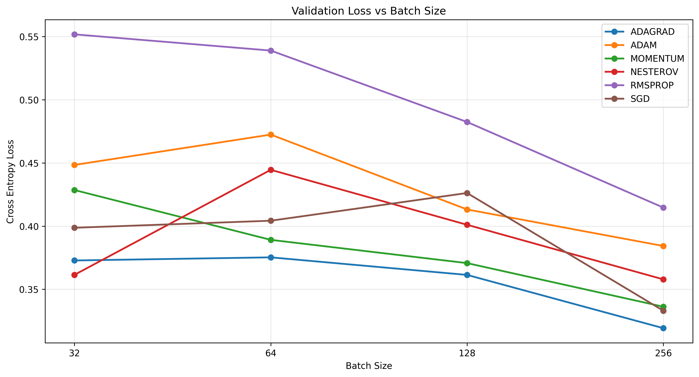

*Loss compares probabilistic fit rather than only the top-1 decision; larger batches may improve loss without maximizing accuracy.*

#### Training Time

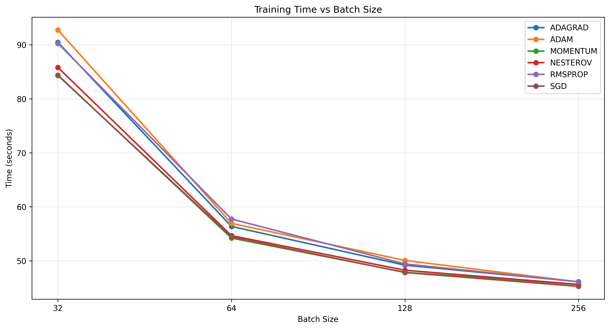

*All six configurations train faster with larger batches under the same epoch budget.*

#### Gpu Memory

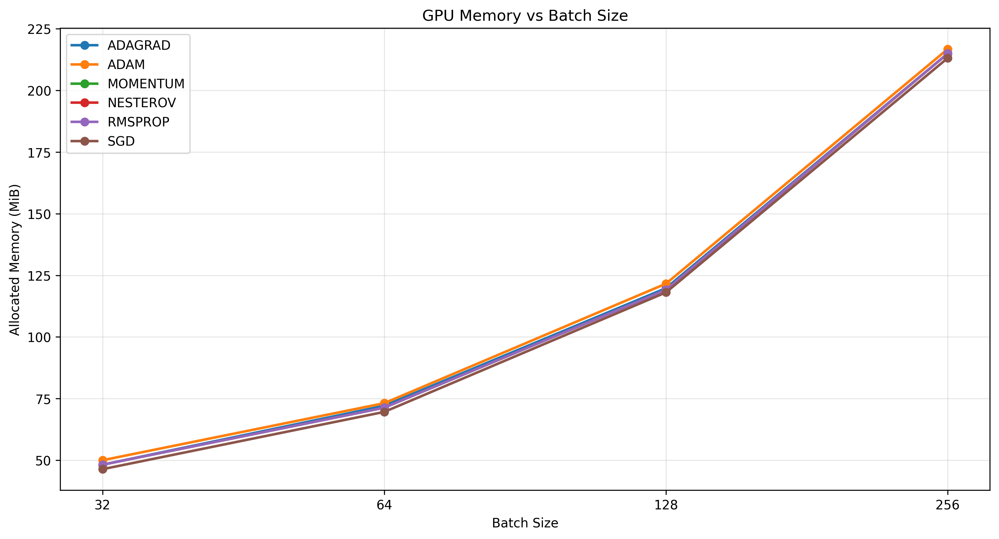

*Allocated memory increases with batch size because more activations are retained per update.*

#### Throughput

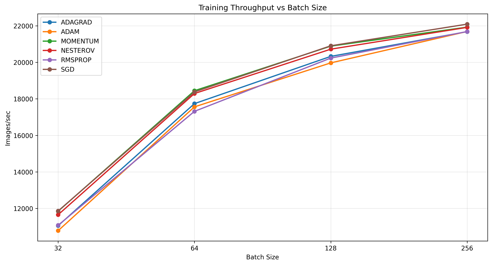

*All six process more images per second as batch size increases; SGD at BS=256 reaches approximately 22,089 images/s.*

#### Updates To Target

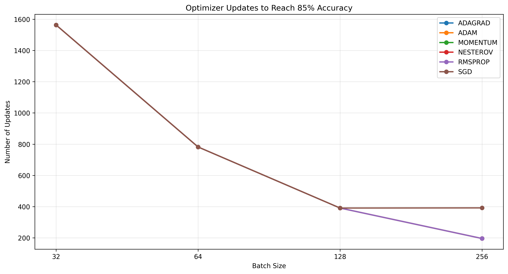

*Larger batches require fewer updates per epoch; this is an epoch-end upper bound on updates to the target, not an exact crossing measurement.*

#### Convergence Time

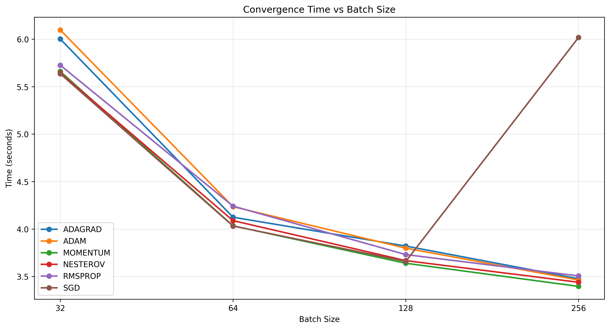

*First-target time is generally lower with larger batches, except when the target requires more epochs (e.g., SGD at BS=256).*
<!-- END BATCH_SIZE FIGURES -->

## 12. Adaptive hyperparameters

The base LR is 0.001 and the batch size is 128. One coefficient is changed at a time while other parameters are fixed. Default reference runs are reused. These experiments investigate the behavior of adaptive scaling indirectly through classification performance; no per-coordinate effective-LR traces are recorded.

### 12.1 RMSprop alpha

| Alpha | Peak accuracy (%) | Final accuracy (%) | Final loss | Best epoch | First ≥85% epoch |
|---:|---:|---:|---:|---:|---:|
| 0.9 | 92.57 | 91.09 | 0.6136 | 4 | 1 |
| 0.99 | **92.95** | **92.18** | 0.4824 | 16 | 1 |
| 0.999 | 91.50 | 91.50 | **0.2360** | 20 | 4 |

Alpha controls the exponential second-moment memory (roughly 10, 100 or 1,000 steps for these values). Alpha 0.99 maximizes peak/final accuracy. Alpha 0.999 reaches the target later, but has the lowest final loss; a better loss does not imply better top-1 accuracy. This demonstrates a trade-off between speed, accuracy and probabilistic fit.

### 12.2 Adam beta1 (beta2 = 0.999)

| Beta1 | Peak accuracy (%) | Final accuracy (%) | Final loss | Best epoch |
|---:|---:|---:|---:|---:|
| 0.8 | **93.07** | **92.65** | 0.4740 | 15 |
| 0.9 | 92.95 | 92.12 | 0.4132 | 14 |
| 0.95 | 92.60 | 92.04 | **0.3696** | 19 |

Lower beta1 weights the current gradient more heavily. Beta1 0.8 improves peak accuracy by 0.12 pp over the default, while beta1 0.95 has lower final loss. The accuracy improvement is small and must not be overstated.

### 12.3 Adam beta2 (beta1 = 0.9)

| Beta2 | Peak accuracy (%) | Final accuracy (%) | Final loss | Best epoch |
|---:|---:|---:|---:|---:|
| 0.99 | 92.93 | 92.12 | 0.4626 | 7 |
| 0.999 | 92.95 | 92.12 | **0.4132** | 14 |
| 0.9999 | **93.01** | **92.82** | 0.4328 | 8 |

Beta2 0.9999 has the best peak and final accuracy in its one-factor sweep. The combination beta1=0.8 and beta2=0.9999 was not tested; it would be incorrect to merge the independently selected coefficients and claim a measured performance. The selected Adam configuration is beta1=0.8, beta2=0.999 because that is the best actual tested peak.

<!-- BEGIN ADAPTIVE FIGURES -->
#### Rmsprop Alpha

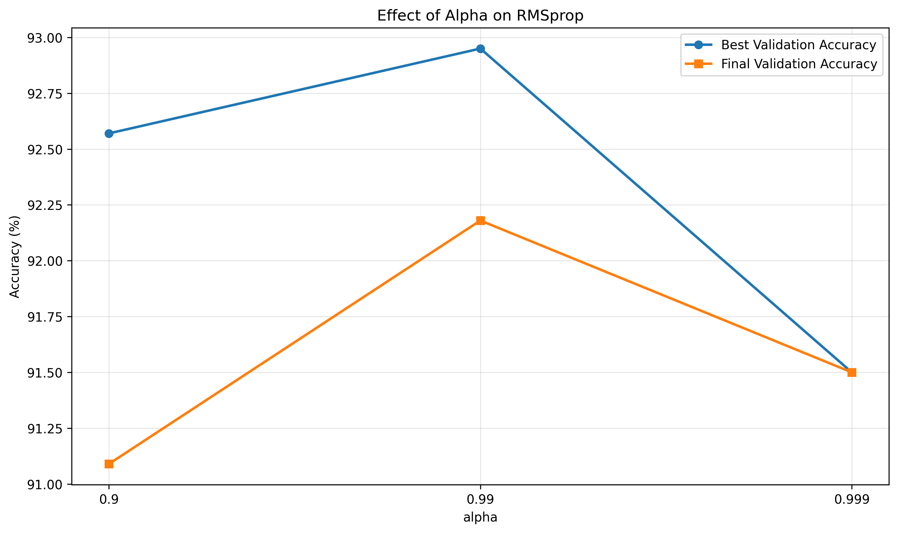

*Alpha 0.99 maximizes peak and final accuracy; 0.999 is slower to reach the target but has lower final loss.*

#### Adam Beta1

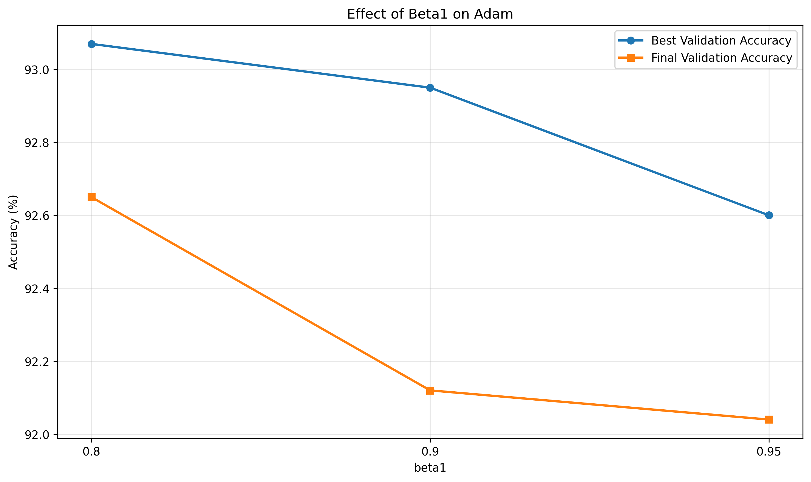

*Beta1=0.8 produces the highest peak and final accuracy at fixed beta2=0.999.*

#### Adam Beta2

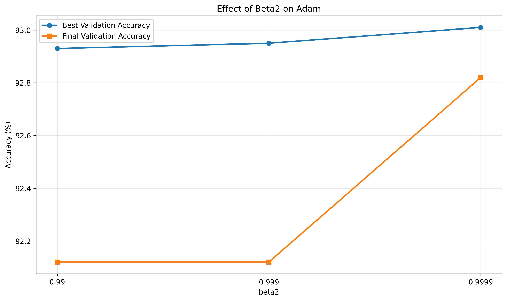

*Beta2=0.9999 gives the highest peak and final accuracy at fixed beta1=0.9. The two best individual beta values were not tested jointly.*
<!-- END ADAPTIVE FIGURES -->

## 13. Epoch-budget and overfitting analysis

The best actually tested configuration for each optimizer is selected by validation peak accuracy, with final accuracy/loss as tie-breakers. The 5-, 10-, 15- and 20-epoch histories are prefixes of the same runs. No additional training is needed because there is no epoch-budget-dependent scheduler. They are not independent experiments.

| Optimizer | 5 epochs | 10 epochs | 15 epochs | 20 epochs | Overall best epoch |
|---|---:|---:|---:|---:|---:|
| SGD | 91.11 | 92.60 | 92.60 | 92.66 | 20 |
| Momentum | 91.72 | 92.83 | 92.83 | 92.83 | 7 |
| Nesterov | 92.40 | 92.77 | 92.77 | 92.77 | 6 |
| Adagrad | 92.58 | 93.14 | 93.21 | 93.26 | 16 |
| RMSprop | 92.20 | 92.38 | 92.38 | 93.08 | 16 |
| Adam | 92.55 | 92.94 | 93.07 | 93.07 | 15 |

*Values are best accuracy (%) observed up to each budget. By definition this metric cannot decrease with increasing budget; use final accuracy and loss to study degradation.*

| Optimizer | Final acc @5 | @10 | @15 | @20 | Final loss @5 | @20 |
|---|---:|---:|---:|---:|---:|---:|
| SGD | 90.74 | 88.74 | 92.17 | 92.66 | 0.2622 | 0.4043 |
| Momentum | 91.51 | 92.65 | 92.45 | 92.51 | 0.2472 | 0.4164 |
| Nesterov | 92.40 | 92.22 | 92.57 | 92.20 | 0.2352 | 0.4445 |
| Adagrad | 92.58 | 93.14 | 93.21 | 93.22 | 0.2183 | 0.3728 |
| RMSprop | 92.09 | 91.54 | 92.29 | 91.84 | 0.2685 | 0.5517 |
| Adam | 92.55 | 92.45 | 93.07 | 92.65 | 0.2291 | 0.4740 |

| Adagrad budget | Train acc (%) | Final val acc (%) | Train loss | Val loss | Accuracy gap (pp) | Train time (s) |
|---:|---:|---:|---:|---:|---:|---:|
| 5 | 95.710 | 92.58 | 0.117744 | 0.218349 | 3.13 | 23.15 |
| 10 | 99.102 | 93.14 | 0.032405 | 0.244814 | 5.96 | 45.59 |
| 15 | 99.964 | 93.21 | 0.005486 | 0.322516 | 6.75 | 67.96 |
| 20 | 100.000 | 93.22 | 0.001475 | 0.372801 | 6.78 | 90.43 |

$$G_{acc}=A_{train}-A_{val},\qquad G_{loss}=L_{val}-L_{train}.$$

Training accuracy increases while validation cross entropy rises across these sampled budgets. The widening gap is consistent with overfitting, including increasingly confident incorrect predictions. Cross entropy penalizes low probability assigned to the correct class: $-\ln(0.01)\approx4.605$, even though the corresponding incorrect prediction counts as only one accuracy error. The training metrics are accumulated during weight updates; the generalization gap is consequently approximate, not a same-checkpoint train-vs-validation measurement.

Adagrad gains only 0.12 pp in best accuracy from 10 to 20 epochs while spending another 44.85 s. Momentum and Nesterov reach their best measured checkpoints by epochs 7 and 6. Adam peaks at 15. These findings demonstrate diminishing returns and the practical value of checkpoint selection. The experiment does not implement early stopping; it assesses what a smaller budget would have recorded under the same policy.

<!-- BEGIN EPOCHS FIGURES -->
#### Best Accuracy

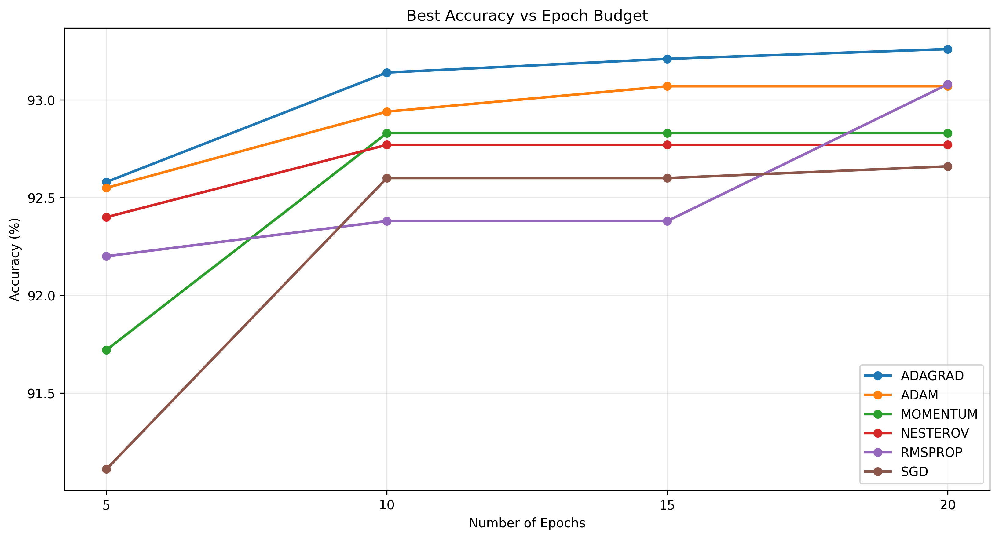

*Best-so-far accuracy is non-decreasing by construction. Momentum and Nesterov show no further peak gains after the 10-epoch budget.*

#### Final Accuracy

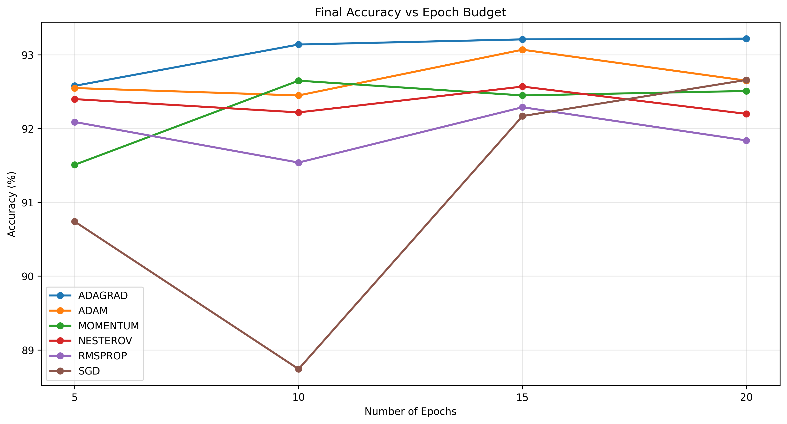

*End-of-budget accuracy can fall even when best-so-far accuracy is unchanged; SGD drops to 88.74% at epoch 10.*

#### Training Loss

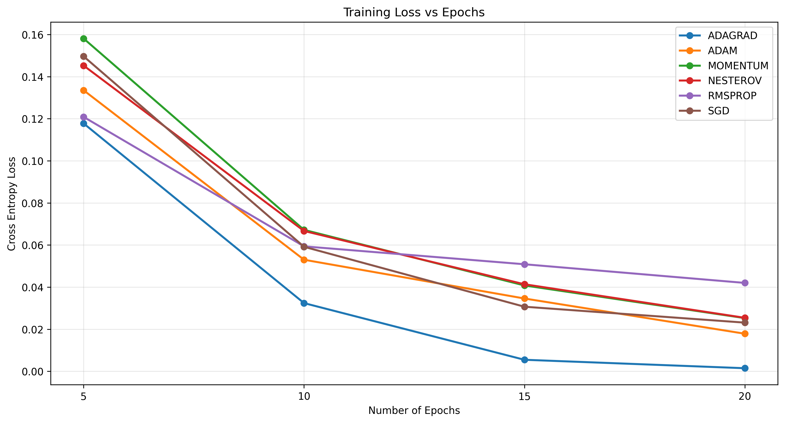

*The recorded training loss decreases across sampled budgets for all six selected runs.*

#### Validation Loss

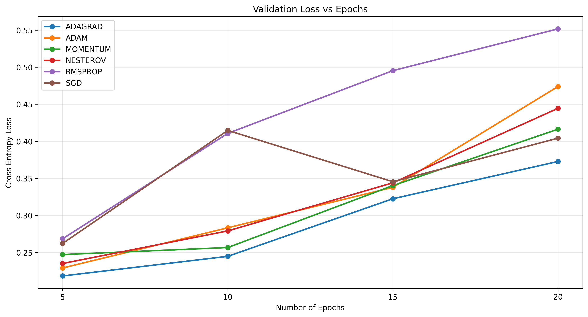

*All six selected runs have higher final validation loss at 20 than at 5 epochs; Adagrad improves accuracy but worsens cross entropy.*

#### Generalization Gap

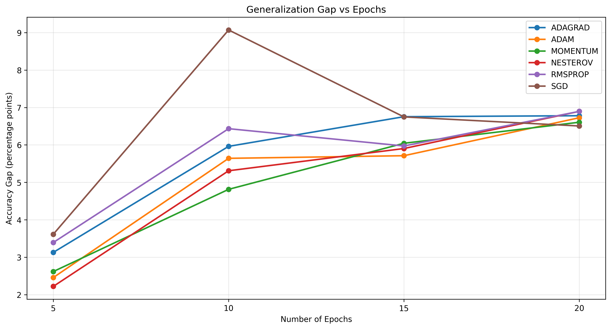

*Training-minus-validation accuracy gap widens between 5 and 20 epochs for all six runs, consistent with overfitting.*

#### Training Time

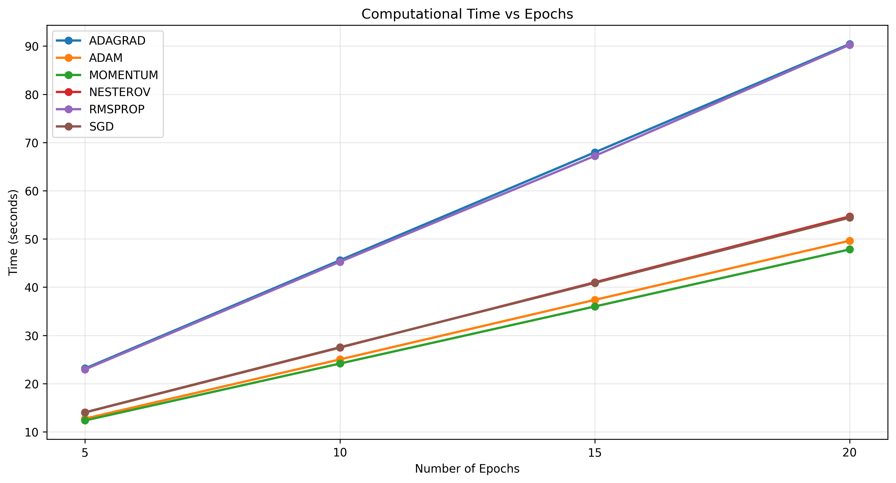

*Training cost grows approximately with the epoch budget. Adagrad spends another 44.85 s for only 0.12 pp peak gain from 10 to 20 epochs.*
<!-- END EPOCHS FIGURES -->

## 14. Multiple-seed stability

The best actually tested configuration for each optimizer is held fixed and repeated for seeds 42, 123 and 2026. Initialization and training shuffle vary, while the dataset split and normalization remain fixed. Six seed-42 runs are reused and twelve runs are new.

| Optimizer | LR | Batch size | Optimizer-specific parameters | Best validation accuracy at seed 42 (%) |
|---|---:|---:|---|---:|
| SGD | 0.1 | 64 | — | 92.66 |
| Momentum | 0.01 | 128 | Momentum=0.95 | 92.83 |
| Nesterov | 0.01 | 64 | Momentum=0.9 | 92.77 |
| Adagrad | 0.01 | 32 | — | 93.26 |
| RMSprop | 0.001 | 32 | Alpha=0.99 | 93.08 |
| Adam | 0.001 | 128 | Betas=(0.8, 0.999) | 93.07 |

The mean and sample standard deviation are

$$\bar A=\frac{1}{n}\sum_{i=1}^{n} A_i,\qquad s_A=\sqrt{\frac{\sum_{i=1}^{n}(A_i-\bar A)^2}{n-1}},\quad n=3.$$

| Optimizer | Mean peak acc (%) | Peak SD (pp) | Min / max peak (%) | Mean final acc (%) | Final SD (pp) | Mean final loss | New-seeds-only mean peak (%) |
|---|---:|---:|---|---:|---:|---:|---:|
| Adagrad | **93.080** | 0.180 | 92.90 / 93.26 | **93.047** | **0.162** | 0.3608 | **92.990** |
| RMSprop | 92.943 | 0.131 | 92.82 / 93.08 | 92.220 | 0.335 | 0.5242 | 92.875 |
| Adam | 92.837 | 0.329 | 92.46 / 93.07 | 92.487 | 0.429 | 0.4280 | 92.720 |
| Nesterov | 92.817 | 0.117 | 92.73 / 92.95 | 92.430 | 0.451 | 0.3955 | 92.840 |
| Momentum | 92.753 | **0.080** | 92.67 / 92.83 | 92.087 | 0.387 | 0.4207 | 92.715 |
| SGD | 92.377 | 0.296 | 92.07 / 92.66 | 91.863 | 0.693 | 0.4107 | 92.235 |

| Optimizer | Completed / total | Reached 85% | Mean train time (s) ± SD | Mean peak allocated MiB | Mean time to target (s) |
|---|---:|---:|---:|---:|---:|
| Adagrad | 3 / 3 | 3 | 90.92 ± 0.98 | 48.19 | 6.13 |
| RMSprop | 3 / 3 | 3 | 89.23 ± 0.95 | 48.19 | 5.88 |
| Adam | 3 / 3 | 3 | 49.88 ± 0.22 | 121.62 | 3.78 |
| Nesterov | 3 / 3 | 3 | 54.83 ± 0.14 | 71.33 | 4.08 |
| Momentum | 3 / 3 | 3 | **48.48 ± 0.56** | 119.12 | **3.71** |
| SGD | 3 / 3 | 3 | 54.33 ± 0.23 | 69.61 | 5.02 |

All 18 selected runs complete and reach the target at least once. Adagrad has the highest mean peak/final accuracy and the smallest final-accuracy SD. Momentum has the smallest peak-accuracy SD. RMSprop is also competitive, but its higher final loss and lower final accuracy suggest that peak accuracy alone is insufficient to characterize its behavior. Adam has the largest peak-accuracy SD in this comparison. Adagrad remains first when seed 42 is excluded (92.990% versus RMSprop's 92.875%). Because seed 42 was used for tuning, the new-seeds-only mean is a useful additional check; three seeds do not establish statistical significance.

<!-- BEGIN STABILITY FIGURES -->
#### Best Accuracy Stability

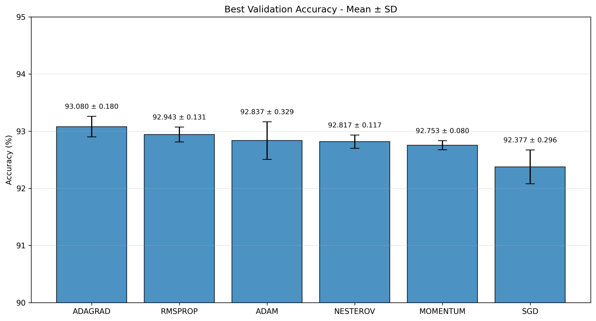

*Mean peak validation accuracy ± sample SD. Adagrad leads the mean; Momentum has the smallest peak SD.*

#### Final Accuracy Stability

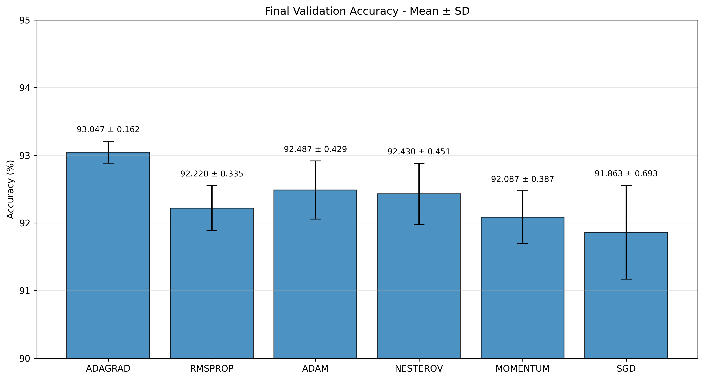

*Mean final accuracy ± sample SD. Adagrad leads both the mean and the repeatability of final accuracy.*

#### Training Time Stability

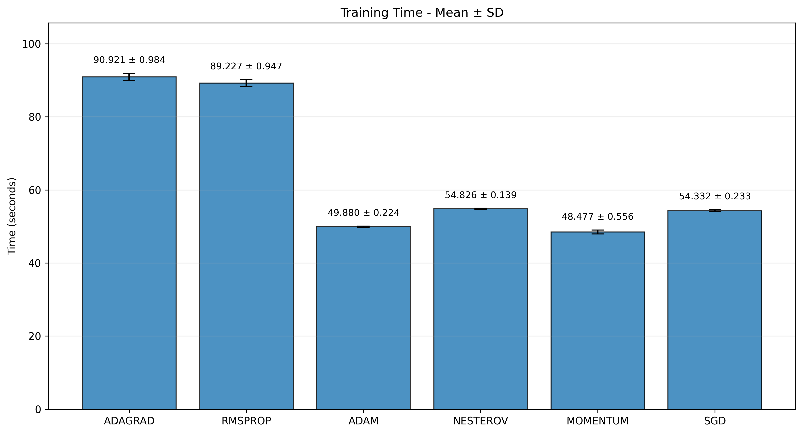

*Mean training time ± sample SD; small-batch Adagrad and RMSprop take longer. Different batch sizes confound isolated optimizer cost.*
<!-- END STABILITY FIGURES -->

## 15. Independent test evaluation

The official 10,000-image test set is evaluated only after hyperparameter selection. The best validation checkpoint of each of the 18 selected training runs is loaded, and all models use test batch size 128, no shuffling and inference mode. No test-set-driven retraining or tuning is performed.

### 15.1 Classification metrics

$$A=\frac{\text{correct predictions}}{N},\qquad P_c=\frac{TP_c}{TP_c+FP_c},\qquad R_c=\frac{TP_c}{TP_c+FN_c}$$

$$F1_c=\frac{2P_cR_c}{P_c+R_c},\qquad F1_{macro}=\frac{1}{10}\sum_{c=1}^{10}F1_c.$$

Macro precision and recall are averages of their respective per-class metrics; macro F1 averages per-class F1 values (not the harmonic mean of macro precision and recall). Zero-division cases are assigned zero. The test set is balanced, so macro recall equals overall accuracy expressed as a fraction. In the confusion matrix, rows represent ground-truth classes and columns represent predicted classes; diagonal entries are correct classifications and off-diagonal entries indicate confusions.

### 15.2 Test results across three seeds

| Optimizer | Runs | Accuracy (%) | SD (pp) | Test loss | Macro precision | Macro recall | Macro F1 | F1 SD |
|---|---:|---:|---:|---:|---:|---:|---:|---:|
| Adagrad | 3 | **92.207** | 0.318 | 0.3516 | **0.9219** | **0.9221** | **0.9219** | 0.00314 |
| Adam | 3 | 91.993 | 0.337 | 0.3225 | 0.9200 | 0.9199 | 0.9196 | 0.00351 |
| RMSprop | 3 | 91.797 | **0.049** | 0.4979 | 0.9180 | 0.9180 | 0.9177 | **0.00059** |
| Nesterov | 3 | 91.793 | 0.307 | 0.3755 | 0.9182 | 0.9179 | 0.9179 | 0.00282 |
| Momentum | 3 | 91.470 | 0.070 | **0.2797** | 0.9153 | 0.9147 | 0.9147 | 0.00125 |
| SGD | 3 | 91.373 | 0.403 | 0.4116 | 0.9142 | 0.9137 | 0.9135 | 0.00355 |

| Optimizer | Mean peak validation acc (%) | Mean test acc (%) | Validation minus test (pp) | Test evaluation time (s) | Mean ms/image |
|---|---:|---:|---:|---:|---:|
| Adagrad | 93.080 | 92.207 | 0.873 | 0.412 | 0.04117 |
| Adam | 92.837 | 91.993 | 0.843 | 0.325 | 0.03250 |
| RMSprop | 92.943 | 91.797 | 1.147 | 0.322 | 0.03224 |
| Nesterov | 92.817 | 91.793 | 1.023 | 0.322 | 0.03219 |
| Momentum | 92.753 | 91.470 | 1.283 | 0.326 | 0.03259 |
| SGD | 92.377 | 91.373 | 1.003 | 0.328 | 0.03280 |

The validation-test gap is expected in part because checkpoint and hyperparameter selection favor validation performance. A test-set difference can also reflect sampling differences. Adagrad retains the highest observed mean accuracy and macro F1. Momentum achieves the lowest cross entropy despite lower top-1 accuracy. RMSprop has the lowest seed-to-seed test accuracy SD but the highest mean test loss. All six models share the same inference architecture, so the measured evaluation-time differences should not be interpreted as intrinsic differences in optimizer inference complexity. Timings include data loading, transfers, loss computation and predictions; they are not pure forward-pass latency, and the first run can include startup overhead.

### 15.3 Confusion matrices and class-level analysis

All 18 confusion matrices are displayed below (three seeds for each optimizer). Inspect the diagonal for correct classification, off-diagonal counts for systematic mistakes, and per-class precision, recall and F1 for class-level performance. The aggregate values above do not identify the most confused class pair. The appendix generator reads the actual confusion-matrix CSVs and produces a class-level analysis across the three evaluated seeds, rather than guessing from the dataset category names.

<!-- BEGIN CONFUSION ANALYSIS -->
The following counts sum predictions across independently trained seeds on the **same** test images; they do not represent additional unique test samples. Pooled recall is calculated from the summed counts.

**SGD (3 seeds):** Highest pooled recall: Bag (98.43%); lowest: Shirt (73.57%). Most frequent directed error: Shirt → T-shirt/top (335 predictions across seeds).

<details><summary>All class recalls and top five directed confusions</summary>

| Class | Correct | Total predictions for true class | Pooled recall |
| --- | --- | --- | --- |
| T-shirt/top | 2610 | 3000 | 87.00% |
| Trouser | 2942 | 3000 | 98.07% |
| Pullover | 2606 | 3000 | 86.87% |
| Dress | 2706 | 3000 | 90.20% |
| Coat | 2641 | 3000 | 88.03% |
| Sandal | 2942 | 3000 | 98.07% |
| Shirt | 2207 | 3000 | 73.57% |
| Sneaker | 2928 | 3000 | 97.60% |
| Bag | 2953 | 3000 | 98.43% |
| Ankle boot | 2877 | 3000 | 95.90% |

| True class | Predicted class | Count |
| --- | --- | --- |
| Shirt | T-shirt/top | 335 |
| T-shirt/top | Shirt | 258 |
| Shirt | Coat | 206 |
| Pullover | Coat | 168 |
| Shirt | Pullover | 153 |

</details>

**MOMENTUM (3 seeds):** Highest pooled recall: Bag (98.70%); lowest: Shirt (75.77%). Most frequent directed error: T-shirt/top → Shirt (293 predictions across seeds).

<details><summary>All class recalls and top five directed confusions</summary>

| Class | Correct | Total predictions for true class | Pooled recall |
| --- | --- | --- | --- |
| T-shirt/top | 2582 | 3000 | 86.07% |
| Trouser | 2954 | 3000 | 98.47% |
| Pullover | 2602 | 3000 | 86.73% |
| Dress | 2774 | 3000 | 92.47% |
| Coat | 2560 | 3000 | 85.33% |
| Sandal | 2932 | 3000 | 97.73% |
| Shirt | 2273 | 3000 | 75.77% |
| Sneaker | 2939 | 3000 | 97.97% |
| Bag | 2961 | 3000 | 98.70% |
| Ankle boot | 2864 | 3000 | 95.47% |

| True class | Predicted class | Count |
| --- | --- | --- |
| T-shirt/top | Shirt | 293 |
| Shirt | T-shirt/top | 286 |
| Coat | Shirt | 187 |
| Shirt | Coat | 176 |
| Pullover | Shirt | 171 |

</details>

**NESTEROV (3 seeds):** Highest pooled recall: Sandal (98.60%); lowest: Shirt (76.27%). Most frequent directed error: Shirt → T-shirt/top (305 predictions across seeds).

<details><summary>All class recalls and top five directed confusions</summary>

| Class | Correct | Total predictions for true class | Pooled recall |
| --- | --- | --- | --- |
| T-shirt/top | 2593 | 3000 | 86.43% |
| Trouser | 2938 | 3000 | 97.93% |
| Pullover | 2599 | 3000 | 86.63% |
| Dress | 2800 | 3000 | 93.33% |
| Coat | 2618 | 3000 | 87.27% |
| Sandal | 2958 | 3000 | 98.60% |
| Shirt | 2288 | 3000 | 76.27% |
| Sneaker | 2878 | 3000 | 95.93% |
| Bag | 2946 | 3000 | 98.20% |
| Ankle boot | 2920 | 3000 | 97.33% |

| True class | Predicted class | Count |
| --- | --- | --- |
| Shirt | T-shirt/top | 305 |
| T-shirt/top | Shirt | 266 |
| Coat | Shirt | 174 |
| Shirt | Coat | 162 |
| Pullover | Shirt | 154 |

</details>

**ADAGRAD (3 seeds):** Highest pooled recall: Bag (98.50%); lowest: Shirt (75.50%). Most frequent directed error: Shirt → T-shirt/top (303 predictions across seeds).

<details><summary>All class recalls and top five directed confusions</summary>

| Class | Correct | Total predictions for true class | Pooled recall |
| --- | --- | --- | --- |
| T-shirt/top | 2624 | 3000 | 87.47% |
| Trouser | 2954 | 3000 | 98.47% |
| Pullover | 2650 | 3000 | 88.33% |
| Dress | 2792 | 3000 | 93.07% |
| Coat | 2648 | 3000 | 88.27% |
| Sandal | 2945 | 3000 | 98.17% |
| Shirt | 2265 | 3000 | 75.50% |
| Sneaker | 2933 | 3000 | 97.77% |
| Bag | 2955 | 3000 | 98.50% |
| Ankle boot | 2896 | 3000 | 96.53% |

| True class | Predicted class | Count |
| --- | --- | --- |
| Shirt | T-shirt/top | 303 |
| T-shirt/top | Shirt | 264 |
| Shirt | Coat | 188 |
| Shirt | Pullover | 151 |
| Coat | Pullover | 144 |

</details>

**RMSPROP (3 seeds):** Highest pooled recall: Trouser (98.57%); lowest: Shirt (74.10%). Most frequent directed error: Shirt → T-shirt/top (316 predictions across seeds).

<details><summary>All class recalls and top five directed confusions</summary>

| Class | Correct | Total predictions for true class | Pooled recall |
| --- | --- | --- | --- |
| T-shirt/top | 2635 | 3000 | 87.83% |
| Trouser | 2957 | 3000 | 98.57% |
| Pullover | 2690 | 3000 | 89.67% |
| Dress | 2765 | 3000 | 92.17% |
| Coat | 2571 | 3000 | 85.70% |
| Sandal | 2944 | 3000 | 98.13% |
| Shirt | 2223 | 3000 | 74.10% |
| Sneaker | 2920 | 3000 | 97.33% |
| Bag | 2950 | 3000 | 98.33% |
| Ankle boot | 2884 | 3000 | 96.13% |

| True class | Predicted class | Count |
| --- | --- | --- |
| Shirt | T-shirt/top | 316 |
| T-shirt/top | Shirt | 251 |
| Shirt | Pullover | 188 |
| Coat | Shirt | 175 |
| Shirt | Coat | 172 |

</details>

**ADAM (3 seeds):** Highest pooled recall: Sandal (98.57%); lowest: Shirt (73.80%). Most frequent directed error: Shirt → T-shirt/top (327 predictions across seeds).

<details><summary>All class recalls and top five directed confusions</summary>

| Class | Correct | Total predictions for true class | Pooled recall |
| --- | --- | --- | --- |
| T-shirt/top | 2656 | 3000 | 88.53% |
| Trouser | 2944 | 3000 | 98.13% |
| Pullover | 2651 | 3000 | 88.37% |
| Dress | 2767 | 3000 | 92.23% |
| Coat | 2665 | 3000 | 88.83% |
| Sandal | 2957 | 3000 | 98.57% |
| Shirt | 2214 | 3000 | 73.80% |
| Sneaker | 2933 | 3000 | 97.77% |
| Bag | 2939 | 3000 | 97.97% |
| Ankle boot | 2872 | 3000 | 95.73% |

| True class | Predicted class | Count |
| --- | --- | --- |
| Shirt | T-shirt/top | 327 |
| T-shirt/top | Shirt | 205 |
| Shirt | Coat | 199 |
| Shirt | Pullover | 154 |
| Coat | Shirt | 144 |

</details>
<!-- END CONFUSION ANALYSIS -->

<!-- BEGIN EVALUATION FIGURES -->
#### Adagrad Seed123 Confusion


*Test accuracy: 92.57%. Lowest class recall: Shirt (76.20%). Most frequent directed error: T-shirt/top → Shirt (91 images). [Numerical matrix](results/classification_reports/adagrad_seed123_confusion.csv).*

#### Adagrad Seed2026 Confusion


*Test accuracy: 92.07%. Lowest class recall: Shirt (75.00%). Most frequent directed error: Shirt → T-shirt/top (114 images). [Numerical matrix](results/classification_reports/adagrad_seed2026_confusion.csv).*

#### Adagrad Seed42 Confusion


*Test accuracy: 91.98%. Lowest class recall: Shirt (75.30%). Most frequent directed error: Shirt → T-shirt/top (99 images). [Numerical matrix](results/classification_reports/adagrad_seed42_confusion.csv).*

#### Adam Seed123 Confusion


*Test accuracy: 92.35%. Lowest class recall: Shirt (76.50%). Most frequent directed error: Shirt → T-shirt/top (94 images). [Numerical matrix](results/classification_reports/adam_seed123_confusion.csv).*

#### Adam Seed2026 Confusion

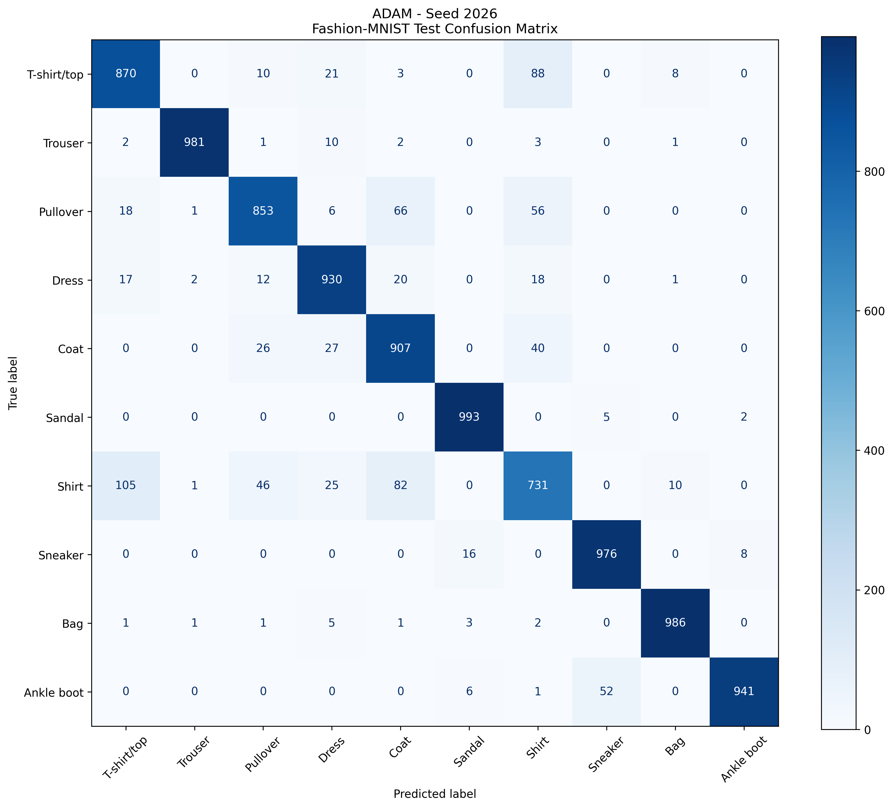

*Test accuracy: 91.68%. Lowest class recall: Shirt (73.10%). Most frequent directed error: Shirt → T-shirt/top (105 images). [Numerical matrix](results/classification_reports/adam_seed2026_confusion.csv).*

#### Adam Seed42 Confusion


*Test accuracy: 91.95%. Lowest class recall: Shirt (71.80%). Most frequent directed error: Shirt → T-shirt/top (128 images). [Numerical matrix](results/classification_reports/adam_seed42_confusion.csv).*

#### Momentum Seed123 Confusion


*Test accuracy: 91.52%. Lowest class recall: Shirt (77.40%). Most frequent directed error: Shirt → T-shirt/top (109 images). [Numerical matrix](results/classification_reports/momentum_seed123_confusion.csv).*

#### Momentum Seed2026 Confusion


*Test accuracy: 91.39%. Lowest class recall: Shirt (72.30%). Most frequent directed error: Shirt → T-shirt/top (107 images). [Numerical matrix](results/classification_reports/momentum_seed2026_confusion.csv).*

#### Momentum Seed42 Confusion


*Test accuracy: 91.50%. Lowest class recall: Shirt (77.60%). Most frequent directed error: T-shirt/top → Shirt (135 images). [Numerical matrix](results/classification_reports/momentum_seed42_confusion.csv).*

#### Nesterov Seed123 Confusion


*Test accuracy: 91.45%. Lowest class recall: Shirt (75.40%). Most frequent directed error: Shirt → T-shirt/top (105 images). [Numerical matrix](results/classification_reports/nesterov_seed123_confusion.csv).*

#### Nesterov Seed2026 Confusion


*Test accuracy: 91.89%. Lowest class recall: Shirt (77.50%). Most frequent directed error: T-shirt/top → Shirt (93 images). [Numerical matrix](results/classification_reports/nesterov_seed2026_confusion.csv).*

#### Nesterov Seed42 Confusion


*Test accuracy: 92.04%. Lowest class recall: Shirt (75.90%). Most frequent directed error: Shirt → T-shirt/top (112 images). [Numerical matrix](results/classification_reports/nesterov_seed42_confusion.csv).*

#### Rmsprop Seed123 Confusion


*Test accuracy: 91.82%. Lowest class recall: Shirt (76.00%). Most frequent directed error: Shirt → T-shirt/top (110 images). [Numerical matrix](results/classification_reports/rmsprop_seed123_confusion.csv).*

#### Rmsprop Seed2026 Confusion


*Test accuracy: 91.83%. Lowest class recall: Shirt (73.20%). Most frequent directed error: Shirt → T-shirt/top (112 images). [Numerical matrix](results/classification_reports/rmsprop_seed2026_confusion.csv).*

#### Rmsprop Seed42 Confusion


*Test accuracy: 91.74%. Lowest class recall: Shirt (73.10%). Most frequent directed error: Shirt → T-shirt/top (94 images). [Numerical matrix](results/classification_reports/rmsprop_seed42_confusion.csv).*

#### Sgd Seed123 Confusion


*Test accuracy: 91.69%. Lowest class recall: Shirt (68.10%). Most frequent directed error: Shirt → T-shirt/top (134 images). [Numerical matrix](results/classification_reports/sgd_seed123_confusion.csv).*

#### Sgd Seed2026 Confusion


*Test accuracy: 90.92%. Lowest class recall: Shirt (76.50%). Most frequent directed error: T-shirt/top → Shirt (108 images). [Numerical matrix](results/classification_reports/sgd_seed2026_confusion.csv).*

#### Sgd Seed42 Confusion

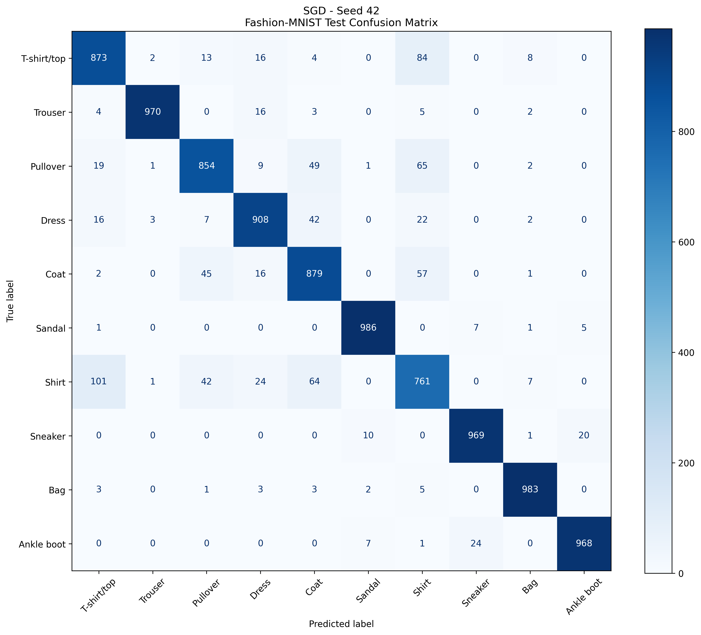

*Test accuracy: 91.51%. Lowest class recall: Shirt (76.10%). Most frequent directed error: Shirt → T-shirt/top (101 images). [Numerical matrix](results/classification_reports/sgd_seed42_confusion.csv).*
<!-- END EVALUATION FIGURES -->

## 16. Final engineering comparison

| Optimizer | Mean val peak (%) | Mean test acc (%) | Mean test loss | Mean train time (s) | Peak allocated MiB | Test accuracy SD (pp) |
|---|---:|---:|---:|---:|---:|---:|
| Adagrad | **93.080** | **92.207** | 0.3516 | 90.92 | **48.19** | 0.318 |
| Adam | 92.837 | 91.993 | 0.3225 | 49.88 | 121.62 | 0.337 |
| RMSprop | 92.943 | 91.797 | 0.4979 | 89.23 | **48.19** | **0.049** |
| Nesterov | 92.817 | 91.793 | 0.3755 | 54.83 | 71.33 | 0.307 |
| Momentum | 92.753 | 91.470 | **0.2797** | **48.48** | 119.12 | 0.070 |
| SGD | 92.377 | 91.373 | 0.4116 | 54.33 | 69.61 | 0.403 |

| Engineering objective | Recommended observed configuration | Justification |
|---|---|---|
| Highest classification accuracy / macro F1 | Adagrad, LR=0.01, BS=32 | Highest mean validation and test accuracy |
| Accuracy vs training time compromise | Adam, LR=0.001, BS=128, betas=(0.8, 0.999) | About 45% less training time than Adagrad with about 0.21 pp lower mean test accuracy |
| Lowest test cross entropy | Momentum, LR=0.01, BS=128, momentum=0.95 | 0.2797 mean test loss |
| Fastest tuned training / target time | Momentum, same configuration | 48.48 s mean training and 3.71 s mean first target time |
| Most repeatable test accuracy | RMSprop, LR=0.001, BS=32, alpha=0.99 | 0.049 pp test accuracy SD |
| Lowest controlled baseline optimizer memory | SGD, LR=0.01, BS=128 | 118.09 MiB under matched baseline conditions |
| Highest throughput in batch sweep | SGD, LR=0.1, BS=256 | 22,089 images/s |

The tuned configurations have different batch sizes; the measured costs compare complete configurations, not isolated optimizer overhead. The baseline is the more controlled reference for comparing optimizer state and runtime. The highest observed validation accuracy (93.26%) is a single run, not the test mean. All final results are reported for checkpoint selection by validation accuracy, even if another checkpoint could have had lower cross entropy.

<!-- BEGIN FINAL FIGURES -->
#### Test Accuracy

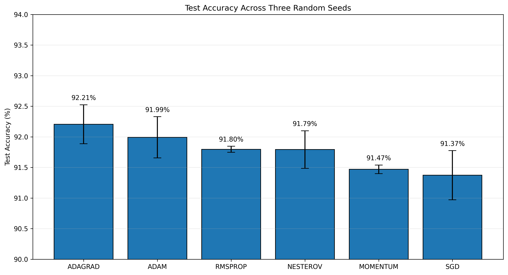

*Mean independent test accuracy ± sample SD across three seeds. Adagrad leads the observed mean; RMSprop has the smallest SD. The displayed accuracy axis is truncated for readability.*

#### Validation Vs Test


*Mean best validation accuracy is higher than mean test accuracy for all selected configurations. Validation-based selection can contribute to this gap.*

#### Classification Metrics


*Macro precision, recall and F1. Adagrad leads the three metrics; macro recall equals overall accuracy on this balanced test set. The displayed axis is truncated.*

#### Accuracy Time Tradeoff


*Accuracy versus mean training time; marker area represents allocated memory. Adam offers near-Adagrad accuracy with much less training time, at a larger measured memory allocation.*

#### Test Loss


*Momentum has the lowest mean cross entropy; RMSprop has the highest. Loss and accuracy rank differently.*

#### Training Time


*Momentum is the fastest selected configuration on average; Adagrad and RMSprop use more updates due to BS=32.*

#### Gpu Memory


*Adagrad and RMSprop have the lowest measured memory among selected configurations because they use the smallest batches. This is not an isolated optimizer-state comparison.*

#### Test Stability


*RMSprop has the lowest test accuracy SD, followed by Momentum. Three seeds yield descriptive repeatability rather than a statistical significance claim.*

#### Convergence Time


*Momentum has the shortest mean time to the first recorded 85% validation accuracy among the selected configurations.*
<!-- END FINAL FIGURES -->

## 17. Discussion and limitations

### 17.1 Answers to the required comparison questions

**Why does vanilla SGD converge differently from adaptive methods?** SGD applies the same scalar LR to every parameter coordinate, making it sensitive to differences in gradient scales and curvature. Adagrad, RMSprop and Adam rescale individual coordinates using gradient history. At baseline LR=0.01, SGD is effective while Adam and RMSprop collapse; at LR=0.001, the latter two achieve 92.95% peak accuracy. Adaptation changes the appropriate base LR rather than removing the need for tuning.

**How does momentum improve optimization?** Momentum carries information from earlier gradients, accelerating directions that persist and potentially reducing oscillation in directions where gradients alternate. In the controlled baseline, Momentum and Nesterov reach the 85% threshold at epoch 1 versus epoch 2 for SGD. At LR=0.1 they diverge, and at momentum=0.99 their final accuracy degrades. Momentum is useful only when its accumulation is compatible with LR and the loss landscape.

**Why can adaptive learning rates accelerate training?** Per-coordinate scaling can help balance parameters with different gradient magnitudes. With suitable LR, Adam and RMSprop reach the target within the first epoch at BS=128. This is not a universal speed advantage: their update rules require extra state and computation, and their baseline with an unsuitable LR performs poorly.

**Why is Adam widely used?** It combines momentum-like first-moment estimation, adaptive second-moment scaling and bias correction, making it a practical starting point for many neural-network problems. Here, tuned Adam yields 91.993% mean test accuracy in about 49.88 s training time, but its LR=0.01 configuration collapses. It remains sensitive to hyperparameters.

**Are adaptive methods always better than SGD with momentum?** No. Adagrad leads test accuracy in this study, but Momentum achieves the lowest test loss, fastest mean training among tuned configurations and lowest peak-validation SD. SGD has the lowest measured baseline GPU memory. Rankings depend on both configuration and metric.

**How does learning rate influence convergence and generalization?** Too-small updates may underfit a fixed training budget; too-large updates may overshoot, cause finite collapse or become numerically non-finite. The LR sweep demonstrates these cases. Even when accuracy is high, confidence on incorrect predictions can worsen cross entropy. The LR choice should balance stable training, validation performance and time rather than maximizing step size.

### 17.2 Limitations and validity

- One dataset and one architecture: no claim of superiority across tasks or network families.
- A discrete, sequential one-factor search: interactions between LR, batch size, momentum and adaptive coefficients are not exhaustively explored. The best configuration is the best observed, not a global optimum.
- Three seeds, one used for tuning; sample SD is descriptive, not a confidence interval or significance test. All seeds share the same split.
- No activation/architecture ablation: LeakyReLU and GELU are justified mathematically and computationally, but their comparative performance was not experimentally isolated.
- Adaptive coefficient sweeps do not directly record effective per-weight step sizes; batch-loss variability is not direct gradient-noise estimation.
- Fixed epochs give different update counts at different batch sizes. The effect of batch size is not isolated from total update count.
- Training metrics are measured during updates, not from a frozen end-of-epoch model. The generalization gap is approximate.
- The 85% threshold is a first-passage metric, not a guarantee of persistent convergence. Numerically completed runs can still collapse.
- GPU timing and memory include implementation and instrumentation overhead. CUDA allocated memory is not total VRAM. Failed partial epochs are not fully measured. Inference timing includes loading and transfers.
- No regularization, scheduling or clipping in the controlled experiments. This exposes optimizer behavior but may not achieve the best practical generalization.
- The test set is used only after configurations and checkpoint-selection rules are fixed. Future tuning should use validation data, not these test results.

## 18. Conclusion

All six required gradient-based optimization algorithms were compared under matched baseline conditions and then studied through learning-rate, momentum, batch-size, adaptive-coefficient and epoch-budget experiments. The study preserves two numerical failures, identifies finite training collapse, and evaluates repeatability across three seeds. The final independent test evaluation uses 18 validation-selected checkpoints.

The learning-rate investigation shows that a shared scalar LR is not equally suitable for different update rules. Adam and RMSprop recover substantially when their LR is reduced to 0.001, while Momentum and Nesterov become numerically unstable at 0.1. The batch-size experiment shows a clear trade-off between accuracy, throughput and allocated memory. Epoch-budget analysis reveals rising validation cross entropy despite decreasing training loss and diminishing gains in peak accuracy.

Adagrad (LR=0.01, BS=32) is the preferred tested configuration when classification accuracy is the main priority: mean best validation accuracy is 93.08%, mean test accuracy is 92.207% and macro F1 is 0.9219. Adam is a strong accuracy-time compromise, Momentum offers lower cross entropy and faster tuned training, and RMSprop has the smallest observed test accuracy variation. These findings support engineering-based optimizer selection rather than treating one optimizer as a universal default.

## 19. Reproducibility

### 19.1 Hardware and software

| Component | Specification |
|---|---|
| Laptop | Lenovo Legion 5 15ACH6H |
| GPU | NVIDIA GeForce RTX 3060 Laptop GPU, 6 GB nominal VRAM |
| Operating system | Ubuntu 22.04 |
| Python | 3.10 |
| PyTorch | 2.9.1+cu128 |
| CUDA build | 12.8 |
| Precision | FP32 |
| Random seeds | 42, 123, 2026 |
| DataLoader workers | 4 |

### 19.2 Repository structure

```text
cse473-optimization/
├── configs/                 # JSON experiment settings
├── data/
│   ├── raw/                 # ignored; downloaded dataset
│   └── splits/              # saved indices and normalization
├── src/                     # data, model, optimizers, train, evaluate, utils, plots
├── experiments/             # sweeps, analysis, plotting, README builder
├── tests/                   # dataset, model and optimizer checks
├── checkpoints/             # ignored; locally saved trained models
├── results/
│   ├── tables/              # experiment CSVs and summary statistics
│   ├── histories/           # per-run configurations, histories and summaries
│   ├── figures/             # every generated plot
│   └── classification_reports/
├── reports/                 # technical report when available
├── requirements.txt
├── README.md
└── .gitignore
```

### 19.3 Installation

Run from the repository root. Use a Python environment compatible with the recorded PyTorch CUDA build. The CUDA-enabled PyTorch installation must match the local driver; CPU execution is possible but changes timings.

```bash
python3 -m pip install -r requirements.txt
python3 -m src.data
python3 -m src.plots
```

Optional environment check:

```bash
python3 -c 'import torch; print(torch.__version__); print(torch.cuda.is_available()); print(torch.version.cuda)'
```

### 19.4 Training and analysis

```bash
python3 -m experiments.baseline
python3 -m experiments.learning_rate
python3 -m experiments.momentum
python3 -m experiments.batch_size
python3 -m experiments.adaptive
python3 -m experiments.epoch_analysis
python3 -m experiments.stability
python3 -m src.evaluate
```

The experiment runners reuse completed runs with matching names when their summaries already exist. Raw data and checkpoints are not tracked by Git. If reproducing from a clone containing result histories but no checkpoints, train in a clean working copy with those generated histories/tables moved to a backup directory outside the repository first, or otherwise restore the corresponding checkpoints. Cached summaries alone cannot recreate weights for evaluation. Preserve the dataset split and original results when archiving. Do not overwrite recorded results unintentionally.

### 19.5 Plot generation

```bash
python3 -m src.plots
python3 -m experiments.plot_baseline
python3 -m experiments.plot_learning_rate
python3 -m experiments.plot_momentum
python3 -m experiments.plot_batch_size
python3 -m experiments.plot_adaptive
python3 -m experiments.plot_epochs
python3 -m experiments.plot_stability
python3 -m experiments.plot_final
python3 -m experiments.build_readme
```

`build_readme.py` generates theoretical activation plots, a static CNN architecture diagram, and refreshes the figure galleries and expandable CSV tables from the local repository. It does not run training, alter experiment results or change hyperparameters. All relative links are intended for GitHub rendering. If results change after rerunning experiments, review the static narrative and highlighted tables as well; the builder updates the generated galleries and appendix, not the manually written analysis.

## 20. Complete results archive

The following appendix contains all summary/comparison tables under `results/tables/` and all numerical class-level evaluation reports. Wide raw tables are in expandable sections to keep this README navigable; the linked CSV files preserve original precision and can be downloaded. The full per-run history files (including layer-wise gradient statistics) are linked individually instead of expanding thousands of cells. The figure galleries throughout this README embed every discovered result PNG, including all 18 confusion matrices. Any additional plots not matching the named experiment folders are included in the appendix below.

<!-- BEGIN EXTRA FIGURES -->
All discovered result PNGs are included in their respective sections above.
<!-- END EXTRA FIGURES -->

<!-- BEGIN TABLE ARCHIVE -->
### 20.1 Experiment and summary tables

<details><summary>adaptive_comparison.csv — 8 rows</summary>

[Open original CSV](results/tables/adaptive_comparison.csv)

| optimizer | lr | alpha | beta1 | beta2 | status | completed_epochs | best_epoch | best_val_accuracy | final_val_accuracy | final_val_loss | total_train_time_sec | peak_gpu_memory_mb | convergence_epoch | convergence_time_sec |
| --- | --- | --- | --- | --- | --- | --- | --- | --- | --- | --- | --- | --- | --- | --- |
| rmsprop | 0.001 | 0.9 | 0.9 | 0.999 | completed | 20 | 4 | 92.57 | 91.09 | 0.6135845 | 48.25773 | 119.1206 | 1 | 3.629146 |
| rmsprop | 0.001 | 0.99 | 0.9 | 0.999 | completed | 20 | 16 | 92.95 | 92.18 | 0.4823742 | 49.42766 | 119.1206 | 1 | 3.730666 |
| rmsprop | 0.001 | 0.999 | 0.9 | 0.999 | completed | 20 | 20 | 91.5 | 91.5 | 0.2359796 | 48.88064 | 119.1206 | 4 | 11.99624 |
| adam | 0.001 | 0.99 | 0.8 | 0.999 | completed | 20 | 15 | 93.07 | 92.65 | 0.4739508 | 49.63528 | 121.624 | 1 | 3.735747 |
| adam | 0.001 | 0.99 | 0.9 | 0.999 | completed | 20 | 14 | 92.95 | 92.12 | 0.4131716 | 50.07839 | 121.624 | 1 | 3.798415 |
| adam | 0.001 | 0.99 | 0.95 | 0.999 | completed | 20 | 19 | 92.6 | 92.04 | 0.3696199 | 49.78459 | 121.624 | 1 | 3.796697 |
| adam | 0.001 | 0.99 | 0.9 | 0.99 | completed | 20 | 7 | 92.93 | 92.12 | 0.4626206 | 49.88163 | 121.624 | 1 | 3.78046 |
| adam | 0.001 | 0.99 | 0.9 | 0.9999 | completed | 20 | 8 | 93.01 | 92.82 | 0.4328113 | 49.89217 | 121.624 | 1 | 3.780207 |

</details>

<details><summary>adaptive_results.csv — 8 rows</summary>

[Open original CSV](results/tables/adaptive_results.csv)

| optimizer | architecture | dataset | lr | momentum | alpha | betas | batch_size | epochs | seed | num_workers | target_accuracy | precision | device | pytorch_version | parameters | gpu | status | failure_reason | completed_epochs | best_epoch | best_val_accuracy | final_train_loss | final_val_loss | final_val_accuracy | total_train_time_sec | total_validation_time_sec | peak_gpu_memory_mb | convergence_epoch | convergence_time_sec | run_name | beta1 | beta2 |
| --- | --- | --- | --- | --- | --- | --- | --- | --- | --- | --- | --- | --- | --- | --- | --- | --- | --- | --- | --- | --- | --- | --- | --- | --- | --- | --- | --- | --- | --- | --- | --- | --- |
| rmsprop | LeakyGELUCNN | Fashion-MNIST | 0.001 | 0.9 | 0.9 | [0.9, 0.999] | 128 | 20 | 42 | 4 | 85 | FP32 | cuda | 2.9.1+cu128 | 475434 | NVIDIA GeForce RTX 3060 Laptop GPU | completed | — | 20 | 4 | 92.57 | 0.0268601 | 0.6135845 | 91.09 | 48.25773 | 7.495086 | 119.1206 | 1 | 3.629146 | adaptive_rmsprop_lr0.001_a0.9_b10.9_b20.999_bs128_ep20_seed42 | 0.9 | 0.999 |
| rmsprop | LeakyGELUCNN | Fashion-MNIST | 0.001 | 0.9 | 0.99 | [0.9, 0.999] | 128 | 20 | 42 | 4 | 85 | FP32 | cuda | 2.9.1+cu128 | 475434 | NVIDIA GeForce RTX 3060 Laptop GPU | completed | — | 20 | 16 | 92.95 | 0.02221353 | 0.4823742 | 92.18 | 49.42766 | 7.771 | 119.1206 | 1 | 3.730666 | lr_sweep_rmsprop_lr0.001_bs128_ep20_seed42 | 0.9 | 0.999 |
| rmsprop | LeakyGELUCNN | Fashion-MNIST | 0.001 | 0.9 | 0.999 | [0.9, 0.999] | 128 | 20 | 42 | 4 | 85 | FP32 | cuda | 2.9.1+cu128 | 475434 | NVIDIA GeForce RTX 3060 Laptop GPU | completed | — | 20 | 20 | 91.5 | 0.1650557 | 0.2359796 | 91.5 | 48.88064 | 7.650536 | 119.1206 | 4 | 11.99624 | adaptive_rmsprop_lr0.001_a0.999_b10.9_b20.999_bs128_ep20_seed42 | 0.9 | 0.999 |
| adam | LeakyGELUCNN | Fashion-MNIST | 0.001 | 0.9 | 0.99 | [0.8, 0.999] | 128 | 20 | 42 | 4 | 85 | FP32 | cuda | 2.9.1+cu128 | 475434 | NVIDIA GeForce RTX 3060 Laptop GPU | completed | — | 20 | 15 | 93.07 | 0.0178666 | 0.4739508 | 92.65 | 49.63528 | 7.593308 | 121.624 | 1 | 3.735747 | adaptive_adam_lr0.001_a0.99_b10.8_b20.999_bs128_ep20_seed42 | 0.8 | 0.999 |
| adam | LeakyGELUCNN | Fashion-MNIST | 0.001 | 0.9 | 0.99 | [0.9, 0.999] | 128 | 20 | 42 | 4 | 85 | FP32 | cuda | 2.9.1+cu128 | 475434 | NVIDIA GeForce RTX 3060 Laptop GPU | completed | — | 20 | 14 | 92.95 | 0.023578 | 0.4131716 | 92.12 | 50.07839 | 7.950297 | 121.624 | 1 | 3.798415 | lr_sweep_adam_lr0.001_bs128_ep20_seed42 | 0.9 | 0.999 |
| adam | LeakyGELUCNN | Fashion-MNIST | 0.001 | 0.9 | 0.99 | [0.95, 0.999] | 128 | 20 | 42 | 4 | 85 | FP32 | cuda | 2.9.1+cu128 | 475434 | NVIDIA GeForce RTX 3060 Laptop GPU | completed | — | 20 | 19 | 92.6 | 0.02691559 | 0.3696199 | 92.04 | 49.78459 | 7.69556 | 121.624 | 1 | 3.796697 | adaptive_adam_lr0.001_a0.99_b10.95_b20.999_bs128_ep20_seed42 | 0.95 | 0.999 |
| adam | LeakyGELUCNN | Fashion-MNIST | 0.001 | 0.9 | 0.99 | [0.9, 0.99] | 128 | 20 | 42 | 4 | 85 | FP32 | cuda | 2.9.1+cu128 | 475434 | NVIDIA GeForce RTX 3060 Laptop GPU | completed | — | 20 | 7 | 92.93 | 0.0203016 | 0.4626206 | 92.12 | 49.88163 | 7.857765 | 121.624 | 1 | 3.78046 | adaptive_adam_lr0.001_a0.99_b10.9_b20.99_bs128_ep20_seed42 | 0.9 | 0.99 |
| adam | LeakyGELUCNN | Fashion-MNIST | 0.001 | 0.9 | 0.99 | [0.9, 0.9999] | 128 | 20 | 42 | 4 | 85 | FP32 | cuda | 2.9.1+cu128 | 475434 | NVIDIA GeForce RTX 3060 Laptop GPU | completed | — | 20 | 8 | 93.01 | 0.02401834 | 0.4328113 | 92.82 | 49.89217 | 7.946245 | 121.624 | 1 | 3.780207 | adaptive_adam_lr0.001_a0.99_b10.9_b20.9999_bs128_ep20_seed42 | 0.9 | 0.9999 |

</details>

<details><summary>baseline_comparison.csv — 6 rows</summary>

[Open original CSV](results/tables/baseline_comparison.csv)

| optimizer | status | completed_epochs | best_epoch | best_val_accuracy | final_val_accuracy | final_val_loss | total_train_time_sec | peak_gpu_memory_mb | convergence_epoch | convergence_time_sec |
| --- | --- | --- | --- | --- | --- | --- | --- | --- | --- | --- |
| sgd | completed | 20 | 16 | 91.71 | 90.94 | 0.2519753 | 46.97253 | 118.0859 | 2 | 6.28686 |
| momentum | completed | 20 | 20 | 92.82 | 92.82 | 0.3707128 | 47.87876 | 119.1206 | 1 | 3.639527 |
| nesterov | completed | 20 | 10 | 92.72 | 92.22 | 0.4010425 | 48.26376 | 119.1206 | 1 | 3.667168 |
| adagrad | completed | 20 | 18 | 92.88 | 92.84 | 0.3613836 | 49.20092 | 119.8081 | 1 | 3.820643 |
| rmsprop | completed | 20 | 1 | 29.35 | 10 | 2.302705 | 48.27467 | 119.1206 | — | — |
| adam | completed | 20 | 3 | 89.03 | 10 | 2.302747 | 48.91293 | 121.624 | 1 | 3.765597 |

</details>

<details><summary>baseline_results.csv — 6 rows</summary>

[Open original CSV](results/tables/baseline_results.csv)

| optimizer | architecture | dataset | lr | momentum | alpha | betas | batch_size | epochs | seed | num_workers | target_accuracy | precision | device | pytorch_version | parameters | gpu | status | failure_reason | completed_epochs | best_epoch | best_val_accuracy | final_train_loss | final_val_loss | final_val_accuracy | total_train_time_sec | total_validation_time_sec | peak_gpu_memory_mb | convergence_epoch | convergence_time_sec |
| --- | --- | --- | --- | --- | --- | --- | --- | --- | --- | --- | --- | --- | --- | --- | --- | --- | --- | --- | --- | --- | --- | --- | --- | --- | --- | --- | --- | --- | --- |
| sgd | LeakyGELUCNN | Fashion-MNIST | 0.01 | 0.9 | 0.99 | [0.9, 0.999] | 128 | 20 | 42 | 4 | 85 | FP32 | cuda | 2.9.1+cu128 | 475434 | NVIDIA GeForce RTX 3060 Laptop GPU | completed | — | 20 | 16 | 91.71 | 0.1504777 | 0.2519753 | 90.94 | 46.97253 | 7.463914 | 118.0859 | 2 | 6.28686 |
| momentum | LeakyGELUCNN | Fashion-MNIST | 0.01 | 0.9 | 0.99 | [0.9, 0.999] | 128 | 20 | 42 | 4 | 85 | FP32 | cuda | 2.9.1+cu128 | 475434 | NVIDIA GeForce RTX 3060 Laptop GPU | completed | — | 20 | 20 | 92.82 | 0.01895083 | 0.3707128 | 92.82 | 47.87876 | 7.555553 | 119.1206 | 1 | 3.639527 |
| nesterov | LeakyGELUCNN | Fashion-MNIST | 0.01 | 0.9 | 0.99 | [0.9, 0.999] | 128 | 20 | 42 | 4 | 85 | FP32 | cuda | 2.9.1+cu128 | 475434 | NVIDIA GeForce RTX 3060 Laptop GPU | completed | — | 20 | 10 | 92.72 | 0.02004166 | 0.4010425 | 92.22 | 48.26376 | 7.505627 | 119.1206 | 1 | 3.667168 |
| adagrad | LeakyGELUCNN | Fashion-MNIST | 0.01 | 0.9 | 0.99 | [0.9, 0.999] | 128 | 20 | 42 | 4 | 85 | FP32 | cuda | 2.9.1+cu128 | 475434 | NVIDIA GeForce RTX 3060 Laptop GPU | completed | — | 20 | 18 | 92.88 | 0.003566412 | 0.3613836 | 92.84 | 49.20092 | 7.562241 | 119.8081 | 1 | 3.820643 |
| rmsprop | LeakyGELUCNN | Fashion-MNIST | 0.01 | 0.9 | 0.99 | [0.9, 0.999] | 128 | 20 | 42 | 4 | 85 | FP32 | cuda | 2.9.1+cu128 | 475434 | NVIDIA GeForce RTX 3060 Laptop GPU | completed | — | 20 | 1 | 29.35 | 2.303435 | 2.302705 | 10 | 48.27467 | 7.698059 | 119.1206 | — | — |
| adam | LeakyGELUCNN | Fashion-MNIST | 0.01 | 0.9 | 0.99 | [0.9, 0.999] | 128 | 20 | 42 | 4 | 85 | FP32 | cuda | 2.9.1+cu128 | 475434 | NVIDIA GeForce RTX 3060 Laptop GPU | completed | — | 20 | 3 | 89.03 | 2.303419 | 2.302747 | 10 | 48.91293 | 7.631491 | 121.624 | 1 | 3.765597 |

</details>

<details><summary>batch_size_comparison.csv — 24 rows</summary>

[Open original CSV](results/tables/batch_size_comparison.csv)

| optimizer | lr | batch_size | status | completed_epochs | best_epoch | best_val_accuracy | final_val_accuracy | final_val_loss | total_train_time_sec | peak_gpu_memory_mb | convergence_epoch | convergence_time_sec | updates_per_epoch | completed_epoch_updates | updates_to_target | images_per_second |
| --- | --- | --- | --- | --- | --- | --- | --- | --- | --- | --- | --- | --- | --- | --- | --- | --- |
| rmsprop | 0.001 | 32 | completed | 20 | 16 | 93.08 | 91.84 | 0.5516965 | 90.25173 | 48.18896 | 1 | 5.725948 | 1563 | 31260 | 1563 | 11080.12 |
| rmsprop | 0.001 | 64 | completed | 20 | 16 | 92.52 | 92.11 | 0.5388672 | 57.74833 | 71.33252 | 1 | 4.241337 | 782 | 15640 | 782 | 17316.52 |
| rmsprop | 0.001 | 128 | completed | 20 | 16 | 92.95 | 92.18 | 0.4823742 | 49.42766 | 119.1206 | 1 | 3.730666 | 391 | 7820 | 391 | 20231.59 |
| rmsprop | 0.001 | 256 | completed | 20 | 14 | 92.76 | 92.2 | 0.4146243 | 46.11538 | 214.9619 | 1 | 3.506201 | 196 | 3920 | 196 | 21684.74 |
| adam | 0.001 | 32 | completed | 20 | 11 | 92.67 | 92.42 | 0.4483843 | 92.72868 | 50.00488 | 1 | 6.097173 | 1563 | 31260 | 1563 | 10784.15 |
| adam | 0.001 | 64 | completed | 20 | 8 | 92.82 | 92.57 | 0.4723931 | 56.94284 | 73.14844 | 1 | 4.235533 | 782 | 15640 | 782 | 17561.47 |
| adam | 0.001 | 128 | completed | 20 | 14 | 92.95 | 92.12 | 0.4131716 | 50.07839 | 121.624 | 1 | 3.798415 | 391 | 7820 | 391 | 19968.69 |
| adam | 0.001 | 256 | completed | 20 | 13 | 92.69 | 92.26 | 0.3842539 | 46.10809 | 216.7778 | 1 | 3.462568 | 196 | 3920 | 196 | 21688.17 |
| adagrad | 0.01 | 32 | completed | 20 | 16 | 93.26 | 93.22 | 0.3728013 | 90.43401 | 48.18896 | 1 | 6.001567 | 1563 | 31260 | 1563 | 11057.79 |
| adagrad | 0.01 | 64 | completed | 20 | 20 | 92.96 | 92.96 | 0.3752771 | 56.37477 | 72.09766 | 1 | 4.124497 | 782 | 15640 | 782 | 17738.43 |
| adagrad | 0.01 | 128 | completed | 20 | 18 | 92.88 | 92.84 | 0.3613836 | 49.20092 | 119.8081 | 1 | 3.820643 | 391 | 7820 | 391 | 20324.82 |
| adagrad | 0.01 | 256 | completed | 20 | 19 | 92.65 | 92.55 | 0.319247 | 46.13197 | 214.9619 | 1 | 3.476581 | 196 | 3920 | 196 | 21676.94 |
| momentum | 0.01 | 32 | completed | 20 | 11 | 92.66 | 91.76 | 0.4285194 | 84.38941 | 48.18896 | 1 | 5.659914 | 1563 | 31260 | 1563 | 11849.83 |
| momentum | 0.01 | 64 | completed | 20 | 14 | 92.61 | 92.06 | 0.3891139 | 54.21478 | 71.33252 | 1 | 4.03381 | 782 | 15640 | 782 | 18445.15 |
| momentum | 0.01 | 128 | completed | 20 | 20 | 92.82 | 92.82 | 0.3707128 | 47.87876 | 119.1206 | 1 | 3.639527 | 391 | 7820 | 391 | 20886.09 |
| momentum | 0.01 | 256 | completed | 20 | 10 | 92.49 | 92.37 | 0.3362184 | 45.60987 | 214.9619 | 1 | 3.395772 | 196 | 3920 | 196 | 21925.08 |
| nesterov | 0.01 | 32 | completed | 20 | 14 | 92.73 | 92.62 | 0.3614661 | 85.7883 | 48.18896 | 1 | 5.645439 | 1563 | 31260 | 1563 | 11656.6 |
| nesterov | 0.01 | 64 | completed | 20 | 6 | 92.77 | 92.2 | 0.4445278 | 54.67014 | 71.33252 | 1 | 4.088544 | 782 | 15640 | 782 | 18291.52 |
| nesterov | 0.01 | 128 | completed | 20 | 10 | 92.72 | 92.22 | 0.4010425 | 48.26376 | 119.1206 | 1 | 3.667168 | 391 | 7820 | 391 | 20719.48 |
| nesterov | 0.01 | 256 | completed | 20 | 10 | 92.39 | 91.92 | 0.3578513 | 45.63702 | 214.9619 | 1 | 3.439448 | 196 | 3920 | 196 | 21912.04 |
| sgd | 0.1 | 32 | completed | 20 | 17 | 92.4 | 92.2 | 0.3986807 | 84.31257 | 46.37305 | 1 | 5.636043 | 1563 | 31260 | 1563 | 11860.63 |
| sgd | 0.1 | 64 | completed | 20 | 20 | 92.66 | 92.66 | 0.404252 | 54.41121 | 69.60938 | 1 | 4.031777 | 782 | 15640 | 782 | 18378.57 |
| sgd | 0.1 | 128 | completed | 20 | 15 | 92.55 | 92.07 | 0.4261805 | 47.83761 | 118.0859 | 1 | 3.659049 | 391 | 7820 | 391 | 20904.06 |
| sgd | 0.1 | 256 | completed | 20 | 19 | 92.23 | 92.01 | 0.3330595 | 45.27098 | 213.146 | 2 | 6.018803 | 196 | 3920 | 392 | 22089.21 |

</details>

<details><summary>batch_size_results.csv — 24 rows</summary>

[Open original CSV](results/tables/batch_size_results.csv)

| optimizer | architecture | dataset | lr | momentum | alpha | betas | batch_size | epochs | seed | num_workers | target_accuracy | precision | device | pytorch_version | parameters | gpu | status | failure_reason | completed_epochs | best_epoch | best_val_accuracy | final_train_loss | final_val_loss | final_val_accuracy | total_train_time_sec | total_validation_time_sec | peak_gpu_memory_mb | convergence_epoch | convergence_time_sec | run_name | updates_per_epoch | completed_epoch_updates | updates_to_target | images_per_second |
| --- | --- | --- | --- | --- | --- | --- | --- | --- | --- | --- | --- | --- | --- | --- | --- | --- | --- | --- | --- | --- | --- | --- | --- | --- | --- | --- | --- | --- | --- | --- | --- | --- | --- | --- |
| rmsprop | LeakyGELUCNN | Fashion-MNIST | 0.001 | 0.9 | 0.99 | [0.9, 0.999] | 32 | 20 | 42 | 4 | 85 | FP32 | cuda | 2.9.1+cu128 | 475434 | NVIDIA GeForce RTX 3060 Laptop GPU | completed | — | 20 | 16 | 93.08 | 0.04199804 | 0.5516965 | 91.84 | 90.25173 | 9.450599 | 48.18896 | 1 | 5.725948 | batch_sweep_rmsprop_lr0.001_bs32_ep20_seed42 | 1563 | 31260 | 1563 | 11080.12 |
| rmsprop | LeakyGELUCNN | Fashion-MNIST | 0.001 | 0.9 | 0.99 | [0.9, 0.999] | 64 | 20 | 42 | 4 | 85 | FP32 | cuda | 2.9.1+cu128 | 475434 | NVIDIA GeForce RTX 3060 Laptop GPU | completed | — | 20 | 16 | 92.52 | 0.03140674 | 0.5388672 | 92.11 | 57.74833 | 8.588998 | 71.33252 | 1 | 4.241337 | batch_sweep_rmsprop_lr0.001_bs64_ep20_seed42 | 782 | 15640 | 782 | 17316.52 |
| rmsprop | LeakyGELUCNN | Fashion-MNIST | 0.001 | 0.9 | 0.99 | [0.9, 0.999] | 128 | 20 | 42 | 4 | 85 | FP32 | cuda | 2.9.1+cu128 | 475434 | NVIDIA GeForce RTX 3060 Laptop GPU | completed | — | 20 | 16 | 92.95 | 0.02221353 | 0.4823742 | 92.18 | 49.42766 | 7.771 | 119.1206 | 1 | 3.730666 | lr_sweep_rmsprop_lr0.001_bs128_ep20_seed42 | 391 | 7820 | 391 | 20231.59 |
| rmsprop | LeakyGELUCNN | Fashion-MNIST | 0.001 | 0.9 | 0.99 | [0.9, 0.999] | 256 | 20 | 42 | 4 | 85 | FP32 | cuda | 2.9.1+cu128 | 475434 | NVIDIA GeForce RTX 3060 Laptop GPU | completed | — | 20 | 14 | 92.76 | 0.01893538 | 0.4146243 | 92.2 | 46.11538 | 7.899503 | 214.9619 | 1 | 3.506201 | batch_sweep_rmsprop_lr0.001_bs256_ep20_seed42 | 196 | 3920 | 196 | 21684.74 |
| adam | LeakyGELUCNN | Fashion-MNIST | 0.001 | 0.9 | 0.99 | [0.9, 0.999] | 32 | 20 | 42 | 4 | 85 | FP32 | cuda | 2.9.1+cu128 | 475434 | NVIDIA GeForce RTX 3060 Laptop GPU | completed | — | 20 | 11 | 92.67 | 0.04053475 | 0.4483843 | 92.42 | 92.72868 | 9.526694 | 50.00488 | 1 | 6.097173 | batch_sweep_adam_lr0.001_bs32_ep20_seed42 | 1563 | 31260 | 1563 | 10784.15 |
| adam | LeakyGELUCNN | Fashion-MNIST | 0.001 | 0.9 | 0.99 | [0.9, 0.999] | 64 | 20 | 42 | 4 | 85 | FP32 | cuda | 2.9.1+cu128 | 475434 | NVIDIA GeForce RTX 3060 Laptop GPU | completed | — | 20 | 8 | 92.82 | 0.03160068 | 0.4723931 | 92.57 | 56.94284 | 8.320245 | 73.14844 | 1 | 4.235533 | batch_sweep_adam_lr0.001_bs64_ep20_seed42 | 782 | 15640 | 782 | 17561.47 |
| adam | LeakyGELUCNN | Fashion-MNIST | 0.001 | 0.9 | 0.99 | [0.9, 0.999] | 128 | 20 | 42 | 4 | 85 | FP32 | cuda | 2.9.1+cu128 | 475434 | NVIDIA GeForce RTX 3060 Laptop GPU | completed | — | 20 | 14 | 92.95 | 0.023578 | 0.4131716 | 92.12 | 50.07839 | 7.950297 | 121.624 | 1 | 3.798415 | lr_sweep_adam_lr0.001_bs128_ep20_seed42 | 391 | 7820 | 391 | 19968.69 |
| adam | LeakyGELUCNN | Fashion-MNIST | 0.001 | 0.9 | 0.99 | [0.9, 0.999] | 256 | 20 | 42 | 4 | 85 | FP32 | cuda | 2.9.1+cu128 | 475434 | NVIDIA GeForce RTX 3060 Laptop GPU | completed | — | 20 | 13 | 92.69 | 0.02549656 | 0.3842539 | 92.26 | 46.10809 | 7.536306 | 216.7778 | 1 | 3.462568 | batch_sweep_adam_lr0.001_bs256_ep20_seed42 | 196 | 3920 | 196 | 21688.17 |
| adagrad | LeakyGELUCNN | Fashion-MNIST | 0.01 | 0.9 | 0.99 | [0.9, 0.999] | 32 | 20 | 42 | 4 | 85 | FP32 | cuda | 2.9.1+cu128 | 475434 | NVIDIA GeForce RTX 3060 Laptop GPU | completed | — | 20 | 16 | 93.26 | 0.001475209 | 0.3728013 | 93.22 | 90.43401 | 9.775094 | 48.18896 | 1 | 6.001567 | batch_sweep_adagrad_lr0.01_bs32_ep20_seed42 | 1563 | 31260 | 1563 | 11057.79 |
| adagrad | LeakyGELUCNN | Fashion-MNIST | 0.01 | 0.9 | 0.99 | [0.9, 0.999] | 64 | 20 | 42 | 4 | 85 | FP32 | cuda | 2.9.1+cu128 | 475434 | NVIDIA GeForce RTX 3060 Laptop GPU | completed | — | 20 | 20 | 92.96 | 0.002172448 | 0.3752771 | 92.96 | 56.37477 | 8.451059 | 72.09766 | 1 | 4.124497 | batch_sweep_adagrad_lr0.01_bs64_ep20_seed42 | 782 | 15640 | 782 | 17738.43 |
| adagrad | LeakyGELUCNN | Fashion-MNIST | 0.01 | 0.9 | 0.99 | [0.9, 0.999] | 128 | 20 | 42 | 4 | 85 | FP32 | cuda | 2.9.1+cu128 | 475434 | NVIDIA GeForce RTX 3060 Laptop GPU | completed | — | 20 | 18 | 92.88 | 0.003566412 | 0.3613836 | 92.84 | 49.20092 | 7.562241 | 119.8081 | 1 | 3.820643 | baseline_adagrad_lr0.01_bs128_ep20_seed42 | 391 | 7820 | 391 | 20324.82 |
| adagrad | LeakyGELUCNN | Fashion-MNIST | 0.01 | 0.9 | 0.99 | [0.9, 0.999] | 256 | 20 | 42 | 4 | 85 | FP32 | cuda | 2.9.1+cu128 | 475434 | NVIDIA GeForce RTX 3060 Laptop GPU | completed | — | 20 | 19 | 92.65 | 0.01284516 | 0.319247 | 92.55 | 46.13197 | 7.655516 | 214.9619 | 1 | 3.476581 | batch_sweep_adagrad_lr0.01_bs256_ep20_seed42 | 196 | 3920 | 196 | 21676.94 |
| momentum | LeakyGELUCNN | Fashion-MNIST | 0.01 | 0.9 | 0.99 | [0.9, 0.999] | 32 | 20 | 42 | 4 | 85 | FP32 | cuda | 2.9.1+cu128 | 475434 | NVIDIA GeForce RTX 3060 Laptop GPU | completed | — | 20 | 11 | 92.66 | 0.04384853 | 0.4285194 | 91.76 | 84.38941 | 9.616303 | 48.18896 | 1 | 5.659914 | batch_sweep_momentum_lr0.01_bs32_ep20_seed42 | 1563 | 31260 | 1563 | 11849.83 |
| momentum | LeakyGELUCNN | Fashion-MNIST | 0.01 | 0.9 | 0.99 | [0.9, 0.999] | 64 | 20 | 42 | 4 | 85 | FP32 | cuda | 2.9.1+cu128 | 475434 | NVIDIA GeForce RTX 3060 Laptop GPU | completed | — | 20 | 14 | 92.61 | 0.02553478 | 0.3891139 | 92.06 | 54.21478 | 8.374356 | 71.33252 | 1 | 4.03381 | batch_sweep_momentum_lr0.01_bs64_ep20_seed42 | 782 | 15640 | 782 | 18445.15 |
| momentum | LeakyGELUCNN | Fashion-MNIST | 0.01 | 0.9 | 0.99 | [0.9, 0.999] | 128 | 20 | 42 | 4 | 85 | FP32 | cuda | 2.9.1+cu128 | 475434 | NVIDIA GeForce RTX 3060 Laptop GPU | completed | — | 20 | 20 | 92.82 | 0.01895083 | 0.3707128 | 92.82 | 47.87876 | 7.555553 | 119.1206 | 1 | 3.639527 | baseline_momentum_lr0.01_bs128_ep20_seed42 | 391 | 7820 | 391 | 20886.09 |
| momentum | LeakyGELUCNN | Fashion-MNIST | 0.01 | 0.9 | 0.99 | [0.9, 0.999] | 256 | 20 | 42 | 4 | 85 | FP32 | cuda | 2.9.1+cu128 | 475434 | NVIDIA GeForce RTX 3060 Laptop GPU | completed | — | 20 | 10 | 92.49 | 0.03059761 | 0.3362184 | 92.37 | 45.60987 | 7.752274 | 214.9619 | 1 | 3.395772 | batch_sweep_momentum_lr0.01_bs256_ep20_seed42 | 196 | 3920 | 196 | 21925.08 |
| nesterov | LeakyGELUCNN | Fashion-MNIST | 0.01 | 0.9 | 0.99 | [0.9, 0.999] | 32 | 20 | 42 | 4 | 85 | FP32 | cuda | 2.9.1+cu128 | 475434 | NVIDIA GeForce RTX 3060 Laptop GPU | completed | — | 20 | 14 | 92.73 | 0.0459853 | 0.3614661 | 92.62 | 85.7883 | 9.651953 | 48.18896 | 1 | 5.645439 | batch_sweep_nesterov_lr0.01_bs32_ep20_seed42 | 1563 | 31260 | 1563 | 11656.6 |
| nesterov | LeakyGELUCNN | Fashion-MNIST | 0.01 | 0.9 | 0.99 | [0.9, 0.999] | 64 | 20 | 42 | 4 | 85 | FP32 | cuda | 2.9.1+cu128 | 475434 | NVIDIA GeForce RTX 3060 Laptop GPU | completed | — | 20 | 6 | 92.77 | 0.02542519 | 0.4445278 | 92.2 | 54.67014 | 8.439 | 71.33252 | 1 | 4.088544 | batch_sweep_nesterov_lr0.01_bs64_ep20_seed42 | 782 | 15640 | 782 | 18291.52 |
| nesterov | LeakyGELUCNN | Fashion-MNIST | 0.01 | 0.9 | 0.99 | [0.9, 0.999] | 128 | 20 | 42 | 4 | 85 | FP32 | cuda | 2.9.1+cu128 | 475434 | NVIDIA GeForce RTX 3060 Laptop GPU | completed | — | 20 | 10 | 92.72 | 0.02004166 | 0.4010425 | 92.22 | 48.26376 | 7.505627 | 119.1206 | 1 | 3.667168 | baseline_nesterov_lr0.01_bs128_ep20_seed42 | 391 | 7820 | 391 | 20719.48 |
| nesterov | LeakyGELUCNN | Fashion-MNIST | 0.01 | 0.9 | 0.99 | [0.9, 0.999] | 256 | 20 | 42 | 4 | 85 | FP32 | cuda | 2.9.1+cu128 | 475434 | NVIDIA GeForce RTX 3060 Laptop GPU | completed | — | 20 | 10 | 92.39 | 0.02344231 | 0.3578513 | 91.92 | 45.63702 | 7.948421 | 214.9619 | 1 | 3.439448 | batch_sweep_nesterov_lr0.01_bs256_ep20_seed42 | 196 | 3920 | 196 | 21912.04 |
| sgd | LeakyGELUCNN | Fashion-MNIST | 0.1 | 0.9 | 0.99 | [0.9, 0.999] | 32 | 20 | 42 | 4 | 85 | FP32 | cuda | 2.9.1+cu128 | 475434 | NVIDIA GeForce RTX 3060 Laptop GPU | completed | — | 20 | 17 | 92.4 | 0.049622 | 0.3986807 | 92.2 | 84.31257 | 9.62256 | 46.37305 | 1 | 5.636043 | batch_sweep_sgd_lr0.1_bs32_ep20_seed42 | 1563 | 31260 | 1563 | 11860.63 |
| sgd | LeakyGELUCNN | Fashion-MNIST | 0.1 | 0.9 | 0.99 | [0.9, 0.999] | 64 | 20 | 42 | 4 | 85 | FP32 | cuda | 2.9.1+cu128 | 475434 | NVIDIA GeForce RTX 3060 Laptop GPU | completed | — | 20 | 20 | 92.66 | 0.02312874 | 0.404252 | 92.66 | 54.41121 | 8.433731 | 69.60938 | 1 | 4.031777 | batch_sweep_sgd_lr0.1_bs64_ep20_seed42 | 782 | 15640 | 782 | 18378.57 |
| sgd | LeakyGELUCNN | Fashion-MNIST | 0.1 | 0.9 | 0.99 | [0.9, 0.999] | 128 | 20 | 42 | 4 | 85 | FP32 | cuda | 2.9.1+cu128 | 475434 | NVIDIA GeForce RTX 3060 Laptop GPU | completed | — | 20 | 15 | 92.55 | 0.007952901 | 0.4261805 | 92.07 | 47.83761 | 7.566847 | 118.0859 | 1 | 3.659049 | lr_sweep_sgd_lr0.1_bs128_ep20_seed42 | 391 | 7820 | 391 | 20904.06 |
| sgd | LeakyGELUCNN | Fashion-MNIST | 0.1 | 0.9 | 0.99 | [0.9, 0.999] | 256 | 20 | 42 | 4 | 85 | FP32 | cuda | 2.9.1+cu128 | 475434 | NVIDIA GeForce RTX 3060 Laptop GPU | completed | — | 20 | 19 | 92.23 | 0.02811202 | 0.3330595 | 92.01 | 45.27098 | 7.697125 | 213.146 | 2 | 6.018803 | batch_sweep_sgd_lr0.1_bs256_ep20_seed42 | 196 | 3920 | 392 | 22089.21 |

</details>

<details><summary>best_batch_sizes.csv — 6 rows</summary>

[Open original CSV](results/tables/best_batch_sizes.csv)

| optimizer | architecture | dataset | lr | momentum | alpha | betas | batch_size | epochs | seed | num_workers | target_accuracy | precision | device | pytorch_version | parameters | gpu | status | failure_reason | completed_epochs | best_epoch | best_val_accuracy | final_train_loss | final_val_loss | final_val_accuracy | total_train_time_sec | total_validation_time_sec | peak_gpu_memory_mb | convergence_epoch | convergence_time_sec | run_name | updates_per_epoch | completed_epoch_updates | updates_to_target | images_per_second |
| --- | --- | --- | --- | --- | --- | --- | --- | --- | --- | --- | --- | --- | --- | --- | --- | --- | --- | --- | --- | --- | --- | --- | --- | --- | --- | --- | --- | --- | --- | --- | --- | --- | --- | --- |
| adagrad | LeakyGELUCNN | Fashion-MNIST | 0.01 | 0.9 | 0.99 | [0.9, 0.999] | 32 | 20 | 42 | 4 | 85 | FP32 | cuda | 2.9.1+cu128 | 475434 | NVIDIA GeForce RTX 3060 Laptop GPU | completed | — | 20 | 16 | 93.26 | 0.001475209 | 0.3728013 | 93.22 | 90.43401 | 9.775094 | 48.18896 | 1 | 6.001567 | batch_sweep_adagrad_lr0.01_bs32_ep20_seed42 | 1563 | 31260 | 1563 | 11057.79 |
| rmsprop | LeakyGELUCNN | Fashion-MNIST | 0.001 | 0.9 | 0.99 | [0.9, 0.999] | 32 | 20 | 42 | 4 | 85 | FP32 | cuda | 2.9.1+cu128 | 475434 | NVIDIA GeForce RTX 3060 Laptop GPU | completed | — | 20 | 16 | 93.08 | 0.04199804 | 0.5516965 | 91.84 | 90.25173 | 9.450599 | 48.18896 | 1 | 5.725948 | batch_sweep_rmsprop_lr0.001_bs32_ep20_seed42 | 1563 | 31260 | 1563 | 11080.12 |
| adam | LeakyGELUCNN | Fashion-MNIST | 0.001 | 0.9 | 0.99 | [0.9, 0.999] | 128 | 20 | 42 | 4 | 85 | FP32 | cuda | 2.9.1+cu128 | 475434 | NVIDIA GeForce RTX 3060 Laptop GPU | completed | — | 20 | 14 | 92.95 | 0.023578 | 0.4131716 | 92.12 | 50.07839 | 7.950297 | 121.624 | 1 | 3.798415 | lr_sweep_adam_lr0.001_bs128_ep20_seed42 | 391 | 7820 | 391 | 19968.69 |
| momentum | LeakyGELUCNN | Fashion-MNIST | 0.01 | 0.9 | 0.99 | [0.9, 0.999] | 128 | 20 | 42 | 4 | 85 | FP32 | cuda | 2.9.1+cu128 | 475434 | NVIDIA GeForce RTX 3060 Laptop GPU | completed | — | 20 | 20 | 92.82 | 0.01895083 | 0.3707128 | 92.82 | 47.87876 | 7.555553 | 119.1206 | 1 | 3.639527 | baseline_momentum_lr0.01_bs128_ep20_seed42 | 391 | 7820 | 391 | 20886.09 |
| nesterov | LeakyGELUCNN | Fashion-MNIST | 0.01 | 0.9 | 0.99 | [0.9, 0.999] | 64 | 20 | 42 | 4 | 85 | FP32 | cuda | 2.9.1+cu128 | 475434 | NVIDIA GeForce RTX 3060 Laptop GPU | completed | — | 20 | 6 | 92.77 | 0.02542519 | 0.4445278 | 92.2 | 54.67014 | 8.439 | 71.33252 | 1 | 4.088544 | batch_sweep_nesterov_lr0.01_bs64_ep20_seed42 | 782 | 15640 | 782 | 18291.52 |
| sgd | LeakyGELUCNN | Fashion-MNIST | 0.1 | 0.9 | 0.99 | [0.9, 0.999] | 64 | 20 | 42 | 4 | 85 | FP32 | cuda | 2.9.1+cu128 | 475434 | NVIDIA GeForce RTX 3060 Laptop GPU | completed | — | 20 | 20 | 92.66 | 0.02312874 | 0.404252 | 92.66 | 54.41121 | 8.433731 | 69.60938 | 1 | 4.031777 | batch_sweep_sgd_lr0.1_bs64_ep20_seed42 | 782 | 15640 | 782 | 18378.57 |

</details>

<details><summary>best_configurations.csv — 6 rows</summary>

[Open original CSV](results/tables/best_configurations.csv)

| optimizer | architecture | dataset | lr | momentum | alpha | betas | batch_size | epochs | seed | num_workers | target_accuracy | precision | device | pytorch_version | parameters | gpu | status | failure_reason | completed_epochs | best_epoch | best_val_accuracy | final_train_loss | final_val_loss | final_val_accuracy | total_train_time_sec | total_validation_time_sec | peak_gpu_memory_mb | convergence_epoch | convergence_time_sec | run_name | updates_per_epoch | completed_epoch_updates | updates_to_target | images_per_second | beta1 | beta2 |
| --- | --- | --- | --- | --- | --- | --- | --- | --- | --- | --- | --- | --- | --- | --- | --- | --- | --- | --- | --- | --- | --- | --- | --- | --- | --- | --- | --- | --- | --- | --- | --- | --- | --- | --- | --- | --- |
| adagrad | LeakyGELUCNN | Fashion-MNIST | 0.01 | 0.9 | 0.99 | [0.9, 0.999] | 32 | 20 | 42 | 4 | 85 | FP32 | cuda | 2.9.1+cu128 | 475434 | NVIDIA GeForce RTX 3060 Laptop GPU | completed | — | 20 | 16 | 93.26 | 0.001475209 | 0.3728013 | 93.22 | 90.43401 | 9.775094 | 48.18896 | 1 | 6.001567 | batch_sweep_adagrad_lr0.01_bs32_ep20_seed42 | 1563 | 31260 | 1563 | 11057.79 | — | — |
| rmsprop | LeakyGELUCNN | Fashion-MNIST | 0.001 | 0.9 | 0.99 | [0.9, 0.999] | 32 | 20 | 42 | 4 | 85 | FP32 | cuda | 2.9.1+cu128 | 475434 | NVIDIA GeForce RTX 3060 Laptop GPU | completed | — | 20 | 16 | 93.08 | 0.04199804 | 0.5516965 | 91.84 | 90.25173 | 9.450599 | 48.18896 | 1 | 5.725948 | batch_sweep_rmsprop_lr0.001_bs32_ep20_seed42 | 1563 | 31260 | 1563 | 11080.12 | — | — |
| adam | LeakyGELUCNN | Fashion-MNIST | 0.001 | 0.9 | 0.99 | [0.8, 0.999] | 128 | 20 | 42 | 4 | 85 | FP32 | cuda | 2.9.1+cu128 | 475434 | NVIDIA GeForce RTX 3060 Laptop GPU | completed | — | 20 | 15 | 93.07 | 0.0178666 | 0.4739508 | 92.65 | 49.63528 | 7.593308 | 121.624 | 1 | 3.735747 | adaptive_adam_lr0.001_a0.99_b10.8_b20.999_bs128_ep20_seed42 | — | — | — | — | 0.8 | 0.999 |
| momentum | LeakyGELUCNN | Fashion-MNIST | 0.01 | 0.95 | 0.99 | [0.9, 0.999] | 128 | 20 | 42 | 4 | 85 | FP32 | cuda | 2.9.1+cu128 | 475434 | NVIDIA GeForce RTX 3060 Laptop GPU | completed | — | 20 | 7 | 92.83 | 0.02528083 | 0.4163921 | 92.51 | 47.83465 | 7.52213 | 119.1206 | 1 | 3.647916 | momentum_sweep_momentum_m0.95_lr0.01_bs128_ep20_seed42 | — | — | — | — | — | — |
| nesterov | LeakyGELUCNN | Fashion-MNIST | 0.01 | 0.9 | 0.99 | [0.9, 0.999] | 64 | 20 | 42 | 4 | 85 | FP32 | cuda | 2.9.1+cu128 | 475434 | NVIDIA GeForce RTX 3060 Laptop GPU | completed | — | 20 | 6 | 92.77 | 0.02542519 | 0.4445278 | 92.2 | 54.67014 | 8.439 | 71.33252 | 1 | 4.088544 | batch_sweep_nesterov_lr0.01_bs64_ep20_seed42 | 782 | 15640 | 782 | 18291.52 | — | — |
| sgd | LeakyGELUCNN | Fashion-MNIST | 0.1 | 0.9 | 0.99 | [0.9, 0.999] | 64 | 20 | 42 | 4 | 85 | FP32 | cuda | 2.9.1+cu128 | 475434 | NVIDIA GeForce RTX 3060 Laptop GPU | completed | — | 20 | 20 | 92.66 | 0.02312874 | 0.404252 | 92.66 | 54.41121 | 8.433731 | 69.60938 | 1 | 4.031777 | batch_sweep_sgd_lr0.1_bs64_ep20_seed42 | 782 | 15640 | 782 | 18378.57 | — | — |

</details>

<details><summary>best_learning_rates.csv — 6 rows</summary>

[Open original CSV](results/tables/best_learning_rates.csv)

| optimizer | architecture | dataset | lr | momentum | alpha | betas | batch_size | epochs | seed | num_workers | target_accuracy | precision | device | pytorch_version | parameters | gpu | status | failure_reason | completed_epochs | best_epoch | best_val_accuracy | final_train_loss | final_val_loss | final_val_accuracy | total_train_time_sec | total_validation_time_sec | peak_gpu_memory_mb | convergence_epoch | convergence_time_sec | run_name |
| --- | --- | --- | --- | --- | --- | --- | --- | --- | --- | --- | --- | --- | --- | --- | --- | --- | --- | --- | --- | --- | --- | --- | --- | --- | --- | --- | --- | --- | --- | --- |
| rmsprop | LeakyGELUCNN | Fashion-MNIST | 0.001 | 0.9 | 0.99 | [0.9, 0.999] | 128 | 20 | 42 | 4 | 85 | FP32 | cuda | 2.9.1+cu128 | 475434 | NVIDIA GeForce RTX 3060 Laptop GPU | completed | — | 20 | 16 | 92.95 | 0.02221353 | 0.4823742 | 92.18 | 49.42766 | 7.771 | 119.1206 | 1 | 3.730666 | lr_sweep_rmsprop_lr0.001_bs128_ep20_seed42 |
| adam | LeakyGELUCNN | Fashion-MNIST | 0.001 | 0.9 | 0.99 | [0.9, 0.999] | 128 | 20 | 42 | 4 | 85 | FP32 | cuda | 2.9.1+cu128 | 475434 | NVIDIA GeForce RTX 3060 Laptop GPU | completed | — | 20 | 14 | 92.95 | 0.023578 | 0.4131716 | 92.12 | 50.07839 | 7.950297 | 121.624 | 1 | 3.798415 | lr_sweep_adam_lr0.001_bs128_ep20_seed42 |
| adagrad | LeakyGELUCNN | Fashion-MNIST | 0.01 | 0.9 | 0.99 | [0.9, 0.999] | 128 | 20 | 42 | 4 | 85 | FP32 | cuda | 2.9.1+cu128 | 475434 | NVIDIA GeForce RTX 3060 Laptop GPU | completed | — | 20 | 18 | 92.88 | 0.003566412 | 0.3613836 | 92.84 | 49.20092 | 7.562241 | 119.8081 | 1 | 3.820643 | baseline_adagrad_lr0.01_bs128_ep20_seed42 |
| momentum | LeakyGELUCNN | Fashion-MNIST | 0.01 | 0.9 | 0.99 | [0.9, 0.999] | 128 | 20 | 42 | 4 | 85 | FP32 | cuda | 2.9.1+cu128 | 475434 | NVIDIA GeForce RTX 3060 Laptop GPU | completed | — | 20 | 20 | 92.82 | 0.01895083 | 0.3707128 | 92.82 | 47.87876 | 7.555553 | 119.1206 | 1 | 3.639527 | baseline_momentum_lr0.01_bs128_ep20_seed42 |
| nesterov | LeakyGELUCNN | Fashion-MNIST | 0.01 | 0.9 | 0.99 | [0.9, 0.999] | 128 | 20 | 42 | 4 | 85 | FP32 | cuda | 2.9.1+cu128 | 475434 | NVIDIA GeForce RTX 3060 Laptop GPU | completed | — | 20 | 10 | 92.72 | 0.02004166 | 0.4010425 | 92.22 | 48.26376 | 7.505627 | 119.1206 | 1 | 3.667168 | baseline_nesterov_lr0.01_bs128_ep20_seed42 |
| sgd | LeakyGELUCNN | Fashion-MNIST | 0.1 | 0.9 | 0.99 | [0.9, 0.999] | 128 | 20 | 42 | 4 | 85 | FP32 | cuda | 2.9.1+cu128 | 475434 | NVIDIA GeForce RTX 3060 Laptop GPU | completed | — | 20 | 15 | 92.55 | 0.007952901 | 0.4261805 | 92.07 | 47.83761 | 7.566847 | 118.0859 | 1 | 3.659049 | lr_sweep_sgd_lr0.1_bs128_ep20_seed42 |

</details>

<details><summary>epoch_comparison.csv — 24 rows</summary>

[Open original CSV](results/tables/epoch_comparison.csv)

| optimizer | run_name | lr | batch_size | epoch_budget | best_epoch | best_val_accuracy | final_train_accuracy | final_val_accuracy | final_train_loss | final_val_loss | accuracy_gap | loss_gap | total_train_time_sec | peak_gpu_memory_mb | convergence_epoch | convergence_time_sec |
| --- | --- | --- | --- | --- | --- | --- | --- | --- | --- | --- | --- | --- | --- | --- | --- | --- |
| adagrad | batch_sweep_adagrad_lr0.01_bs32_ep20_seed42 | 0.01 | 32 | 5 | 5 | 92.58 | 95.71 | 92.58 | 0.1177445 | 0.2183492 | 3.13 | 0.1006048 | 23.14879 | 48.18896 | 1 | 6.001567 |
| adagrad | batch_sweep_adagrad_lr0.01_bs32_ep20_seed42 | 0.01 | 32 | 10 | 10 | 93.14 | 99.102 | 93.14 | 0.03240544 | 0.2448145 | 5.962 | 0.212409 | 45.58508 | 48.18896 | 1 | 6.001567 |
| adagrad | batch_sweep_adagrad_lr0.01_bs32_ep20_seed42 | 0.01 | 32 | 15 | 15 | 93.21 | 99.964 | 93.21 | 0.005485693 | 0.3225161 | 6.754 | 0.3170304 | 67.95698 | 48.18896 | 1 | 6.001567 |
| adagrad | batch_sweep_adagrad_lr0.01_bs32_ep20_seed42 | 0.01 | 32 | 20 | 16 | 93.26 | 100 | 93.22 | 0.001475209 | 0.3728013 | 6.78 | 0.3713261 | 90.43401 | 48.18896 | 1 | 6.001567 |
| rmsprop | batch_sweep_rmsprop_lr0.001_bs32_ep20_seed42 | 0.001 | 32 | 5 | 3 | 92.2 | 95.484 | 92.09 | 0.1208417 | 0.2685438 | 3.394 | 0.1477021 | 22.94565 | 48.18896 | 1 | 5.725948 |
| rmsprop | batch_sweep_rmsprop_lr0.001_bs32_ep20_seed42 | 0.001 | 32 | 10 | 8 | 92.38 | 97.974 | 91.54 | 0.05936646 | 0.4106987 | 6.434 | 0.3513322 | 45.25433 | 48.18896 | 1 | 5.725948 |
| rmsprop | batch_sweep_rmsprop_lr0.001_bs32_ep20_seed42 | 0.001 | 32 | 15 | 8 | 92.38 | 98.262 | 92.29 | 0.05085884 | 0.4953291 | 5.972 | 0.4444703 | 67.2209 | 48.18896 | 1 | 5.725948 |
| rmsprop | batch_sweep_rmsprop_lr0.001_bs32_ep20_seed42 | 0.001 | 32 | 20 | 16 | 93.08 | 98.736 | 91.84 | 0.04199804 | 0.5516965 | 6.896 | 0.5096985 | 90.25173 | 48.18896 | 1 | 5.725948 |
| adam | adaptive_adam_lr0.001_a0.99_b10.8_b20.999_bs128_ep20_seed42 | 0.001 | 128 | 5 | 5 | 92.55 | 95.008 | 92.55 | 0.1334927 | 0.2291135 | 2.458 | 0.09562081 | 12.74398 | 121.624 | 1 | 3.735747 |
| adam | adaptive_adam_lr0.001_a0.99_b10.8_b20.999_bs128_ep20_seed42 | 0.001 | 128 | 10 | 8 | 92.94 | 98.092 | 92.45 | 0.05300414 | 0.2833501 | 5.642 | 0.2303459 | 25.01431 | 121.624 | 1 | 3.735747 |
| adam | adaptive_adam_lr0.001_a0.99_b10.8_b20.999_bs128_ep20_seed42 | 0.001 | 128 | 15 | 15 | 93.07 | 98.782 | 93.07 | 0.03459462 | 0.337969 | 5.712 | 0.3033744 | 37.36255 | 121.624 | 1 | 3.735747 |
| adam | adaptive_adam_lr0.001_a0.99_b10.8_b20.999_bs128_ep20_seed42 | 0.001 | 128 | 20 | 15 | 93.07 | 99.376 | 92.65 | 0.0178666 | 0.4739508 | 6.726 | 0.4560842 | 49.63528 | 121.624 | 1 | 3.735747 |
| momentum | momentum_sweep_momentum_m0.95_lr0.01_bs128_ep20_seed42 | 0.01 | 128 | 5 | 4 | 91.72 | 94.128 | 91.51 | 0.158086 | 0.2472324 | 2.618 | 0.08914638 | 12.35919 | 119.1206 | 1 | 3.647916 |
| momentum | momentum_sweep_momentum_m0.95_lr0.01_bs128_ep20_seed42 | 0.01 | 128 | 10 | 7 | 92.83 | 97.464 | 92.65 | 0.06719224 | 0.2567043 | 4.814 | 0.1895121 | 24.16207 | 119.1206 | 1 | 3.647916 |
| momentum | momentum_sweep_momentum_m0.95_lr0.01_bs128_ep20_seed42 | 0.01 | 128 | 15 | 7 | 92.83 | 98.494 | 92.45 | 0.04079103 | 0.3402492 | 6.044 | 0.2994581 | 35.99661 | 119.1206 | 1 | 3.647916 |
| momentum | momentum_sweep_momentum_m0.95_lr0.01_bs128_ep20_seed42 | 0.01 | 128 | 20 | 7 | 92.83 | 99.116 | 92.51 | 0.02528083 | 0.4163921 | 6.606 | 0.3911113 | 47.83465 | 119.1206 | 1 | 3.647916 |
| nesterov | batch_sweep_nesterov_lr0.01_bs64_ep20_seed42 | 0.01 | 64 | 5 | 4 | 92.4 | 94.622 | 92.4 | 0.1452334 | 0.2351688 | 2.222 | 0.0899354 | 14.01127 | 71.33252 | 1 | 4.088544 |
| nesterov | batch_sweep_nesterov_lr0.01_bs64_ep20_seed42 | 0.01 | 64 | 10 | 6 | 92.77 | 97.53 | 92.22 | 0.06666713 | 0.27912 | 5.31 | 0.2124529 | 27.47109 | 71.33252 | 1 | 4.088544 |
| nesterov | batch_sweep_nesterov_lr0.01_bs64_ep20_seed42 | 0.01 | 64 | 15 | 6 | 92.77 | 98.474 | 92.57 | 0.0413561 | 0.3440348 | 5.904 | 0.3026787 | 41.009 | 71.33252 | 1 | 4.088544 |
| nesterov | batch_sweep_nesterov_lr0.01_bs64_ep20_seed42 | 0.01 | 64 | 20 | 6 | 92.77 | 99.096 | 92.2 | 0.02542519 | 0.4445278 | 6.896 | 0.4191026 | 54.67014 | 71.33252 | 1 | 4.088544 |
| sgd | batch_sweep_sgd_lr0.1_bs64_ep20_seed42 | 0.1 | 64 | 5 | 4 | 91.11 | 94.354 | 90.74 | 0.1496089 | 0.2622248 | 3.614 | 0.1126159 | 14.05172 | 69.60938 | 1 | 4.031777 |
| sgd | batch_sweep_sgd_lr0.1_bs64_ep20_seed42 | 0.1 | 64 | 10 | 8 | 92.6 | 97.81 | 88.74 | 0.05916419 | 0.4147166 | 9.07 | 0.3555524 | 27.53969 | 69.60938 | 1 | 4.031777 |
| sgd | batch_sweep_sgd_lr0.1_bs64_ep20_seed42 | 0.1 | 64 | 15 | 8 | 92.6 | 98.918 | 92.17 | 0.03068867 | 0.3454563 | 6.748 | 0.3147676 | 40.87842 | 69.60938 | 1 | 4.031777 |
| sgd | batch_sweep_sgd_lr0.1_bs64_ep20_seed42 | 0.1 | 64 | 20 | 20 | 92.66 | 99.166 | 92.66 | 0.02312874 | 0.404252 | 6.506 | 0.3811233 | 54.41121 | 69.60938 | 1 | 4.031777 |

</details>

<details><summary>final_comparison.csv — 6 rows</summary>

[Open original CSV](results/tables/final_comparison.csv)

| optimizer | evaluated_runs | mean_test_accuracy | std_test_accuracy | mean_test_loss | mean_precision | mean_recall | mean_f1 | std_f1 | mean_evaluation_time | mean_time_per_image | successful_runs | mean_best_accuracy | std_best_accuracy | min_best_accuracy | max_best_accuracy | mean_final_accuracy | std_final_accuracy | mean_final_loss | mean_training_time | std_training_time | mean_gpu_memory | mean_convergence_time | reached_target_runs | total_runs | failed_runs | new_seeds_mean_accuracy | lr | batch_size | momentum | alpha | betas |
| --- | --- | --- | --- | --- | --- | --- | --- | --- | --- | --- | --- | --- | --- | --- | --- | --- | --- | --- | --- | --- | --- | --- | --- | --- | --- | --- | --- | --- | --- | --- | --- |
| adagrad | 3 | 92.20667 | 0.3178574 | 0.3515701 | 0.9218915 | 0.9220667 | 0.9218626 | 0.003138253 | 0.4116504 | 0.04116504 | 3 | 93.08 | 0.18 | 92.9 | 93.26 | 93.04667 | 0.1616581 | 0.3608103 | 90.92057 | 0.9836898 | 48.18896 | 6.128358 | 3 | 3 | 0 | 92.99 | 0.01 | 32 | 0.9 | 0.99 | [0.9, 0.999] |
| adam | 3 | 91.99333 | 0.3370954 | 0.3225203 | 0.9199757 | 0.9199333 | 0.9196121 | 0.003506938 | 0.3249994 | 0.03249994 | 3 | 92.83667 | 0.3292922 | 92.46 | 93.07 | 92.48667 | 0.4289911 | 0.4280176 | 49.88011 | 0.2236146 | 121.624 | 3.783419 | 3 | 3 | 0 | 92.72 | 0.001 | 128 | 0.9 | 0.99 | [0.8, 0.999] |
| rmsprop | 3 | 91.79667 | 0.04932883 | 0.4978868 | 0.9179841 | 0.9179667 | 0.9177022 | 0.0005865775 | 0.3223753 | 0.03223753 | 3 | 92.94333 | 0.1305118 | 92.82 | 93.08 | 92.22 | 0.3345146 | 0.5242283 | 89.22713 | 0.9467084 | 48.18896 | 5.883105 | 3 | 3 | 0 | 92.875 | 0.001 | 32 | 0.9 | 0.99 | [0.9, 0.999] |
| nesterov | 3 | 91.79333 | 0.3066486 | 0.3755105 | 0.9181659 | 0.9179333 | 0.9179011 | 0.002820459 | 0.3218947 | 0.03218947 | 3 | 92.81667 | 0.1171893 | 92.73 | 92.95 | 92.43 | 0.4513314 | 0.3954632 | 54.82585 | 0.1390891 | 71.33252 | 4.078135 | 3 | 3 | 0 | 92.84 | 0.01 | 64 | 0.9 | 0.99 | [0.9, 0.999] |
| momentum | 3 | 91.47 | 0.07 | 0.2796929 | 0.9153375 | 0.9147 | 0.9146958 | 0.001254101 | 0.325942 | 0.0325942 | 3 | 92.75333 | 0.08020806 | 92.67 | 92.83 | 92.08667 | 0.3873414 | 0.4207197 | 48.47705 | 0.5563596 | 119.1206 | 3.709715 | 3 | 3 | 0 | 92.715 | 0.01 | 128 | 0.95 | 0.99 | [0.9, 0.999] |
| sgd | 3 | 91.37333 | 0.402782 | 0.4115762 | 0.9141603 | 0.9137333 | 0.9135216 | 0.00355243 | 0.3279932 | 0.03279932 | 3 | 92.37667 | 0.2956913 | 92.07 | 92.66 | 91.86333 | 0.6929887 | 0.4107131 | 54.33232 | 0.2328926 | 69.60938 | 5.020229 | 3 | 3 | 0 | 92.235 | 0.1 | 64 | 0.9 | 0.99 | [0.9, 0.999] |

</details>

<details><summary>learning_rate_comparison.csv — 24 rows</summary>

[Open original CSV](results/tables/learning_rate_comparison.csv)

| optimizer | lr | status | completed_epochs | best_epoch | best_val_accuracy | final_val_accuracy | final_val_loss | total_train_time_sec | peak_gpu_memory_mb | convergence_epoch | convergence_time_sec |
| --- | --- | --- | --- | --- | --- | --- | --- | --- | --- | --- | --- |
| sgd | 0.0001 | completed | 20 | 20 | 80.52 | 80.52 | 0.5604295 | 48.57584 | 118.0859 | — | — |
| sgd | 0.001 | completed | 20 | 19 | 88.2 | 87.9 | 0.3333324 | 47.76317 | 118.0859 | 7 | 20.11811 |
| sgd | 0.01 | completed | 20 | 16 | 91.71 | 90.94 | 0.2519753 | 46.97253 | 118.0859 | 2 | 6.28686 |
| sgd | 0.1 | completed | 20 | 15 | 92.55 | 92.07 | 0.4261805 | 47.83761 | 118.0859 | 1 | 3.659049 |
| momentum | 0.0001 | completed | 20 | 20 | 88.29 | 88.29 | 0.3255688 | 48.43033 | 119.1206 | 7 | 20.26061 |
| momentum | 0.001 | completed | 20 | 20 | 92.16 | 92.16 | 0.2308965 | 48.81543 | 119.1206 | 2 | 6.491655 |
| momentum | 0.01 | completed | 20 | 20 | 92.82 | 92.82 | 0.3707128 | 47.87876 | 119.1206 | 1 | 3.639527 |
| momentum | 0.1 | diverged | 0 | — | — | — | — | 0 | — | — | — |
| nesterov | 0.0001 | completed | 20 | 20 | 88.47 | 88.47 | 0.3216826 | 48.75735 | 119.1206 | 7 | 20.34812 |
| nesterov | 0.001 | completed | 20 | 20 | 92.06 | 92.06 | 0.2361088 | 48.80698 | 119.1206 | 1 | 3.701773 |
| nesterov | 0.01 | completed | 20 | 10 | 92.72 | 92.22 | 0.4010425 | 48.26376 | 119.1206 | 1 | 3.667168 |
| nesterov | 0.1 | diverged | 0 | — | — | — | — | 0 | — | — | — |
| adagrad | 0.0001 | completed | 20 | 20 | 86.2 | 86.2 | 0.3983697 | 51.52621 | 119.8081 | 12 | 35.53458 |
| adagrad | 0.001 | completed | 20 | 19 | 91.47 | 91.31 | 0.2451323 | 51.87459 | 119.8081 | 1 | 4.066012 |
| adagrad | 0.01 | completed | 20 | 18 | 92.88 | 92.84 | 0.3613836 | 49.20092 | 119.8081 | 1 | 3.820643 |
| adagrad | 0.1 | completed | 20 | 19 | 67.08 | 65.26 | 0.9080315 | 49.76809 | 119.8081 | — | — |
| rmsprop | 0.0001 | completed | 20 | 16 | 92.6 | 92 | 0.2640912 | 51.9363 | 119.1206 | 2 | 8.925945 |
| rmsprop | 0.001 | completed | 20 | 16 | 92.95 | 92.18 | 0.4823742 | 49.42766 | 119.1206 | 1 | 3.730666 |
| rmsprop | 0.01 | completed | 20 | 1 | 29.35 | 10 | 2.302705 | 48.27467 | 119.1206 | — | — |
| rmsprop | 0.1 | completed | 20 | 3 | 10 | 10 | 859.052 | 48.83352 | 119.1206 | — | — |
| adam | 0.0001 | completed | 20 | 17 | 92.49 | 92.39 | 0.2448513 | 50.12692 | 121.624 | 1 | 3.782213 |
| adam | 0.001 | completed | 20 | 14 | 92.95 | 92.12 | 0.4131716 | 50.07839 | 121.624 | 1 | 3.798415 |
| adam | 0.01 | completed | 20 | 3 | 89.03 | 10 | 2.302747 | 48.91293 | 121.624 | 1 | 3.765597 |
| adam | 0.1 | completed | 20 | 1 | 10 | 10 | 2.308662 | 49.39029 | 121.624 | — | — |

</details>

<details><summary>learning_rate_results.csv — 24 rows</summary>

[Open original CSV](results/tables/learning_rate_results.csv)

| optimizer | architecture | dataset | lr | momentum | alpha | betas | batch_size | epochs | seed | num_workers | target_accuracy | precision | device | pytorch_version | parameters | gpu | status | failure_reason | completed_epochs | best_epoch | best_val_accuracy | final_train_loss | final_val_loss | final_val_accuracy | total_train_time_sec | total_validation_time_sec | peak_gpu_memory_mb | convergence_epoch | convergence_time_sec | run_name |
| --- | --- | --- | --- | --- | --- | --- | --- | --- | --- | --- | --- | --- | --- | --- | --- | --- | --- | --- | --- | --- | --- | --- | --- | --- | --- | --- | --- | --- | --- | --- |
| sgd | LeakyGELUCNN | Fashion-MNIST | 0.0001 | 0.9 | 0.99 | [0.9, 0.999] | 128 | 20 | 42 | 4 | 85 | FP32 | cuda | 2.9.1+cu128 | 475434 | NVIDIA GeForce RTX 3060 Laptop GPU | completed | — | 20 | 20 | 80.52 | 0.5679549 | 0.5604295 | 80.52 | 48.57584 | 7.616401 | 118.0859 | — | — | lr_sweep_sgd_lr0.0001_bs128_ep20_seed42 |
| sgd | LeakyGELUCNN | Fashion-MNIST | 0.001 | 0.9 | 0.99 | [0.9, 0.999] | 128 | 20 | 42 | 4 | 85 | FP32 | cuda | 2.9.1+cu128 | 475434 | NVIDIA GeForce RTX 3060 Laptop GPU | completed | — | 20 | 19 | 88.2 | 0.3293269 | 0.3333324 | 87.9 | 47.76317 | 7.672206 | 118.0859 | 7 | 20.11811 | lr_sweep_sgd_lr0.001_bs128_ep20_seed42 |
| sgd | LeakyGELUCNN | Fashion-MNIST | 0.01 | 0.9 | 0.99 | [0.9, 0.999] | 128 | 20 | 42 | 4 | 85 | FP32 | cuda | 2.9.1+cu128 | 475434 | NVIDIA GeForce RTX 3060 Laptop GPU | completed | — | 20 | 16 | 91.71 | 0.1504777 | 0.2519753 | 90.94 | 46.97253 | 7.463914 | 118.0859 | 2 | 6.28686 | baseline_sgd_lr0.01_bs128_ep20_seed42 |
| sgd | LeakyGELUCNN | Fashion-MNIST | 0.1 | 0.9 | 0.99 | [0.9, 0.999] | 128 | 20 | 42 | 4 | 85 | FP32 | cuda | 2.9.1+cu128 | 475434 | NVIDIA GeForce RTX 3060 Laptop GPU | completed | — | 20 | 15 | 92.55 | 0.007952901 | 0.4261805 | 92.07 | 47.83761 | 7.566847 | 118.0859 | 1 | 3.659049 | lr_sweep_sgd_lr0.1_bs128_ep20_seed42 |
| momentum | LeakyGELUCNN | Fashion-MNIST | 0.0001 | 0.9 | 0.99 | [0.9, 0.999] | 128 | 20 | 42 | 4 | 85 | FP32 | cuda | 2.9.1+cu128 | 475434 | NVIDIA GeForce RTX 3060 Laptop GPU | completed | — | 20 | 20 | 88.29 | 0.3246956 | 0.3255688 | 88.29 | 48.43033 | 7.800635 | 119.1206 | 7 | 20.26061 | lr_sweep_momentum_lr0.0001_bs128_ep20_seed42 |
| momentum | LeakyGELUCNN | Fashion-MNIST | 0.001 | 0.9 | 0.99 | [0.9, 0.999] | 128 | 20 | 42 | 4 | 85 | FP32 | cuda | 2.9.1+cu128 | 475434 | NVIDIA GeForce RTX 3060 Laptop GPU | completed | — | 20 | 20 | 92.16 | 0.144376 | 0.2308965 | 92.16 | 48.81543 | 7.849645 | 119.1206 | 2 | 6.491655 | lr_sweep_momentum_lr0.001_bs128_ep20_seed42 |
| momentum | LeakyGELUCNN | Fashion-MNIST | 0.01 | 0.9 | 0.99 | [0.9, 0.999] | 128 | 20 | 42 | 4 | 85 | FP32 | cuda | 2.9.1+cu128 | 475434 | NVIDIA GeForce RTX 3060 Laptop GPU | completed | — | 20 | 20 | 92.82 | 0.01895083 | 0.3707128 | 92.82 | 47.87876 | 7.555553 | 119.1206 | 1 | 3.639527 | baseline_momentum_lr0.01_bs128_ep20_seed42 |
| momentum | LeakyGELUCNN | Fashion-MNIST | 0.1 | 0.9 | 0.99 | [0.9, 0.999] | 128 | 20 | 42 | 4 | 85 | FP32 | cuda | 2.9.1+cu128 | 475434 | NVIDIA GeForce RTX 3060 Laptop GPU | diverged | Non-finite loss or gradient at batch 33 | 0 | — | — | — | — | — | 0 | 0 | — | — | — | lr_sweep_momentum_lr0.1_bs128_ep20_seed42 |
| nesterov | LeakyGELUCNN | Fashion-MNIST | 0.0001 | 0.9 | 0.99 | [0.9, 0.999] | 128 | 20 | 42 | 4 | 85 | FP32 | cuda | 2.9.1+cu128 | 475434 | NVIDIA GeForce RTX 3060 Laptop GPU | completed | — | 20 | 20 | 88.47 | 0.3195739 | 0.3216826 | 88.47 | 48.75735 | 7.751779 | 119.1206 | 7 | 20.34812 | lr_sweep_nesterov_lr0.0001_bs128_ep20_seed42 |
| nesterov | LeakyGELUCNN | Fashion-MNIST | 0.001 | 0.9 | 0.99 | [0.9, 0.999] | 128 | 20 | 42 | 4 | 85 | FP32 | cuda | 2.9.1+cu128 | 475434 | NVIDIA GeForce RTX 3060 Laptop GPU | completed | — | 20 | 20 | 92.06 | 0.1358838 | 0.2361088 | 92.06 | 48.80698 | 7.857645 | 119.1206 | 1 | 3.701773 | lr_sweep_nesterov_lr0.001_bs128_ep20_seed42 |
| nesterov | LeakyGELUCNN | Fashion-MNIST | 0.01 | 0.9 | 0.99 | [0.9, 0.999] | 128 | 20 | 42 | 4 | 85 | FP32 | cuda | 2.9.1+cu128 | 475434 | NVIDIA GeForce RTX 3060 Laptop GPU | completed | — | 20 | 10 | 92.72 | 0.02004166 | 0.4010425 | 92.22 | 48.26376 | 7.505627 | 119.1206 | 1 | 3.667168 | baseline_nesterov_lr0.01_bs128_ep20_seed42 |
| nesterov | LeakyGELUCNN | Fashion-MNIST | 0.1 | 0.9 | 0.99 | [0.9, 0.999] | 128 | 20 | 42 | 4 | 85 | FP32 | cuda | 2.9.1+cu128 | 475434 | NVIDIA GeForce RTX 3060 Laptop GPU | diverged | Non-finite loss or gradient at batch 32 | 0 | — | — | — | — | — | 0 | 0 | — | — | — | lr_sweep_nesterov_lr0.1_bs128_ep20_seed42 |
| adagrad | LeakyGELUCNN | Fashion-MNIST | 0.0001 | 0.9 | 0.99 | [0.9, 0.999] | 128 | 20 | 42 | 4 | 85 | FP32 | cuda | 2.9.1+cu128 | 475434 | NVIDIA GeForce RTX 3060 Laptop GPU | completed | — | 20 | 20 | 86.2 | 0.3975855 | 0.3983697 | 86.2 | 51.52621 | 7.997956 | 119.8081 | 12 | 35.53458 | lr_sweep_adagrad_lr0.0001_bs128_ep20_seed42 |
| adagrad | LeakyGELUCNN | Fashion-MNIST | 0.001 | 0.9 | 0.99 | [0.9, 0.999] | 128 | 20 | 42 | 4 | 85 | FP32 | cuda | 2.9.1+cu128 | 475434 | NVIDIA GeForce RTX 3060 Laptop GPU | completed | — | 20 | 19 | 91.47 | 0.1898481 | 0.2451323 | 91.31 | 51.87459 | 8.212517 | 119.8081 | 1 | 4.066012 | lr_sweep_adagrad_lr0.001_bs128_ep20_seed42 |
| adagrad | LeakyGELUCNN | Fashion-MNIST | 0.01 | 0.9 | 0.99 | [0.9, 0.999] | 128 | 20 | 42 | 4 | 85 | FP32 | cuda | 2.9.1+cu128 | 475434 | NVIDIA GeForce RTX 3060 Laptop GPU | completed | — | 20 | 18 | 92.88 | 0.003566412 | 0.3613836 | 92.84 | 49.20092 | 7.562241 | 119.8081 | 1 | 3.820643 | baseline_adagrad_lr0.01_bs128_ep20_seed42 |
| adagrad | LeakyGELUCNN | Fashion-MNIST | 0.1 | 0.9 | 0.99 | [0.9, 0.999] | 128 | 20 | 42 | 4 | 85 | FP32 | cuda | 2.9.1+cu128 | 475434 | NVIDIA GeForce RTX 3060 Laptop GPU | completed | — | 20 | 19 | 67.08 | 0.8951502 | 0.9080315 | 65.26 | 49.76809 | 7.953265 | 119.8081 | — | — | lr_sweep_adagrad_lr0.1_bs128_ep20_seed42 |
| rmsprop | LeakyGELUCNN | Fashion-MNIST | 0.0001 | 0.9 | 0.99 | [0.9, 0.999] | 128 | 20 | 42 | 4 | 85 | FP32 | cuda | 2.9.1+cu128 | 475434 | NVIDIA GeForce RTX 3060 Laptop GPU | completed | — | 20 | 16 | 92.6 | 0.05340113 | 0.2640912 | 92 | 51.9363 | 7.833416 | 119.1206 | 2 | 8.925945 | lr_sweep_rmsprop_lr0.0001_bs128_ep20_seed42 |
| rmsprop | LeakyGELUCNN | Fashion-MNIST | 0.001 | 0.9 | 0.99 | [0.9, 0.999] | 128 | 20 | 42 | 4 | 85 | FP32 | cuda | 2.9.1+cu128 | 475434 | NVIDIA GeForce RTX 3060 Laptop GPU | completed | — | 20 | 16 | 92.95 | 0.02221353 | 0.4823742 | 92.18 | 49.42766 | 7.771 | 119.1206 | 1 | 3.730666 | lr_sweep_rmsprop_lr0.001_bs128_ep20_seed42 |
| rmsprop | LeakyGELUCNN | Fashion-MNIST | 0.01 | 0.9 | 0.99 | [0.9, 0.999] | 128 | 20 | 42 | 4 | 85 | FP32 | cuda | 2.9.1+cu128 | 475434 | NVIDIA GeForce RTX 3060 Laptop GPU | completed | — | 20 | 1 | 29.35 | 2.303435 | 2.302705 | 10 | 48.27467 | 7.698059 | 119.1206 | — | — | baseline_rmsprop_lr0.01_bs128_ep20_seed42 |
| rmsprop | LeakyGELUCNN | Fashion-MNIST | 0.1 | 0.9 | 0.99 | [0.9, 0.999] | 128 | 20 | 42 | 4 | 85 | FP32 | cuda | 2.9.1+cu128 | 475434 | NVIDIA GeForce RTX 3060 Laptop GPU | completed | — | 20 | 3 | 10 | 2.310062 | 859.052 | 10 | 48.83352 | 7.908728 | 119.1206 | — | — | lr_sweep_rmsprop_lr0.1_bs128_ep20_seed42 |
| adam | LeakyGELUCNN | Fashion-MNIST | 0.0001 | 0.9 | 0.99 | [0.9, 0.999] | 128 | 20 | 42 | 4 | 85 | FP32 | cuda | 2.9.1+cu128 | 475434 | NVIDIA GeForce RTX 3060 Laptop GPU | completed | — | 20 | 17 | 92.49 | 0.06407524 | 0.2448513 | 92.39 | 50.12692 | 7.84635 | 121.624 | 1 | 3.782213 | lr_sweep_adam_lr0.0001_bs128_ep20_seed42 |
| adam | LeakyGELUCNN | Fashion-MNIST | 0.001 | 0.9 | 0.99 | [0.9, 0.999] | 128 | 20 | 42 | 4 | 85 | FP32 | cuda | 2.9.1+cu128 | 475434 | NVIDIA GeForce RTX 3060 Laptop GPU | completed | — | 20 | 14 | 92.95 | 0.023578 | 0.4131716 | 92.12 | 50.07839 | 7.950297 | 121.624 | 1 | 3.798415 | lr_sweep_adam_lr0.001_bs128_ep20_seed42 |
| adam | LeakyGELUCNN | Fashion-MNIST | 0.01 | 0.9 | 0.99 | [0.9, 0.999] | 128 | 20 | 42 | 4 | 85 | FP32 | cuda | 2.9.1+cu128 | 475434 | NVIDIA GeForce RTX 3060 Laptop GPU | completed | — | 20 | 3 | 89.03 | 2.303419 | 2.302747 | 10 | 48.91293 | 7.631491 | 121.624 | 1 | 3.765597 | baseline_adam_lr0.01_bs128_ep20_seed42 |
| adam | LeakyGELUCNN | Fashion-MNIST | 0.1 | 0.9 | 0.99 | [0.9, 0.999] | 128 | 20 | 42 | 4 | 85 | FP32 | cuda | 2.9.1+cu128 | 475434 | NVIDIA GeForce RTX 3060 Laptop GPU | completed | — | 20 | 1 | 10 | 2.310271 | 2.308662 | 10 | 49.39029 | 7.865336 | 121.624 | — | — | lr_sweep_adam_lr0.1_bs128_ep20_seed42 |

</details>

<details><summary>momentum_comparison.csv — 8 rows</summary>

[Open original CSV](results/tables/momentum_comparison.csv)

| optimizer | momentum | status | completed_epochs | best_epoch | best_val_accuracy | final_val_accuracy | final_val_loss | total_train_time_sec | peak_gpu_memory_mb | convergence_epoch | convergence_time_sec |
| --- | --- | --- | --- | --- | --- | --- | --- | --- | --- | --- | --- |
| momentum | 0.5 | completed | 20 | 18 | 92.23 | 92.03 | 0.2600219 | 47.497 | 119.1206 | 1 | 3.585786 |
| momentum | 0.9 | completed | 20 | 20 | 92.82 | 92.82 | 0.3707128 | 47.87876 | 119.1206 | 1 | 3.639527 |
| momentum | 0.95 | completed | 20 | 7 | 92.83 | 92.51 | 0.4163921 | 47.83465 | 119.1206 | 1 | 3.647916 |
| momentum | 0.99 | completed | 20 | 5 | 91.15 | 89.03 | 0.3395178 | 48.04288 | 119.1206 | 1 | 3.644931 |
| nesterov | 0.5 | completed | 20 | 16 | 92.23 | 91.7 | 0.2700347 | 48.36673 | 119.1206 | 2 | 6.391775 |
| nesterov | 0.9 | completed | 20 | 10 | 92.72 | 92.22 | 0.4010425 | 48.26376 | 119.1206 | 1 | 3.667168 |
| nesterov | 0.95 | completed | 20 | 15 | 92.49 | 92.21 | 0.394502 | 48.54393 | 119.1206 | 1 | 3.679929 |
| nesterov | 0.99 | completed | 20 | 12 | 91.84 | 90.81 | 0.3053253 | 48.5959 | 119.1206 | 1 | 3.713104 |

</details>

<details><summary>momentum_results.csv — 8 rows</summary>

[Open original CSV](results/tables/momentum_results.csv)

| optimizer | architecture | dataset | lr | momentum | alpha | betas | batch_size | epochs | seed | num_workers | target_accuracy | precision | device | pytorch_version | parameters | gpu | status | failure_reason | completed_epochs | best_epoch | best_val_accuracy | final_train_loss | final_val_loss | final_val_accuracy | total_train_time_sec | total_validation_time_sec | peak_gpu_memory_mb | convergence_epoch | convergence_time_sec | run_name |
| --- | --- | --- | --- | --- | --- | --- | --- | --- | --- | --- | --- | --- | --- | --- | --- | --- | --- | --- | --- | --- | --- | --- | --- | --- | --- | --- | --- | --- | --- | --- |
| momentum | LeakyGELUCNN | Fashion-MNIST | 0.01 | 0.5 | 0.99 | [0.9, 0.999] | 128 | 20 | 42 | 4 | 85 | FP32 | cuda | 2.9.1+cu128 | 475434 | NVIDIA GeForce RTX 3060 Laptop GPU | completed | — | 20 | 18 | 92.23 | 0.078918 | 0.2600219 | 92.03 | 47.497 | 7.5279 | 119.1206 | 1 | 3.585786 | momentum_sweep_momentum_m0.5_lr0.01_bs128_ep20_seed42 |
| momentum | LeakyGELUCNN | Fashion-MNIST | 0.01 | 0.9 | 0.99 | [0.9, 0.999] | 128 | 20 | 42 | 4 | 85 | FP32 | cuda | 2.9.1+cu128 | 475434 | NVIDIA GeForce RTX 3060 Laptop GPU | completed | — | 20 | 20 | 92.82 | 0.01895083 | 0.3707128 | 92.82 | 47.87876 | 7.555553 | 119.1206 | 1 | 3.639527 | baseline_momentum_lr0.01_bs128_ep20_seed42 |
| momentum | LeakyGELUCNN | Fashion-MNIST | 0.01 | 0.95 | 0.99 | [0.9, 0.999] | 128 | 20 | 42 | 4 | 85 | FP32 | cuda | 2.9.1+cu128 | 475434 | NVIDIA GeForce RTX 3060 Laptop GPU | completed | — | 20 | 7 | 92.83 | 0.02528083 | 0.4163921 | 92.51 | 47.83465 | 7.52213 | 119.1206 | 1 | 3.647916 | momentum_sweep_momentum_m0.95_lr0.01_bs128_ep20_seed42 |
| momentum | LeakyGELUCNN | Fashion-MNIST | 0.01 | 0.99 | 0.99 | [0.9, 0.999] | 128 | 20 | 42 | 4 | 85 | FP32 | cuda | 2.9.1+cu128 | 475434 | NVIDIA GeForce RTX 3060 Laptop GPU | completed | — | 20 | 5 | 91.15 | 0.2454204 | 0.3395178 | 89.03 | 48.04288 | 7.46531 | 119.1206 | 1 | 3.644931 | momentum_sweep_momentum_m0.99_lr0.01_bs128_ep20_seed42 |
| nesterov | LeakyGELUCNN | Fashion-MNIST | 0.01 | 0.5 | 0.99 | [0.9, 0.999] | 128 | 20 | 42 | 4 | 85 | FP32 | cuda | 2.9.1+cu128 | 475434 | NVIDIA GeForce RTX 3060 Laptop GPU | completed | — | 20 | 16 | 92.23 | 0.08250284 | 0.2700347 | 91.7 | 48.36673 | 7.623189 | 119.1206 | 2 | 6.391775 | momentum_sweep_nesterov_m0.5_lr0.01_bs128_ep20_seed42 |
| nesterov | LeakyGELUCNN | Fashion-MNIST | 0.01 | 0.9 | 0.99 | [0.9, 0.999] | 128 | 20 | 42 | 4 | 85 | FP32 | cuda | 2.9.1+cu128 | 475434 | NVIDIA GeForce RTX 3060 Laptop GPU | completed | — | 20 | 10 | 92.72 | 0.02004166 | 0.4010425 | 92.22 | 48.26376 | 7.505627 | 119.1206 | 1 | 3.667168 | baseline_nesterov_lr0.01_bs128_ep20_seed42 |
| nesterov | LeakyGELUCNN | Fashion-MNIST | 0.01 | 0.95 | 0.99 | [0.9, 0.999] | 128 | 20 | 42 | 4 | 85 | FP32 | cuda | 2.9.1+cu128 | 475434 | NVIDIA GeForce RTX 3060 Laptop GPU | completed | — | 20 | 15 | 92.49 | 0.03239227 | 0.394502 | 92.21 | 48.54393 | 7.717813 | 119.1206 | 1 | 3.679929 | momentum_sweep_nesterov_m0.95_lr0.01_bs128_ep20_seed42 |
| nesterov | LeakyGELUCNN | Fashion-MNIST | 0.01 | 0.99 | 0.99 | [0.9, 0.999] | 128 | 20 | 42 | 4 | 85 | FP32 | cuda | 2.9.1+cu128 | 475434 | NVIDIA GeForce RTX 3060 Laptop GPU | completed | — | 20 | 12 | 91.84 | 0.1715071 | 0.3053253 | 90.81 | 48.5959 | 7.889474 | 119.1206 | 1 | 3.713104 | momentum_sweep_nesterov_m0.99_lr0.01_bs128_ep20_seed42 |

</details>

<details><summary>stability_comparison.csv — 18 rows</summary>

[Open original CSV](results/tables/stability_comparison.csv)

| optimizer | seed | lr | batch_size | status | best_epoch | best_val_accuracy | final_val_accuracy | final_val_loss | total_train_time_sec | peak_gpu_memory_mb | convergence_epoch | convergence_time_sec |
| --- | --- | --- | --- | --- | --- | --- | --- | --- | --- | --- | --- | --- |
| adagrad | 42 | 0.01 | 32 | completed | 16 | 93.26 | 93.22 | 0.3728013 | 90.43401 | 48.18896 | 1 | 6.001567 |
| adagrad | 123 | 0.01 | 32 | completed | 8 | 93.08 | 93.02 | 0.3504883 | 90.27498 | 48.18896 | 1 | 5.752495 |
| adagrad | 2026 | 0.01 | 32 | completed | 20 | 92.9 | 92.9 | 0.3591413 | 92.05272 | 48.18896 | 1 | 6.631012 |
| rmsprop | 42 | 0.001 | 32 | completed | 16 | 93.08 | 91.84 | 0.5516965 | 90.25173 | 48.18896 | 1 | 5.725948 |
| rmsprop | 123 | 0.001 | 32 | completed | 11 | 92.93 | 92.35 | 0.5158492 | 88.38483 | 48.18896 | 1 | 5.948604 |
| rmsprop | 2026 | 0.001 | 32 | completed | 13 | 92.82 | 92.47 | 0.5051391 | 89.04482 | 48.18896 | 1 | 5.974761 |
| adam | 42 | 0.001 | 128 | completed | 15 | 93.07 | 92.65 | 0.4739508 | 49.63528 | 121.624 | 1 | 3.735747 |
| adam | 123 | 0.001 | 128 | completed | 11 | 92.98 | 92.81 | 0.371239 | 50.07356 | 121.624 | 1 | 3.816692 |
| adam | 2026 | 0.001 | 128 | completed | 5 | 92.46 | 92 | 0.438863 | 49.9315 | 121.624 | 1 | 3.797819 |
| momentum | 42 | 0.01 | 128 | completed | 7 | 92.83 | 92.51 | 0.4163921 | 47.83465 | 119.1206 | 1 | 3.647916 |
| momentum | 123 | 0.01 | 128 | completed | 9 | 92.67 | 91.75 | 0.4004212 | 48.80419 | 119.1206 | 1 | 3.724043 |
| momentum | 2026 | 0.01 | 128 | completed | 10 | 92.76 | 92 | 0.4453456 | 48.79229 | 119.1206 | 1 | 3.757185 |
| nesterov | 42 | 0.01 | 64 | completed | 6 | 92.77 | 92.2 | 0.4445278 | 54.67014 | 71.33252 | 1 | 4.088544 |
| nesterov | 123 | 0.01 | 64 | completed | 20 | 92.95 | 92.95 | 0.3599248 | 54.93779 | 71.33252 | 1 | 4.0896 |
| nesterov | 2026 | 0.01 | 64 | completed | 18 | 92.73 | 92.14 | 0.3819371 | 54.86961 | 71.33252 | 1 | 4.056262 |
| sgd | 42 | 0.1 | 64 | completed | 20 | 92.66 | 92.66 | 0.404252 | 54.41121 | 69.60938 | 1 | 4.031777 |
| sgd | 123 | 0.1 | 64 | completed | 15 | 92.4 | 91.4 | 0.4156242 | 54.51552 | 69.60938 | 1 | 4.017185 |
| sgd | 2026 | 0.1 | 64 | completed | 13 | 92.07 | 91.53 | 0.412263 | 54.07023 | 69.60938 | 2 | 7.011725 |

</details>

<details><summary>stability_results.csv — 18 rows</summary>

[Open original CSV](results/tables/stability_results.csv)

| optimizer | architecture | dataset | lr | momentum | alpha | betas | batch_size | epochs | seed | num_workers | target_accuracy | precision | device | pytorch_version | parameters | gpu | status | failure_reason | completed_epochs | best_epoch | best_val_accuracy | final_train_loss | final_val_loss | final_val_accuracy | total_train_time_sec | total_validation_time_sec | peak_gpu_memory_mb | convergence_epoch | convergence_time_sec | run_name |
| --- | --- | --- | --- | --- | --- | --- | --- | --- | --- | --- | --- | --- | --- | --- | --- | --- | --- | --- | --- | --- | --- | --- | --- | --- | --- | --- | --- | --- | --- | --- |
| adagrad | LeakyGELUCNN | Fashion-MNIST | 0.01 | 0.9 | 0.99 | [0.9, 0.999] | 32 | 20 | 42 | 4 | 85 | FP32 | cuda | 2.9.1+cu128 | 475434 | NVIDIA GeForce RTX 3060 Laptop GPU | completed | — | 20 | 16 | 93.26 | 0.001475209 | 0.3728013 | 93.22 | 90.43401 | 9.775094 | 48.18896 | 1 | 6.001567 | batch_sweep_adagrad_lr0.01_bs32_ep20_seed42 |
| adagrad | LeakyGELUCNN | Fashion-MNIST | 0.01 | 0.9 | 0.99 | [0.9, 0.999] | 32 | 20 | 123 | 4 | 85 | FP32 | cuda | 2.9.1+cu128 | 475434 | NVIDIA GeForce RTX 3060 Laptop GPU | completed | — | 20 | 8 | 93.08 | 0.002220003 | 0.3504883 | 93.02 | 90.27498 | 9.163244 | 48.18896 | 1 | 5.752495 | stability_batch_sweep_adagrad_lr0.01_bs32_ep20_seed123 |
| adagrad | LeakyGELUCNN | Fashion-MNIST | 0.01 | 0.9 | 0.99 | [0.9, 0.999] | 32 | 20 | 2026 | 4 | 85 | FP32 | cuda | 2.9.1+cu128 | 475434 | NVIDIA GeForce RTX 3060 Laptop GPU | completed | — | 20 | 20 | 92.9 | 0.004275757 | 0.3591413 | 92.9 | 92.05272 | 9.479232 | 48.18896 | 1 | 6.631012 | stability_batch_sweep_adagrad_lr0.01_bs32_ep20_seed2026 |
| rmsprop | LeakyGELUCNN | Fashion-MNIST | 0.001 | 0.9 | 0.99 | [0.9, 0.999] | 32 | 20 | 42 | 4 | 85 | FP32 | cuda | 2.9.1+cu128 | 475434 | NVIDIA GeForce RTX 3060 Laptop GPU | completed | — | 20 | 16 | 93.08 | 0.04199804 | 0.5516965 | 91.84 | 90.25173 | 9.450599 | 48.18896 | 1 | 5.725948 | batch_sweep_rmsprop_lr0.001_bs32_ep20_seed42 |
| rmsprop | LeakyGELUCNN | Fashion-MNIST | 0.001 | 0.9 | 0.99 | [0.9, 0.999] | 32 | 20 | 123 | 4 | 85 | FP32 | cuda | 2.9.1+cu128 | 475434 | NVIDIA GeForce RTX 3060 Laptop GPU | completed | — | 20 | 11 | 92.93 | 0.04385352 | 0.5158492 | 92.35 | 88.38483 | 9.4705 | 48.18896 | 1 | 5.948604 | stability_batch_sweep_rmsprop_lr0.001_bs32_ep20_seed123 |
| rmsprop | LeakyGELUCNN | Fashion-MNIST | 0.001 | 0.9 | 0.99 | [0.9, 0.999] | 32 | 20 | 2026 | 4 | 85 | FP32 | cuda | 2.9.1+cu128 | 475434 | NVIDIA GeForce RTX 3060 Laptop GPU | completed | — | 20 | 13 | 92.82 | 0.0459115 | 0.5051391 | 92.47 | 89.04482 | 9.491744 | 48.18896 | 1 | 5.974761 | stability_batch_sweep_rmsprop_lr0.001_bs32_ep20_seed2026 |
| adam | LeakyGELUCNN | Fashion-MNIST | 0.001 | 0.9 | 0.99 | [0.8, 0.999] | 128 | 20 | 42 | 4 | 85 | FP32 | cuda | 2.9.1+cu128 | 475434 | NVIDIA GeForce RTX 3060 Laptop GPU | completed | — | 20 | 15 | 93.07 | 0.0178666 | 0.4739508 | 92.65 | 49.63528 | 7.593308 | 121.624 | 1 | 3.735747 | adaptive_adam_lr0.001_a0.99_b10.8_b20.999_bs128_ep20_seed42 |
| adam | LeakyGELUCNN | Fashion-MNIST | 0.001 | 0.9 | 0.99 | [0.8, 0.999] | 128 | 20 | 123 | 4 | 85 | FP32 | cuda | 2.9.1+cu128 | 475434 | NVIDIA GeForce RTX 3060 Laptop GPU | completed | — | 20 | 11 | 92.98 | 0.02587332 | 0.371239 | 92.81 | 50.07356 | 7.863609 | 121.624 | 1 | 3.816692 | stability_adaptive_adam_lr0.001_a0.99_b10.8_b20.999_bs128_ep20_seed123 |
| adam | LeakyGELUCNN | Fashion-MNIST | 0.001 | 0.9 | 0.99 | [0.8, 0.999] | 128 | 20 | 2026 | 4 | 85 | FP32 | cuda | 2.9.1+cu128 | 475434 | NVIDIA GeForce RTX 3060 Laptop GPU | completed | — | 20 | 5 | 92.46 | 0.03139087 | 0.438863 | 92 | 49.9315 | 7.959459 | 121.624 | 1 | 3.797819 | stability_adaptive_adam_lr0.001_a0.99_b10.8_b20.999_bs128_ep20_seed2026 |
| momentum | LeakyGELUCNN | Fashion-MNIST | 0.01 | 0.95 | 0.99 | [0.9, 0.999] | 128 | 20 | 42 | 4 | 85 | FP32 | cuda | 2.9.1+cu128 | 475434 | NVIDIA GeForce RTX 3060 Laptop GPU | completed | — | 20 | 7 | 92.83 | 0.02528083 | 0.4163921 | 92.51 | 47.83465 | 7.52213 | 119.1206 | 1 | 3.647916 | momentum_sweep_momentum_m0.95_lr0.01_bs128_ep20_seed42 |
| momentum | LeakyGELUCNN | Fashion-MNIST | 0.01 | 0.95 | 0.99 | [0.9, 0.999] | 128 | 20 | 123 | 4 | 85 | FP32 | cuda | 2.9.1+cu128 | 475434 | NVIDIA GeForce RTX 3060 Laptop GPU | completed | — | 20 | 9 | 92.67 | 0.03663438 | 0.4004212 | 91.75 | 48.80419 | 7.989247 | 119.1206 | 1 | 3.724043 | stability_momentum_sweep_momentum_m0.95_lr0.01_bs128_ep20_seed123 |
| momentum | LeakyGELUCNN | Fashion-MNIST | 0.01 | 0.95 | 0.99 | [0.9, 0.999] | 128 | 20 | 2026 | 4 | 85 | FP32 | cuda | 2.9.1+cu128 | 475434 | NVIDIA GeForce RTX 3060 Laptop GPU | completed | — | 20 | 10 | 92.76 | 0.02917835 | 0.4453456 | 92 | 48.79229 | 7.941873 | 119.1206 | 1 | 3.757185 | stability_momentum_sweep_momentum_m0.95_lr0.01_bs128_ep20_seed2026 |
| nesterov | LeakyGELUCNN | Fashion-MNIST | 0.01 | 0.9 | 0.99 | [0.9, 0.999] | 64 | 20 | 42 | 4 | 85 | FP32 | cuda | 2.9.1+cu128 | 475434 | NVIDIA GeForce RTX 3060 Laptop GPU | completed | — | 20 | 6 | 92.77 | 0.02542519 | 0.4445278 | 92.2 | 54.67014 | 8.439 | 71.33252 | 1 | 4.088544 | batch_sweep_nesterov_lr0.01_bs64_ep20_seed42 |
| nesterov | LeakyGELUCNN | Fashion-MNIST | 0.01 | 0.9 | 0.99 | [0.9, 0.999] | 64 | 20 | 123 | 4 | 85 | FP32 | cuda | 2.9.1+cu128 | 475434 | NVIDIA GeForce RTX 3060 Laptop GPU | completed | — | 20 | 20 | 92.95 | 0.03393802 | 0.3599248 | 92.95 | 54.93779 | 8.520079 | 71.33252 | 1 | 4.0896 | stability_batch_sweep_nesterov_lr0.01_bs64_ep20_seed123 |
| nesterov | LeakyGELUCNN | Fashion-MNIST | 0.01 | 0.9 | 0.99 | [0.9, 0.999] | 64 | 20 | 2026 | 4 | 85 | FP32 | cuda | 2.9.1+cu128 | 475434 | NVIDIA GeForce RTX 3060 Laptop GPU | completed | — | 20 | 18 | 92.73 | 0.02628288 | 0.3819371 | 92.14 | 54.86961 | 8.573313 | 71.33252 | 1 | 4.056262 | stability_batch_sweep_nesterov_lr0.01_bs64_ep20_seed2026 |
| sgd | LeakyGELUCNN | Fashion-MNIST | 0.1 | 0.9 | 0.99 | [0.9, 0.999] | 64 | 20 | 42 | 4 | 85 | FP32 | cuda | 2.9.1+cu128 | 475434 | NVIDIA GeForce RTX 3060 Laptop GPU | completed | — | 20 | 20 | 92.66 | 0.02312874 | 0.404252 | 92.66 | 54.41121 | 8.433731 | 69.60938 | 1 | 4.031777 | batch_sweep_sgd_lr0.1_bs64_ep20_seed42 |
| sgd | LeakyGELUCNN | Fashion-MNIST | 0.1 | 0.9 | 0.99 | [0.9, 0.999] | 64 | 20 | 123 | 4 | 85 | FP32 | cuda | 2.9.1+cu128 | 475434 | NVIDIA GeForce RTX 3060 Laptop GPU | completed | — | 20 | 15 | 92.4 | 0.03212962 | 0.4156242 | 91.4 | 54.51552 | 8.604686 | 69.60938 | 1 | 4.017185 | stability_batch_sweep_sgd_lr0.1_bs64_ep20_seed123 |
| sgd | LeakyGELUCNN | Fashion-MNIST | 0.1 | 0.9 | 0.99 | [0.9, 0.999] | 64 | 20 | 2026 | 4 | 85 | FP32 | cuda | 2.9.1+cu128 | 475434 | NVIDIA GeForce RTX 3060 Laptop GPU | completed | — | 20 | 13 | 92.07 | 0.03039463 | 0.412263 | 91.53 | 54.07023 | 8.433182 | 69.60938 | 2 | 7.011725 | stability_batch_sweep_sgd_lr0.1_bs64_ep20_seed2026 |

</details>

<details><summary>stability_statistics.csv — 6 rows</summary>

[Open original CSV](results/tables/stability_statistics.csv)

| optimizer | successful_runs | mean_best_accuracy | std_best_accuracy | min_best_accuracy | max_best_accuracy | mean_final_accuracy | std_final_accuracy | mean_final_loss | mean_training_time | std_training_time | mean_gpu_memory | mean_convergence_time | reached_target_runs | total_runs | failed_runs | new_seeds_mean_accuracy |
| --- | --- | --- | --- | --- | --- | --- | --- | --- | --- | --- | --- | --- | --- | --- | --- | --- |
| adagrad | 3 | 93.08 | 0.18 | 92.9 | 93.26 | 93.04667 | 0.1616581 | 0.3608103 | 90.92057 | 0.9836898 | 48.18896 | 6.128358 | 3 | 3 | 0 | 92.99 |
| rmsprop | 3 | 92.94333 | 0.1305118 | 92.82 | 93.08 | 92.22 | 0.3345146 | 0.5242283 | 89.22713 | 0.9467084 | 48.18896 | 5.883105 | 3 | 3 | 0 | 92.875 |
| adam | 3 | 92.83667 | 0.3292922 | 92.46 | 93.07 | 92.48667 | 0.4289911 | 0.4280176 | 49.88011 | 0.2236146 | 121.624 | 3.783419 | 3 | 3 | 0 | 92.72 |
| nesterov | 3 | 92.81667 | 0.1171893 | 92.73 | 92.95 | 92.43 | 0.4513314 | 0.3954632 | 54.82585 | 0.1390891 | 71.33252 | 4.078135 | 3 | 3 | 0 | 92.84 |
| momentum | 3 | 92.75333 | 0.08020806 | 92.67 | 92.83 | 92.08667 | 0.3873414 | 0.4207197 | 48.47705 | 0.5563596 | 119.1206 | 3.709715 | 3 | 3 | 0 | 92.715 |
| sgd | 3 | 92.37667 | 0.2956913 | 92.07 | 92.66 | 91.86333 | 0.6929887 | 0.4107131 | 54.33232 | 0.2328926 | 69.60938 | 5.020229 | 3 | 3 | 0 | 92.235 |

</details>

<details><summary>test_results.csv — 18 rows</summary>

[Open original CSV](results/tables/test_results.csv)

| optimizer | seed | run_name | lr | training_batch_size | best_epoch | best_val_accuracy | test_loss | test_accuracy | macro_precision | macro_recall | macro_f1 | evaluation_time_sec | evaluation_time_ms_per_image | images_per_second |
| --- | --- | --- | --- | --- | --- | --- | --- | --- | --- | --- | --- | --- | --- | --- |
| adagrad | 42 | batch_sweep_adagrad_lr0.01_bs32_ep20_seed42 | 0.01 | 32 | 16 | 93.26 | 0.400977 | 91.98 | 0.9195478 | 0.9198 | 0.9195997 | 0.6013181 | 0.06013181 | 16630.13 |
| adagrad | 123 | stability_batch_sweep_adagrad_lr0.01_bs32_ep20_seed123 | 0.01 | 32 | 8 | 93.08 | 0.2465446 | 92.57 | 0.9253814 | 0.9257 | 0.9254452 | 0.313682 | 0.0313682 | 31879.42 |
| adagrad | 2026 | stability_batch_sweep_adagrad_lr0.01_bs32_ep20_seed2026 | 0.01 | 32 | 20 | 92.9 | 0.4071886 | 92.07 | 0.9207454 | 0.9207 | 0.9205429 | 0.3199511 | 0.03199511 | 31254.77 |
| rmsprop | 42 | batch_sweep_rmsprop_lr0.001_bs32_ep20_seed42 | 0.001 | 32 | 16 | 93.08 | 0.5621027 | 91.74 | 0.9172572 | 0.9174 | 0.9170265 | 0.3240199 | 0.03240199 | 30862.3 |
| rmsprop | 123 | stability_batch_sweep_rmsprop_lr0.001_bs32_ep20_seed123 | 0.001 | 32 | 11 | 92.93 | 0.4338311 | 91.82 | 0.918376 | 0.9182 | 0.91808 | 0.3168427 | 0.03168427 | 31561.4 |
| rmsprop | 2026 | stability_batch_sweep_rmsprop_lr0.001_bs32_ep20_seed2026 | 0.001 | 32 | 13 | 92.82 | 0.4977264 | 91.83 | 0.9183192 | 0.9183 | 0.9180002 | 0.3262634 | 0.03262634 | 30650.09 |
| adam | 42 | adaptive_adam_lr0.001_a0.99_b10.8_b20.999_bs128_ep20_seed42 | 0.001 | 128 | 15 | 93.07 | 0.4069238 | 91.95 | 0.9196506 | 0.9195 | 0.9190393 | 0.3234331 | 0.03234331 | 30918.29 |
| adam | 123 | stability_adaptive_adam_lr0.001_a0.99_b10.8_b20.999_bs128_ep20_seed123 | 0.001 | 128 | 11 | 92.98 | 0.3277981 | 92.35 | 0.9234564 | 0.9235 | 0.9233701 | 0.3228157 | 0.03228157 | 30977.43 |
| adam | 2026 | stability_adaptive_adam_lr0.001_a0.99_b10.8_b20.999_bs128_ep20_seed2026 | 0.001 | 128 | 5 | 92.46 | 0.2328391 | 91.68 | 0.9168201 | 0.9168 | 0.9164268 | 0.3287495 | 0.03287495 | 30418.29 |
| momentum | 42 | momentum_sweep_momentum_m0.95_lr0.01_bs128_ep20_seed42 | 0.01 | 128 | 7 | 92.83 | 0.2600244 | 91.5 | 0.9161802 | 0.915 | 0.9152906 | 0.3151444 | 0.03151444 | 31731.48 |
| momentum | 123 | stability_momentum_sweep_momentum_m0.95_lr0.01_bs128_ep20_seed123 | 0.01 | 128 | 9 | 92.67 | 0.2838817 | 91.52 | 0.9163422 | 0.9152 | 0.9155418 | 0.3199231 | 0.03199231 | 31257.51 |
| momentum | 2026 | stability_momentum_sweep_momentum_m0.95_lr0.01_bs128_ep20_seed2026 | 0.01 | 128 | 10 | 92.76 | 0.2951726 | 91.39 | 0.91349 | 0.9139 | 0.913255 | 0.3427584 | 0.03427584 | 29175.07 |
| nesterov | 42 | batch_sweep_nesterov_lr0.01_bs64_ep20_seed42 | 0.01 | 64 | 6 | 92.77 | 0.2470325 | 92.04 | 0.9203016 | 0.9204 | 0.9201678 | 0.3150212 | 0.03150212 | 31743.89 |
| nesterov | 123 | stability_batch_sweep_nesterov_lr0.01_bs64_ep20_seed123 | 0.01 | 64 | 20 | 92.95 | 0.4492893 | 91.45 | 0.9153681 | 0.9145 | 0.9147425 | 0.3244163 | 0.03244163 | 30824.59 |
| nesterov | 2026 | stability_batch_sweep_nesterov_lr0.01_bs64_ep20_seed2026 | 0.01 | 64 | 18 | 92.73 | 0.4302096 | 91.89 | 0.9188281 | 0.9189 | 0.918793 | 0.3262467 | 0.03262467 | 30651.65 |
| sgd | 42 | batch_sweep_sgd_lr0.1_bs64_ep20_seed42 | 0.1 | 64 | 20 | 92.66 | 0.5011762 | 91.51 | 0.9155678 | 0.9151 | 0.9152357 | 0.3132288 | 0.03132288 | 31925.54 |
| sgd | 123 | stability_batch_sweep_sgd_lr0.1_bs64_ep20_seed123 | 0.1 | 64 | 15 | 92.4 | 0.3753247 | 91.69 | 0.9169501 | 0.9169 | 0.915892 | 0.3319859 | 0.03319859 | 30121.76 |
| sgd | 2026 | stability_batch_sweep_sgd_lr0.1_bs64_ep20_seed2026 | 0.1 | 64 | 13 | 92.07 | 0.3582276 | 90.92 | 0.9099631 | 0.9092 | 0.9094372 | 0.3387649 | 0.03387649 | 29519 |

</details>

<details><summary>test_statistics.csv — 6 rows</summary>

[Open original CSV](results/tables/test_statistics.csv)

| optimizer | evaluated_runs | mean_test_accuracy | std_test_accuracy | mean_test_loss | mean_precision | mean_recall | mean_f1 | std_f1 | mean_evaluation_time | mean_time_per_image |
| --- | --- | --- | --- | --- | --- | --- | --- | --- | --- | --- |
| adagrad | 3 | 92.20667 | 0.3178574 | 0.3515701 | 0.9218915 | 0.9220667 | 0.9218626 | 0.003138253 | 0.4116504 | 0.04116504 |
| adam | 3 | 91.99333 | 0.3370954 | 0.3225203 | 0.9199757 | 0.9199333 | 0.9196121 | 0.003506938 | 0.3249994 | 0.03249994 |
| rmsprop | 3 | 91.79667 | 0.04932883 | 0.4978868 | 0.9179841 | 0.9179667 | 0.9177022 | 0.0005865775 | 0.3223753 | 0.03223753 |
| nesterov | 3 | 91.79333 | 0.3066486 | 0.3755105 | 0.9181659 | 0.9179333 | 0.9179011 | 0.002820459 | 0.3218947 | 0.03218947 |
| momentum | 3 | 91.47 | 0.07 | 0.2796929 | 0.9153375 | 0.9147 | 0.9146958 | 0.001254101 | 0.325942 | 0.0325942 |
| sgd | 3 | 91.37333 | 0.402782 | 0.4115762 | 0.9141603 | 0.9137333 | 0.9135216 | 0.00355243 | 0.3279932 | 0.03279932 |

</details>

### 20.2 Per-class classification reports and confusion matrices

<details><summary>adagrad_seed123_confusion.csv — 10 rows</summary>

[Open original CSV](results/classification_reports/adagrad_seed123_confusion.csv)

| Class / metric | T-shirt/top | Trouser | Pullover | Dress | Coat | Sandal | Shirt | Sneaker | Bag | Ankle boot |
| --- | --- | --- | --- | --- | --- | --- | --- | --- | --- | --- |
| T-shirt/top | 878 | 0 | 11 | 10 | 3 | 0 | 91 | 0 | 7 | 0 |
| Trouser | 5 | 989 | 0 | 3 | 2 | 0 | 1 | 0 | 0 | 0 |
| Pullover | 15 | 1 | 897 | 8 | 36 | 0 | 42 | 0 | 1 | 0 |
| Dress | 13 | 3 | 9 | 933 | 15 | 0 | 24 | 0 | 3 | 0 |
| Coat | 0 | 1 | 59 | 26 | 880 | 0 | 34 | 0 | 0 | 0 |
| Sandal | 0 | 0 | 0 | 0 | 0 | 983 | 0 | 13 | 0 | 4 |
| Shirt | 90 | 2 | 51 | 22 | 65 | 0 | 762 | 0 | 8 | 0 |
| Sneaker | 0 | 0 | 0 | 0 | 0 | 8 | 0 | 984 | 0 | 8 |
| Bag | 2 | 1 | 1 | 1 | 3 | 1 | 1 | 2 | 988 | 0 |
| Ankle boot | 0 | 0 | 0 | 0 | 0 | 5 | 1 | 31 | 0 | 963 |

</details>

<details><summary>adagrad_seed123_report.csv — 13 rows</summary>

[Open original CSV](results/classification_reports/adagrad_seed123_report.csv)

| Class / metric | precision | recall | f1-score | support |
| --- | --- | --- | --- | --- |
| T-shirt/top | 0.8753739 | 0.878 | 0.876685 | 1000 |
| Trouser | 0.9919759 | 0.989 | 0.9904857 | 1000 |
| Pullover | 0.8725681 | 0.897 | 0.8846154 | 1000 |
| Dress | 0.9302094 | 0.933 | 0.9316026 | 1000 |
| Coat | 0.876494 | 0.88 | 0.8782435 | 1000 |
| Sandal | 0.9859579 | 0.983 | 0.9844767 | 1000 |
| Shirt | 0.7970711 | 0.762 | 0.7791411 | 1000 |
| Sneaker | 0.9553398 | 0.984 | 0.9694581 | 1000 |
| Bag | 0.9811321 | 0.988 | 0.9845541 | 1000 |
| Ankle boot | 0.9876923 | 0.963 | 0.9751899 | 1000 |
| accuracy | 0.9257 | 0.9257 | 0.9257 | 0.9257 |
| macro avg | 0.9253814 | 0.9257 | 0.9254452 | 10000 |
| weighted avg | 0.9253814 | 0.9257 | 0.9254452 | 10000 |

</details>

<details><summary>adagrad_seed2026_confusion.csv — 10 rows</summary>

[Open original CSV](results/classification_reports/adagrad_seed2026_confusion.csv)

| Class / metric | T-shirt/top | Trouser | Pullover | Dress | Coat | Sandal | Shirt | Sneaker | Bag | Ankle boot |
| --- | --- | --- | --- | --- | --- | --- | --- | --- | --- | --- |
| T-shirt/top | 885 | 0 | 11 | 12 | 5 | 1 | 79 | 0 | 7 | 0 |
| Trouser | 4 | 981 | 0 | 10 | 3 | 0 | 2 | 0 | 0 | 0 |
| Pullover | 22 | 1 | 865 | 8 | 55 | 0 | 47 | 0 | 2 | 0 |
| Dress | 22 | 1 | 8 | 932 | 15 | 0 | 21 | 0 | 1 | 0 |
| Coat | 2 | 0 | 38 | 23 | 888 | 0 | 49 | 0 | 0 | 0 |
| Sandal | 0 | 0 | 0 | 0 | 0 | 980 | 0 | 11 | 2 | 7 |
| Shirt | 114 | 0 | 42 | 22 | 67 | 0 | 750 | 0 | 5 | 0 |
| Sneaker | 0 | 0 | 0 | 0 | 0 | 7 | 0 | 971 | 0 | 22 |
| Bag | 6 | 1 | 1 | 3 | 1 | 2 | 1 | 1 | 984 | 0 |
| Ankle boot | 1 | 0 | 0 | 0 | 0 | 4 | 0 | 24 | 0 | 971 |

</details>

<details><summary>adagrad_seed2026_report.csv — 13 rows</summary>

[Open original CSV](results/classification_reports/adagrad_seed2026_report.csv)

| Class / metric | precision | recall | f1-score | support |
| --- | --- | --- | --- | --- |
| T-shirt/top | 0.8380682 | 0.885 | 0.8608949 | 1000 |
| Trouser | 0.9969512 | 0.981 | 0.9889113 | 1000 |
| Pullover | 0.8963731 | 0.865 | 0.8804071 | 1000 |
| Dress | 0.9227723 | 0.932 | 0.9273632 | 1000 |
| Coat | 0.8588008 | 0.888 | 0.8731563 | 1000 |
| Sandal | 0.9859155 | 0.98 | 0.9829488 | 1000 |
| Shirt | 0.7903056 | 0.75 | 0.7696254 | 1000 |
| Sneaker | 0.9642502 | 0.971 | 0.9676134 | 1000 |
| Bag | 0.983017 | 0.984 | 0.9835082 | 1000 |
| Ankle boot | 0.971 | 0.971 | 0.971 | 1000 |
| accuracy | 0.9207 | 0.9207 | 0.9207 | 0.9207 |
| macro avg | 0.9207454 | 0.9207 | 0.9205429 | 10000 |
| weighted avg | 0.9207454 | 0.9207 | 0.9205429 | 10000 |

</details>

<details><summary>adagrad_seed42_confusion.csv — 10 rows</summary>

[Open original CSV](results/classification_reports/adagrad_seed42_confusion.csv)

| Class / metric | T-shirt/top | Trouser | Pullover | Dress | Coat | Sandal | Shirt | Sneaker | Bag | Ankle boot |
| --- | --- | --- | --- | --- | --- | --- | --- | --- | --- | --- |
| T-shirt/top | 861 | 0 | 22 | 15 | 1 | 1 | 94 | 0 | 6 | 0 |
| Trouser | 3 | 984 | 1 | 8 | 2 | 0 | 2 | 0 | 0 | 0 |
| Pullover | 16 | 0 | 888 | 8 | 38 | 0 | 49 | 0 | 1 | 0 |
| Dress | 16 | 4 | 11 | 927 | 17 | 0 | 20 | 0 | 5 | 0 |
| Coat | 2 | 0 | 47 | 28 | 880 | 0 | 42 | 0 | 1 | 0 |
| Sandal | 0 | 0 | 0 | 0 | 0 | 982 | 0 | 11 | 1 | 6 |
| Shirt | 99 | 0 | 58 | 25 | 56 | 0 | 753 | 0 | 9 | 0 |
| Sneaker | 0 | 0 | 0 | 0 | 0 | 11 | 0 | 978 | 0 | 11 |
| Bag | 4 | 1 | 0 | 4 | 2 | 1 | 3 | 2 | 983 | 0 |
| Ankle boot | 0 | 0 | 0 | 0 | 0 | 5 | 1 | 32 | 0 | 962 |

</details>

<details><summary>adagrad_seed42_report.csv — 13 rows</summary>

[Open original CSV](results/classification_reports/adagrad_seed42_report.csv)

| Class / metric | precision | recall | f1-score | support |
| --- | --- | --- | --- | --- |
| T-shirt/top | 0.8601399 | 0.861 | 0.8605697 | 1000 |
| Trouser | 0.9949444 | 0.984 | 0.9894419 | 1000 |
| Pullover | 0.8646543 | 0.888 | 0.8761717 | 1000 |
| Dress | 0.9133005 | 0.927 | 0.9200993 | 1000 |
| Coat | 0.8835341 | 0.88 | 0.8817635 | 1000 |
| Sandal | 0.982 | 0.982 | 0.982 | 1000 |
| Shirt | 0.7811203 | 0.753 | 0.7668024 | 1000 |
| Sneaker | 0.9560117 | 0.978 | 0.9668809 | 1000 |
| Bag | 0.9771372 | 0.983 | 0.9800598 | 1000 |
| Ankle boot | 0.9826353 | 0.962 | 0.9722082 | 1000 |
| accuracy | 0.9198 | 0.9198 | 0.9198 | 0.9198 |
| macro avg | 0.9195478 | 0.9198 | 0.9195997 | 10000 |
| weighted avg | 0.9195478 | 0.9198 | 0.9195997 | 10000 |

</details>

<details><summary>adam_seed123_confusion.csv — 10 rows</summary>

[Open original CSV](results/classification_reports/adam_seed123_confusion.csv)

| Class / metric | T-shirt/top | Trouser | Pullover | Dress | Coat | Sandal | Shirt | Sneaker | Bag | Ankle boot |
| --- | --- | --- | --- | --- | --- | --- | --- | --- | --- | --- |
| T-shirt/top | 877 | 0 | 19 | 26 | 4 | 1 | 68 | 0 | 5 | 0 |
| Trouser | 3 | 976 | 0 | 13 | 3 | 0 | 2 | 0 | 3 | 0 |
| Pullover | 14 | 1 | 892 | 5 | 37 | 0 | 51 | 0 | 0 | 0 |
| Dress | 18 | 2 | 10 | 932 | 17 | 0 | 21 | 0 | 0 | 0 |
| Coat | 0 | 0 | 38 | 25 | 889 | 0 | 48 | 0 | 0 | 0 |
| Sandal | 0 | 0 | 0 | 0 | 0 | 979 | 0 | 19 | 0 | 2 |
| Shirt | 94 | 0 | 43 | 34 | 57 | 0 | 765 | 0 | 7 | 0 |
| Sneaker | 0 | 0 | 0 | 0 | 0 | 5 | 0 | 980 | 0 | 15 |
| Bag | 2 | 1 | 2 | 2 | 4 | 1 | 5 | 4 | 979 | 0 |
| Ankle boot | 0 | 0 | 0 | 0 | 0 | 5 | 1 | 28 | 0 | 966 |

</details>

<details><summary>adam_seed123_report.csv — 13 rows</summary>

[Open original CSV](results/classification_reports/adam_seed123_report.csv)

| Class / metric | precision | recall | f1-score | support |
| --- | --- | --- | --- | --- |
| T-shirt/top | 0.8700397 | 0.877 | 0.873506 | 1000 |
| Trouser | 0.9959184 | 0.976 | 0.9858586 | 1000 |
| Pullover | 0.8884462 | 0.892 | 0.8902196 | 1000 |
| Dress | 0.8987464 | 0.932 | 0.9150712 | 1000 |
| Coat | 0.8793274 | 0.889 | 0.8841372 | 1000 |
| Sandal | 0.987891 | 0.979 | 0.9834254 | 1000 |
| Shirt | 0.7960458 | 0.765 | 0.7802142 | 1000 |
| Sneaker | 0.9505335 | 0.98 | 0.9650419 | 1000 |
| Bag | 0.9849095 | 0.979 | 0.9819458 | 1000 |
| Ankle boot | 0.982706 | 0.966 | 0.9742814 | 1000 |
| accuracy | 0.9235 | 0.9235 | 0.9235 | 0.9235 |
| macro avg | 0.9234564 | 0.9235 | 0.9233701 | 10000 |
| weighted avg | 0.9234564 | 0.9235 | 0.9233701 | 10000 |

</details>

<details><summary>adam_seed2026_confusion.csv — 10 rows</summary>

[Open original CSV](results/classification_reports/adam_seed2026_confusion.csv)

| Class / metric | T-shirt/top | Trouser | Pullover | Dress | Coat | Sandal | Shirt | Sneaker | Bag | Ankle boot |
| --- | --- | --- | --- | --- | --- | --- | --- | --- | --- | --- |
| T-shirt/top | 870 | 0 | 10 | 21 | 3 | 0 | 88 | 0 | 8 | 0 |
| Trouser | 2 | 981 | 1 | 10 | 2 | 0 | 3 | 0 | 1 | 0 |
| Pullover | 18 | 1 | 853 | 6 | 66 | 0 | 56 | 0 | 0 | 0 |
| Dress | 17 | 2 | 12 | 930 | 20 | 0 | 18 | 0 | 1 | 0 |
| Coat | 0 | 0 | 26 | 27 | 907 | 0 | 40 | 0 | 0 | 0 |
| Sandal | 0 | 0 | 0 | 0 | 0 | 993 | 0 | 5 | 0 | 2 |
| Shirt | 105 | 1 | 46 | 25 | 82 | 0 | 731 | 0 | 10 | 0 |
| Sneaker | 0 | 0 | 0 | 0 | 0 | 16 | 0 | 976 | 0 | 8 |
| Bag | 1 | 1 | 1 | 5 | 1 | 3 | 2 | 0 | 986 | 0 |
| Ankle boot | 0 | 0 | 0 | 0 | 0 | 6 | 1 | 52 | 0 | 941 |

</details>

<details><summary>adam_seed2026_report.csv — 13 rows</summary>

[Open original CSV](results/classification_reports/adam_seed2026_report.csv)

| Class / metric | precision | recall | f1-score | support |
| --- | --- | --- | --- | --- |
| T-shirt/top | 0.8588351 | 0.87 | 0.8643815 | 1000 |
| Trouser | 0.994929 | 0.981 | 0.9879154 | 1000 |
| Pullover | 0.8988409 | 0.853 | 0.8753207 | 1000 |
| Dress | 0.9082031 | 0.93 | 0.9189723 | 1000 |
| Coat | 0.8390379 | 0.907 | 0.8716963 | 1000 |
| Sandal | 0.975442 | 0.993 | 0.9841427 | 1000 |
| Shirt | 0.7784878 | 0.731 | 0.7539969 | 1000 |
| Sneaker | 0.9448209 | 0.976 | 0.9601574 | 1000 |
| Bag | 0.9801193 | 0.986 | 0.9830508 | 1000 |
| Ankle boot | 0.9894848 | 0.941 | 0.9646335 | 1000 |
| accuracy | 0.9168 | 0.9168 | 0.9168 | 0.9168 |
| macro avg | 0.9168201 | 0.9168 | 0.9164268 | 10000 |
| weighted avg | 0.9168201 | 0.9168 | 0.9164268 | 10000 |

</details>

<details><summary>adam_seed42_confusion.csv — 10 rows</summary>

[Open original CSV](results/classification_reports/adam_seed42_confusion.csv)

| Class / metric | T-shirt/top | Trouser | Pullover | Dress | Coat | Sandal | Shirt | Sneaker | Bag | Ankle boot |
| --- | --- | --- | --- | --- | --- | --- | --- | --- | --- | --- |
| T-shirt/top | 909 | 1 | 18 | 14 | 5 | 1 | 49 | 0 | 3 | 0 |
| Trouser | 2 | 987 | 0 | 10 | 0 | 0 | 0 | 0 | 1 | 0 |
| Pullover | 23 | 1 | 906 | 6 | 30 | 0 | 32 | 1 | 1 | 0 |
| Dress | 21 | 1 | 13 | 905 | 29 | 0 | 31 | 0 | 0 | 0 |
| Coat | 2 | 0 | 59 | 13 | 869 | 1 | 56 | 0 | 0 | 0 |
| Sandal | 0 | 0 | 0 | 0 | 0 | 985 | 0 | 13 | 0 | 2 |
| Shirt | 128 | 0 | 65 | 24 | 60 | 0 | 718 | 0 | 5 | 0 |
| Sneaker | 0 | 0 | 0 | 0 | 0 | 9 | 0 | 977 | 0 | 14 |
| Bag | 6 | 2 | 1 | 7 | 0 | 1 | 5 | 4 | 974 | 0 |
| Ankle boot | 1 | 0 | 0 | 0 | 0 | 6 | 1 | 27 | 0 | 965 |

</details>

<details><summary>adam_seed42_report.csv — 13 rows</summary>

[Open original CSV](results/classification_reports/adam_seed42_report.csv)

| Class / metric | precision | recall | f1-score | support |
| --- | --- | --- | --- | --- |
| T-shirt/top | 0.8324176 | 0.909 | 0.8690249 | 1000 |
| Trouser | 0.9949597 | 0.987 | 0.9909639 | 1000 |
| Pullover | 0.8531073 | 0.906 | 0.8787585 | 1000 |
| Dress | 0.9244127 | 0.905 | 0.9146033 | 1000 |
| Coat | 0.8751259 | 0.869 | 0.8720522 | 1000 |
| Sandal | 0.9820538 | 0.985 | 0.9835247 | 1000 |
| Shirt | 0.8049327 | 0.718 | 0.7589852 | 1000 |
| Sneaker | 0.9559687 | 0.977 | 0.9663699 | 1000 |
| Bag | 0.9898374 | 0.974 | 0.9818548 | 1000 |
| Ankle boot | 0.9836901 | 0.965 | 0.9742554 | 1000 |
| accuracy | 0.9195 | 0.9195 | 0.9195 | 0.9195 |
| macro avg | 0.9196506 | 0.9195 | 0.9190393 | 10000 |
| weighted avg | 0.9196506 | 0.9195 | 0.9190393 | 10000 |

</details>

<details><summary>momentum_seed123_confusion.csv — 10 rows</summary>

[Open original CSV](results/classification_reports/momentum_seed123_confusion.csv)

| Class / metric | T-shirt/top | Trouser | Pullover | Dress | Coat | Sandal | Shirt | Sneaker | Bag | Ankle boot |
| --- | --- | --- | --- | --- | --- | --- | --- | --- | --- | --- |
| T-shirt/top | 890 | 0 | 17 | 10 | 1 | 2 | 75 | 0 | 5 | 0 |
| Trouser | 0 | 986 | 0 | 9 | 1 | 0 | 3 | 0 | 1 | 0 |
| Pullover | 16 | 1 | 873 | 6 | 38 | 1 | 63 | 0 | 2 | 0 |
| Dress | 16 | 5 | 14 | 896 | 31 | 0 | 35 | 0 | 3 | 0 |
| Coat | 0 | 2 | 50 | 9 | 848 | 0 | 90 | 0 | 1 | 0 |
| Sandal | 0 | 0 | 0 | 0 | 0 | 968 | 0 | 23 | 3 | 6 |
| Shirt | 109 | 0 | 51 | 16 | 41 | 0 | 774 | 0 | 9 | 0 |
| Sneaker | 0 | 0 | 0 | 0 | 0 | 8 | 0 | 975 | 1 | 16 |
| Bag | 4 | 1 | 1 | 1 | 1 | 0 | 2 | 1 | 989 | 0 |
| Ankle boot | 0 | 0 | 0 | 0 | 0 | 4 | 1 | 42 | 0 | 953 |

</details>

<details><summary>momentum_seed123_report.csv — 13 rows</summary>

[Open original CSV](results/classification_reports/momentum_seed123_report.csv)

| Class / metric | precision | recall | f1-score | support |
| --- | --- | --- | --- | --- |
| T-shirt/top | 0.8599034 | 0.89 | 0.8746929 | 1000 |
| Trouser | 0.9909548 | 0.986 | 0.9884712 | 1000 |
| Pullover | 0.8677932 | 0.873 | 0.8703888 | 1000 |
| Dress | 0.9461457 | 0.896 | 0.9203903 | 1000 |
| Coat | 0.8824142 | 0.848 | 0.8648649 | 1000 |
| Sandal | 0.9847406 | 0.968 | 0.9762985 | 1000 |
| Shirt | 0.7420901 | 0.774 | 0.7577093 | 1000 |
| Sneaker | 0.9365994 | 0.975 | 0.955414 | 1000 |
| Bag | 0.9753452 | 0.989 | 0.9821251 | 1000 |
| Ankle boot | 0.9774359 | 0.953 | 0.9650633 | 1000 |
| accuracy | 0.9152 | 0.9152 | 0.9152 | 0.9152 |
| macro avg | 0.9163422 | 0.9152 | 0.9155418 | 10000 |
| weighted avg | 0.9163422 | 0.9152 | 0.9155418 | 10000 |

</details>

<details><summary>momentum_seed2026_confusion.csv — 10 rows</summary>

[Open original CSV](results/classification_reports/momentum_seed2026_confusion.csv)

| Class / metric | T-shirt/top | Trouser | Pullover | Dress | Coat | Sandal | Shirt | Sneaker | Bag | Ankle boot |
| --- | --- | --- | --- | --- | --- | --- | --- | --- | --- | --- |
| T-shirt/top | 867 | 0 | 11 | 28 | 1 | 0 | 83 | 0 | 10 | 0 |
| Trouser | 1 | 983 | 0 | 14 | 1 | 0 | 1 | 0 | 0 | 0 |
| Pullover | 23 | 1 | 856 | 17 | 56 | 0 | 43 | 0 | 4 | 0 |
| Dress | 8 | 0 | 7 | 956 | 15 | 0 | 13 | 0 | 1 | 0 |
| Coat | 1 | 1 | 53 | 45 | 848 | 0 | 50 | 0 | 2 | 0 |
| Sandal | 0 | 0 | 0 | 0 | 0 | 979 | 1 | 10 | 2 | 8 |
| Shirt | 107 | 0 | 57 | 46 | 62 | 0 | 723 | 0 | 5 | 0 |
| Sneaker | 0 | 0 | 0 | 0 | 0 | 9 | 0 | 977 | 0 | 14 |
| Bag | 1 | 0 | 0 | 7 | 3 | 1 | 1 | 0 | 987 | 0 |
| Ankle boot | 0 | 0 | 0 | 0 | 0 | 4 | 1 | 32 | 0 | 963 |

</details>

<details><summary>momentum_seed2026_report.csv — 13 rows</summary>

[Open original CSV](results/classification_reports/momentum_seed2026_report.csv)

| Class / metric | precision | recall | f1-score | support |
| --- | --- | --- | --- | --- |
| T-shirt/top | 0.860119 | 0.867 | 0.8635458 | 1000 |
| Trouser | 0.9979695 | 0.983 | 0.9904282 | 1000 |
| Pullover | 0.8699187 | 0.856 | 0.8629032 | 1000 |
| Dress | 0.8589398 | 0.956 | 0.9048746 | 1000 |
| Coat | 0.8600406 | 0.848 | 0.8539778 | 1000 |
| Sandal | 0.9859013 | 0.979 | 0.9824385 | 1000 |
| Shirt | 0.7893013 | 0.723 | 0.7546973 | 1000 |
| Sneaker | 0.9587831 | 0.977 | 0.9678058 | 1000 |
| Bag | 0.9762611 | 0.987 | 0.9816012 | 1000 |
| Ankle boot | 0.977665 | 0.963 | 0.9702771 | 1000 |
| accuracy | 0.9139 | 0.9139 | 0.9139 | 0.9139 |
| macro avg | 0.91349 | 0.9139 | 0.913255 | 10000 |
| weighted avg | 0.91349 | 0.9139 | 0.913255 | 10000 |

</details>

<details><summary>momentum_seed42_confusion.csv — 10 rows</summary>

[Open original CSV](results/classification_reports/momentum_seed42_confusion.csv)

| Class / metric | T-shirt/top | Trouser | Pullover | Dress | Coat | Sandal | Shirt | Sneaker | Bag | Ankle boot |
| --- | --- | --- | --- | --- | --- | --- | --- | --- | --- | --- |
| T-shirt/top | 825 | 0 | 11 | 12 | 5 | 1 | 135 | 0 | 11 | 0 |
| Trouser | 2 | 985 | 1 | 6 | 1 | 0 | 4 | 0 | 1 | 0 |
| Pullover | 9 | 1 | 873 | 8 | 43 | 0 | 65 | 0 | 1 | 0 |
| Dress | 16 | 4 | 5 | 922 | 19 | 0 | 31 | 0 | 3 | 0 |
| Coat | 1 | 0 | 65 | 23 | 864 | 0 | 47 | 0 | 0 | 0 |
| Sandal | 0 | 0 | 0 | 0 | 0 | 985 | 0 | 11 | 0 | 4 |
| Shirt | 70 | 0 | 51 | 23 | 73 | 0 | 776 | 0 | 7 | 0 |
| Sneaker | 0 | 0 | 0 | 0 | 0 | 5 | 0 | 987 | 0 | 8 |
| Bag | 1 | 1 | 0 | 5 | 1 | 2 | 1 | 4 | 985 | 0 |
| Ankle boot | 0 | 0 | 0 | 0 | 0 | 3 | 0 | 48 | 1 | 948 |

</details>

<details><summary>momentum_seed42_report.csv — 13 rows</summary>

[Open original CSV](results/classification_reports/momentum_seed42_report.csv)

| Class / metric | precision | recall | f1-score | support |
| --- | --- | --- | --- | --- |
| T-shirt/top | 0.8928571 | 0.825 | 0.8575884 | 1000 |
| Trouser | 0.9939455 | 0.985 | 0.9894525 | 1000 |
| Pullover | 0.8677932 | 0.873 | 0.8703888 | 1000 |
| Dress | 0.9229229 | 0.922 | 0.9224612 | 1000 |
| Coat | 0.8588469 | 0.864 | 0.8614158 | 1000 |
| Sandal | 0.9889558 | 0.985 | 0.9869739 | 1000 |
| Shirt | 0.7327668 | 0.776 | 0.753764 | 1000 |
| Sneaker | 0.94 | 0.987 | 0.9629268 | 1000 |
| Bag | 0.9762141 | 0.985 | 0.9805874 | 1000 |
| Ankle boot | 0.9875 | 0.948 | 0.9673469 | 1000 |
| accuracy | 0.915 | 0.915 | 0.915 | 0.915 |
| macro avg | 0.9161802 | 0.915 | 0.9152906 | 10000 |
| weighted avg | 0.9161802 | 0.915 | 0.9152906 | 10000 |

</details>

<details><summary>nesterov_seed123_confusion.csv — 10 rows</summary>

[Open original CSV](results/classification_reports/nesterov_seed123_confusion.csv)

| Class / metric | T-shirt/top | Trouser | Pullover | Dress | Coat | Sandal | Shirt | Sneaker | Bag | Ankle boot |
| --- | --- | --- | --- | --- | --- | --- | --- | --- | --- | --- |
| T-shirt/top | 878 | 0 | 11 | 18 | 4 | 1 | 85 | 0 | 3 | 0 |
| Trouser | 8 | 972 | 0 | 7 | 8 | 0 | 4 | 0 | 1 | 0 |
| Pullover | 26 | 2 | 840 | 8 | 52 | 0 | 71 | 0 | 1 | 0 |
| Dress | 16 | 1 | 4 | 918 | 24 | 0 | 36 | 0 | 1 | 0 |
| Coat | 0 | 0 | 46 | 21 | 881 | 0 | 51 | 0 | 1 | 0 |
| Sandal | 0 | 0 | 0 | 0 | 0 | 980 | 0 | 18 | 0 | 2 |
| Shirt | 105 | 0 | 41 | 31 | 65 | 0 | 754 | 0 | 4 | 0 |
| Sneaker | 0 | 0 | 0 | 0 | 0 | 4 | 0 | 980 | 1 | 15 |
| Bag | 5 | 1 | 0 | 4 | 3 | 1 | 6 | 4 | 976 | 0 |
| Ankle boot | 1 | 0 | 0 | 0 | 0 | 3 | 0 | 30 | 0 | 966 |

</details>

<details><summary>nesterov_seed123_report.csv — 13 rows</summary>

[Open original CSV](results/classification_reports/nesterov_seed123_report.csv)

| Class / metric | precision | recall | f1-score | support |
| --- | --- | --- | --- | --- |
| T-shirt/top | 0.8450433 | 0.878 | 0.8612065 | 1000 |
| Trouser | 0.9959016 | 0.972 | 0.9838057 | 1000 |
| Pullover | 0.8917197 | 0.84 | 0.8650875 | 1000 |
| Dress | 0.9116187 | 0.918 | 0.9147982 | 1000 |
| Coat | 0.8495661 | 0.881 | 0.8649975 | 1000 |
| Sandal | 0.9908999 | 0.98 | 0.9854198 | 1000 |
| Shirt | 0.7487587 | 0.754 | 0.7513702 | 1000 |
| Sneaker | 0.9496124 | 0.98 | 0.9645669 | 1000 |
| Bag | 0.9878543 | 0.976 | 0.9818913 | 1000 |
| Ankle boot | 0.982706 | 0.966 | 0.9742814 | 1000 |
| accuracy | 0.9145 | 0.9145 | 0.9145 | 0.9145 |
| macro avg | 0.9153681 | 0.9145 | 0.9147425 | 10000 |
| weighted avg | 0.9153681 | 0.9145 | 0.9147425 | 10000 |

</details>

<details><summary>nesterov_seed2026_confusion.csv — 10 rows</summary>

[Open original CSV](results/classification_reports/nesterov_seed2026_confusion.csv)

| Class / metric | T-shirt/top | Trouser | Pullover | Dress | Coat | Sandal | Shirt | Sneaker | Bag | Ankle boot |
| --- | --- | --- | --- | --- | --- | --- | --- | --- | --- | --- |
| T-shirt/top | 854 | 0 | 22 | 19 | 2 | 1 | 93 | 0 | 9 | 0 |
| Trouser | 1 | 986 | 0 | 7 | 1 | 0 | 4 | 0 | 1 | 0 |
| Pullover | 19 | 1 | 873 | 13 | 42 | 0 | 48 | 0 | 3 | 1 |
| Dress | 11 | 5 | 9 | 937 | 19 | 0 | 18 | 0 | 1 | 0 |
| Coat | 1 | 2 | 48 | 25 | 866 | 0 | 58 | 0 | 0 | 0 |
| Sandal | 1 | 0 | 0 | 0 | 0 | 989 | 0 | 5 | 1 | 4 |
| Shirt | 88 | 1 | 45 | 30 | 54 | 0 | 775 | 0 | 7 | 0 |
| Sneaker | 0 | 0 | 0 | 0 | 0 | 18 | 0 | 951 | 1 | 30 |
| Bag | 4 | 0 | 1 | 5 | 0 | 1 | 5 | 0 | 984 | 0 |
| Ankle boot | 0 | 0 | 0 | 0 | 0 | 7 | 1 | 18 | 0 | 974 |

</details>

<details><summary>nesterov_seed2026_report.csv — 13 rows</summary>

[Open original CSV](results/classification_reports/nesterov_seed2026_report.csv)

| Class / metric | precision | recall | f1-score | support |
| --- | --- | --- | --- | --- |
| T-shirt/top | 0.8723187 | 0.854 | 0.8630622 | 1000 |
| Trouser | 0.9909548 | 0.986 | 0.9884712 | 1000 |
| Pullover | 0.8747495 | 0.873 | 0.8738739 | 1000 |
| Dress | 0.9044402 | 0.937 | 0.9204322 | 1000 |
| Coat | 0.8800813 | 0.866 | 0.8729839 | 1000 |
| Sandal | 0.9734252 | 0.989 | 0.9811508 | 1000 |
| Shirt | 0.7734531 | 0.775 | 0.7742258 | 1000 |
| Sneaker | 0.976386 | 0.951 | 0.9635258 | 1000 |
| Bag | 0.9771599 | 0.984 | 0.980568 | 1000 |
| Ankle boot | 0.9653122 | 0.974 | 0.9696366 | 1000 |
| accuracy | 0.9189 | 0.9189 | 0.9189 | 0.9189 |
| macro avg | 0.9188281 | 0.9189 | 0.918793 | 10000 |
| weighted avg | 0.9188281 | 0.9189 | 0.918793 | 10000 |

</details>

<details><summary>nesterov_seed42_confusion.csv — 10 rows</summary>

[Open original CSV](results/classification_reports/nesterov_seed42_confusion.csv)

| Class / metric | T-shirt/top | Trouser | Pullover | Dress | Coat | Sandal | Shirt | Sneaker | Bag | Ankle boot |
| --- | --- | --- | --- | --- | --- | --- | --- | --- | --- | --- |
| T-shirt/top | 861 | 0 | 11 | 31 | 3 | 0 | 88 | 0 | 6 | 0 |
| Trouser | 2 | 980 | 0 | 13 | 1 | 0 | 2 | 0 | 2 | 0 |
| Pullover | 19 | 1 | 886 | 11 | 45 | 0 | 35 | 0 | 3 | 0 |
| Dress | 10 | 3 | 12 | 945 | 10 | 0 | 20 | 0 | 0 | 0 |
| Coat | 1 | 0 | 31 | 31 | 871 | 0 | 65 | 0 | 1 | 0 |
| Sandal | 0 | 0 | 0 | 0 | 0 | 989 | 0 | 3 | 1 | 7 |
| Shirt | 112 | 1 | 49 | 32 | 43 | 0 | 759 | 0 | 4 | 0 |
| Sneaker | 0 | 0 | 0 | 0 | 0 | 14 | 0 | 947 | 1 | 38 |
| Bag | 3 | 1 | 0 | 3 | 1 | 3 | 1 | 2 | 986 | 0 |
| Ankle boot | 0 | 0 | 0 | 1 | 0 | 4 | 0 | 15 | 0 | 980 |

</details>

<details><summary>nesterov_seed42_report.csv — 13 rows</summary>

[Open original CSV](results/classification_reports/nesterov_seed42_report.csv)

| Class / metric | precision | recall | f1-score | support |
| --- | --- | --- | --- | --- |
| T-shirt/top | 0.8541667 | 0.861 | 0.8575697 | 1000 |
| Trouser | 0.9939148 | 0.98 | 0.9869084 | 1000 |
| Pullover | 0.8958544 | 0.886 | 0.8908999 | 1000 |
| Dress | 0.8856607 | 0.945 | 0.9143687 | 1000 |
| Coat | 0.8942505 | 0.871 | 0.8824721 | 1000 |
| Sandal | 0.9792079 | 0.989 | 0.9840796 | 1000 |
| Shirt | 0.7824742 | 0.759 | 0.7705584 | 1000 |
| Sneaker | 0.9793175 | 0.947 | 0.9628876 | 1000 |
| Bag | 0.9820717 | 0.986 | 0.9840319 | 1000 |
| Ankle boot | 0.9560976 | 0.98 | 0.9679012 | 1000 |
| accuracy | 0.9204 | 0.9204 | 0.9204 | 0.9204 |
| macro avg | 0.9203016 | 0.9204 | 0.9201678 | 10000 |
| weighted avg | 0.9203016 | 0.9204 | 0.9201678 | 10000 |

</details>

<details><summary>rmsprop_seed123_confusion.csv — 10 rows</summary>

[Open original CSV](results/classification_reports/rmsprop_seed123_confusion.csv)

| Class / metric | T-shirt/top | Trouser | Pullover | Dress | Coat | Sandal | Shirt | Sneaker | Bag | Ankle boot |
| --- | --- | --- | --- | --- | --- | --- | --- | --- | --- | --- |
| T-shirt/top | 879 | 1 | 16 | 20 | 1 | 1 | 79 | 0 | 2 | 1 |
| Trouser | 0 | 988 | 0 | 10 | 0 | 0 | 1 | 0 | 1 | 0 |
| Pullover | 23 | 2 | 873 | 6 | 38 | 0 | 57 | 0 | 1 | 0 |
| Dress | 12 | 1 | 11 | 946 | 15 | 0 | 14 | 0 | 1 | 0 |
| Coat | 1 | 0 | 50 | 27 | 844 | 0 | 77 | 0 | 1 | 0 |
| Sandal | 0 | 0 | 0 | 0 | 0 | 985 | 0 | 8 | 0 | 7 |
| Shirt | 110 | 1 | 46 | 29 | 45 | 0 | 760 | 0 | 9 | 0 |
| Sneaker | 0 | 0 | 0 | 0 | 0 | 13 | 0 | 980 | 0 | 7 |
| Bag | 2 | 1 | 3 | 7 | 0 | 1 | 3 | 4 | 979 | 0 |
| Ankle boot | 0 | 0 | 0 | 0 | 0 | 4 | 1 | 47 | 0 | 948 |

</details>

<details><summary>rmsprop_seed123_report.csv — 13 rows</summary>

[Open original CSV](results/classification_reports/rmsprop_seed123_report.csv)

| Class / metric | precision | recall | f1-score | support |
| --- | --- | --- | --- | --- |
| T-shirt/top | 0.8558909 | 0.879 | 0.8672916 | 1000 |
| Trouser | 0.9939638 | 0.988 | 0.9909729 | 1000 |
| Pullover | 0.8738739 | 0.873 | 0.8734367 | 1000 |
| Dress | 0.9052632 | 0.946 | 0.9251834 | 1000 |
| Coat | 0.8950159 | 0.844 | 0.8687597 | 1000 |
| Sandal | 0.9810757 | 0.985 | 0.9830339 | 1000 |
| Shirt | 0.766129 | 0.76 | 0.7630522 | 1000 |
| Sneaker | 0.9432146 | 0.98 | 0.9612555 | 1000 |
| Bag | 0.9849095 | 0.979 | 0.9819458 | 1000 |
| Ankle boot | 0.9844237 | 0.948 | 0.9658686 | 1000 |
| accuracy | 0.9182 | 0.9182 | 0.9182 | 0.9182 |
| macro avg | 0.918376 | 0.9182 | 0.91808 | 10000 |
| weighted avg | 0.918376 | 0.9182 | 0.91808 | 10000 |

</details>

<details><summary>rmsprop_seed2026_confusion.csv — 10 rows</summary>

[Open original CSV](results/classification_reports/rmsprop_seed2026_confusion.csv)

| Class / metric | T-shirt/top | Trouser | Pullover | Dress | Coat | Sandal | Shirt | Sneaker | Bag | Ankle boot |
| --- | --- | --- | --- | --- | --- | --- | --- | --- | --- | --- |
| T-shirt/top | 898 | 2 | 10 | 6 | 1 | 1 | 79 | 0 | 3 | 0 |
| Trouser | 2 | 985 | 2 | 8 | 0 | 0 | 0 | 0 | 3 | 0 |
| Pullover | 24 | 1 | 907 | 7 | 24 | 0 | 37 | 0 | 0 | 0 |
| Dress | 34 | 3 | 9 | 901 | 23 | 0 | 27 | 0 | 3 | 0 |
| Coat | 2 | 2 | 56 | 21 | 860 | 0 | 57 | 0 | 2 | 0 |
| Sandal | 1 | 0 | 0 | 0 | 0 | 981 | 0 | 9 | 0 | 9 |
| Shirt | 112 | 0 | 65 | 19 | 64 | 0 | 732 | 0 | 8 | 0 |
| Sneaker | 0 | 0 | 0 | 0 | 0 | 10 | 0 | 965 | 1 | 24 |
| Bag | 2 | 1 | 3 | 3 | 1 | 1 | 2 | 1 | 986 | 0 |
| Ankle boot | 1 | 0 | 0 | 0 | 0 | 2 | 0 | 29 | 0 | 968 |

</details>

<details><summary>rmsprop_seed2026_report.csv — 13 rows</summary>

[Open original CSV](results/classification_reports/rmsprop_seed2026_report.csv)

| Class / metric | precision | recall | f1-score | support |
| --- | --- | --- | --- | --- |
| T-shirt/top | 0.8345725 | 0.898 | 0.8651252 | 1000 |
| Trouser | 0.9909457 | 0.985 | 0.9879639 | 1000 |
| Pullover | 0.8621673 | 0.907 | 0.8840156 | 1000 |
| Dress | 0.9336788 | 0.901 | 0.9170483 | 1000 |
| Coat | 0.8838643 | 0.86 | 0.8717689 | 1000 |
| Sandal | 0.9859296 | 0.981 | 0.9834586 | 1000 |
| Shirt | 0.7837259 | 0.732 | 0.7569804 | 1000 |
| Sneaker | 0.9611554 | 0.965 | 0.9630739 | 1000 |
| Bag | 0.9801193 | 0.986 | 0.9830508 | 1000 |
| Ankle boot | 0.967033 | 0.968 | 0.9675162 | 1000 |
| accuracy | 0.9183 | 0.9183 | 0.9183 | 0.9183 |
| macro avg | 0.9183192 | 0.9183 | 0.9180002 | 10000 |
| weighted avg | 0.9183192 | 0.9183 | 0.9180002 | 10000 |

</details>

<details><summary>rmsprop_seed42_confusion.csv — 10 rows</summary>

[Open original CSV](results/classification_reports/rmsprop_seed42_confusion.csv)

| Class / metric | T-shirt/top | Trouser | Pullover | Dress | Coat | Sandal | Shirt | Sneaker | Bag | Ankle boot |
| --- | --- | --- | --- | --- | --- | --- | --- | --- | --- | --- |
| T-shirt/top | 858 | 1 | 17 | 21 | 3 | 1 | 93 | 0 | 6 | 0 |
| Trouser | 1 | 984 | 0 | 5 | 3 | 0 | 6 | 0 | 1 | 0 |
| Pullover | 14 | 0 | 910 | 6 | 37 | 0 | 33 | 0 | 0 | 0 |
| Dress | 10 | 6 | 25 | 918 | 17 | 0 | 22 | 0 | 1 | 1 |
| Coat | 0 | 0 | 65 | 27 | 867 | 0 | 41 | 0 | 0 | 0 |
| Sandal | 0 | 0 | 0 | 0 | 0 | 978 | 0 | 15 | 0 | 7 |
| Shirt | 94 | 2 | 77 | 27 | 63 | 0 | 731 | 0 | 6 | 0 |
| Sneaker | 0 | 0 | 0 | 0 | 0 | 8 | 0 | 975 | 0 | 17 |
| Bag | 3 | 0 | 1 | 2 | 2 | 3 | 2 | 1 | 985 | 1 |
| Ankle boot | 0 | 0 | 0 | 0 | 0 | 2 | 2 | 28 | 0 | 968 |

</details>

<details><summary>rmsprop_seed42_report.csv — 13 rows</summary>

[Open original CSV](results/classification_reports/rmsprop_seed42_report.csv)

| Class / metric | precision | recall | f1-score | support |
| --- | --- | --- | --- | --- |
| T-shirt/top | 0.8755102 | 0.858 | 0.8666667 | 1000 |
| Trouser | 0.9909366 | 0.984 | 0.9874561 | 1000 |
| Pullover | 0.8310502 | 0.91 | 0.8687351 | 1000 |
| Dress | 0.9125249 | 0.918 | 0.9152542 | 1000 |
| Coat | 0.8739919 | 0.867 | 0.8704819 | 1000 |
| Sandal | 0.9858871 | 0.978 | 0.9819277 | 1000 |
| Shirt | 0.7860215 | 0.731 | 0.757513 | 1000 |
| Sneaker | 0.9568204 | 0.975 | 0.9658247 | 1000 |
| Bag | 0.985986 | 0.985 | 0.9854927 | 1000 |
| Ankle boot | 0.9738431 | 0.968 | 0.9709127 | 1000 |
| accuracy | 0.9174 | 0.9174 | 0.9174 | 0.9174 |
| macro avg | 0.9172572 | 0.9174 | 0.9170265 | 10000 |
| weighted avg | 0.9172572 | 0.9174 | 0.9170265 | 10000 |

</details>

<details><summary>sgd_seed123_confusion.csv — 10 rows</summary>

[Open original CSV](results/classification_reports/sgd_seed123_confusion.csv)

| Class / metric | T-shirt/top | Trouser | Pullover | Dress | Coat | Sandal | Shirt | Sneaker | Bag | Ankle boot |
| --- | --- | --- | --- | --- | --- | --- | --- | --- | --- | --- |
| T-shirt/top | 893 | 0 | 21 | 10 | 5 | 0 | 66 | 0 | 5 | 0 |
| Trouser | 0 | 987 | 0 | 6 | 1 | 0 | 3 | 0 | 3 | 0 |
| Pullover | 17 | 0 | 894 | 7 | 52 | 0 | 27 | 0 | 3 | 0 |
| Dress | 33 | 4 | 9 | 915 | 20 | 0 | 19 | 0 | 0 | 0 |
| Coat | 0 | 0 | 47 | 21 | 905 | 0 | 26 | 0 | 1 | 0 |
| Sandal | 0 | 0 | 0 | 0 | 0 | 970 | 0 | 23 | 0 | 7 |
| Shirt | 134 | 1 | 60 | 26 | 88 | 0 | 681 | 0 | 10 | 0 |
| Sneaker | 0 | 0 | 0 | 0 | 0 | 5 | 0 | 982 | 0 | 13 |
| Bag | 3 | 1 | 3 | 2 | 2 | 1 | 2 | 2 | 984 | 0 |
| Ankle boot | 1 | 0 | 0 | 0 | 0 | 5 | 0 | 35 | 1 | 958 |

</details>

<details><summary>sgd_seed123_report.csv — 13 rows</summary>

[Open original CSV](results/classification_reports/sgd_seed123_report.csv)

| Class / metric | precision | recall | f1-score | support |
| --- | --- | --- | --- | --- |
| T-shirt/top | 0.826087 | 0.893 | 0.8582412 | 1000 |
| Trouser | 0.9939577 | 0.987 | 0.9904666 | 1000 |
| Pullover | 0.8646035 | 0.894 | 0.879056 | 1000 |
| Dress | 0.9270517 | 0.915 | 0.9209864 | 1000 |
| Coat | 0.8434296 | 0.905 | 0.8731307 | 1000 |
| Sandal | 0.988787 | 0.97 | 0.9793034 | 1000 |
| Shirt | 0.8264563 | 0.681 | 0.7467105 | 1000 |
| Sneaker | 0.9424184 | 0.982 | 0.9618022 | 1000 |
| Bag | 0.9771599 | 0.984 | 0.980568 | 1000 |
| Ankle boot | 0.9795501 | 0.958 | 0.9686552 | 1000 |
| accuracy | 0.9169 | 0.9169 | 0.9169 | 0.9169 |
| macro avg | 0.9169501 | 0.9169 | 0.915892 | 10000 |
| weighted avg | 0.9169501 | 0.9169 | 0.915892 | 10000 |

</details>

<details><summary>sgd_seed2026_confusion.csv — 10 rows</summary>

[Open original CSV](results/classification_reports/sgd_seed2026_confusion.csv)

| Class / metric | T-shirt/top | Trouser | Pullover | Dress | Coat | Sandal | Shirt | Sneaker | Bag | Ankle boot |
| --- | --- | --- | --- | --- | --- | --- | --- | --- | --- | --- |
| T-shirt/top | 844 | 0 | 25 | 10 | 4 | 0 | 108 | 0 | 9 | 0 |
| Trouser | 0 | 985 | 0 | 8 | 4 | 0 | 2 | 0 | 1 | 0 |
| Pullover | 14 | 2 | 858 | 6 | 67 | 0 | 50 | 0 | 3 | 0 |
| Dress | 24 | 8 | 12 | 883 | 27 | 1 | 43 | 0 | 2 | 0 |
| Coat | 1 | 1 | 57 | 20 | 857 | 2 | 62 | 0 | 0 | 0 |
| Sandal | 1 | 0 | 0 | 0 | 0 | 986 | 0 | 9 | 0 | 4 |
| Shirt | 100 | 1 | 51 | 19 | 54 | 1 | 765 | 0 | 9 | 0 |
| Sneaker | 0 | 0 | 0 | 0 | 0 | 13 | 0 | 977 | 0 | 10 |
| Bag | 2 | 0 | 3 | 4 | 0 | 0 | 2 | 2 | 986 | 1 |
| Ankle boot | 0 | 0 | 0 | 0 | 0 | 4 | 2 | 43 | 0 | 951 |

</details>

<details><summary>sgd_seed2026_report.csv — 13 rows</summary>

[Open original CSV](results/classification_reports/sgd_seed2026_report.csv)

| Class / metric | precision | recall | f1-score | support |
| --- | --- | --- | --- | --- |
| T-shirt/top | 0.8559838 | 0.844 | 0.8499496 | 1000 |
| Trouser | 0.9879639 | 0.985 | 0.9864797 | 1000 |
| Pullover | 0.8528827 | 0.858 | 0.8554337 | 1000 |
| Dress | 0.9294737 | 0.883 | 0.905641 | 1000 |
| Coat | 0.846002 | 0.857 | 0.8514655 | 1000 |
| Sandal | 0.979146 | 0.986 | 0.982561 | 1000 |
| Shirt | 0.7398453 | 0.765 | 0.7522124 | 1000 |
| Sneaker | 0.9476237 | 0.977 | 0.9620876 | 1000 |
| Bag | 0.9762376 | 0.986 | 0.9810945 | 1000 |
| Ankle boot | 0.984472 | 0.951 | 0.9674466 | 1000 |
| accuracy | 0.9092 | 0.9092 | 0.9092 | 0.9092 |
| macro avg | 0.9099631 | 0.9092 | 0.9094372 | 10000 |
| weighted avg | 0.9099631 | 0.9092 | 0.9094372 | 10000 |

</details>

<details><summary>sgd_seed42_confusion.csv — 10 rows</summary>

[Open original CSV](results/classification_reports/sgd_seed42_confusion.csv)

| Class / metric | T-shirt/top | Trouser | Pullover | Dress | Coat | Sandal | Shirt | Sneaker | Bag | Ankle boot |
| --- | --- | --- | --- | --- | --- | --- | --- | --- | --- | --- |
| T-shirt/top | 873 | 2 | 13 | 16 | 4 | 0 | 84 | 0 | 8 | 0 |
| Trouser | 4 | 970 | 0 | 16 | 3 | 0 | 5 | 0 | 2 | 0 |
| Pullover | 19 | 1 | 854 | 9 | 49 | 1 | 65 | 0 | 2 | 0 |
| Dress | 16 | 3 | 7 | 908 | 42 | 0 | 22 | 0 | 2 | 0 |
| Coat | 2 | 0 | 45 | 16 | 879 | 0 | 57 | 0 | 1 | 0 |
| Sandal | 1 | 0 | 0 | 0 | 0 | 986 | 0 | 7 | 1 | 5 |
| Shirt | 101 | 1 | 42 | 24 | 64 | 0 | 761 | 0 | 7 | 0 |
| Sneaker | 0 | 0 | 0 | 0 | 0 | 10 | 0 | 969 | 1 | 20 |
| Bag | 3 | 0 | 1 | 3 | 3 | 2 | 5 | 0 | 983 | 0 |
| Ankle boot | 0 | 0 | 0 | 0 | 0 | 7 | 1 | 24 | 0 | 968 |

</details>

<details><summary>sgd_seed42_report.csv — 13 rows</summary>

[Open original CSV](results/classification_reports/sgd_seed42_report.csv)

| Class / metric | precision | recall | f1-score | support |
| --- | --- | --- | --- | --- |
| T-shirt/top | 0.8567223 | 0.873 | 0.8647845 | 1000 |
| Trouser | 0.9928352 | 0.97 | 0.9812848 | 1000 |
| Pullover | 0.8877339 | 0.854 | 0.8705403 | 1000 |
| Dress | 0.9153226 | 0.908 | 0.9116466 | 1000 |
| Coat | 0.841954 | 0.879 | 0.8600783 | 1000 |
| Sandal | 0.9801193 | 0.986 | 0.9830508 | 1000 |
| Shirt | 0.761 | 0.761 | 0.761 | 1000 |
| Sneaker | 0.969 | 0.969 | 0.969 | 1000 |
| Bag | 0.9761668 | 0.983 | 0.9795715 | 1000 |
| Ankle boot | 0.9748238 | 0.968 | 0.9713999 | 1000 |
| accuracy | 0.9151 | 0.9151 | 0.9151 | 0.9151 |
| macro avg | 0.9155678 | 0.9151 | 0.9152357 | 10000 |
| weighted avg | 0.9155678 | 0.9151 | 0.9152357 | 10000 |

</details>

### 20.3 Per-run history and configuration index

| Run | Configuration | Epoch-level metrics | Summary |
| --- | --- | --- | --- |
| adaptive_adam_lr0.001_a0.99_b10.8_b20.999_bs128_ep20_seed42 | [Config](results/histories/adaptive_adam_lr0.001_a0.99_b10.8_b20.999_bs128_ep20_seed42/config.json) | [Epoch history](results/histories/adaptive_adam_lr0.001_a0.99_b10.8_b20.999_bs128_ep20_seed42/history.csv) | [Summary](results/histories/adaptive_adam_lr0.001_a0.99_b10.8_b20.999_bs128_ep20_seed42/summary.json) |
| adaptive_adam_lr0.001_a0.99_b10.95_b20.999_bs128_ep20_seed42 | [Config](results/histories/adaptive_adam_lr0.001_a0.99_b10.95_b20.999_bs128_ep20_seed42/config.json) | [Epoch history](results/histories/adaptive_adam_lr0.001_a0.99_b10.95_b20.999_bs128_ep20_seed42/history.csv) | [Summary](results/histories/adaptive_adam_lr0.001_a0.99_b10.95_b20.999_bs128_ep20_seed42/summary.json) |
| adaptive_adam_lr0.001_a0.99_b10.9_b20.9999_bs128_ep20_seed42 | [Config](results/histories/adaptive_adam_lr0.001_a0.99_b10.9_b20.9999_bs128_ep20_seed42/config.json) | [Epoch history](results/histories/adaptive_adam_lr0.001_a0.99_b10.9_b20.9999_bs128_ep20_seed42/history.csv) | [Summary](results/histories/adaptive_adam_lr0.001_a0.99_b10.9_b20.9999_bs128_ep20_seed42/summary.json) |
| adaptive_adam_lr0.001_a0.99_b10.9_b20.99_bs128_ep20_seed42 | [Config](results/histories/adaptive_adam_lr0.001_a0.99_b10.9_b20.99_bs128_ep20_seed42/config.json) | [Epoch history](results/histories/adaptive_adam_lr0.001_a0.99_b10.9_b20.99_bs128_ep20_seed42/history.csv) | [Summary](results/histories/adaptive_adam_lr0.001_a0.99_b10.9_b20.99_bs128_ep20_seed42/summary.json) |
| adaptive_rmsprop_lr0.001_a0.999_b10.9_b20.999_bs128_ep20_seed42 | [Config](results/histories/adaptive_rmsprop_lr0.001_a0.999_b10.9_b20.999_bs128_ep20_seed42/config.json) | [Epoch history](results/histories/adaptive_rmsprop_lr0.001_a0.999_b10.9_b20.999_bs128_ep20_seed42/history.csv) | [Summary](results/histories/adaptive_rmsprop_lr0.001_a0.999_b10.9_b20.999_bs128_ep20_seed42/summary.json) |
| adaptive_rmsprop_lr0.001_a0.9_b10.9_b20.999_bs128_ep20_seed42 | [Config](results/histories/adaptive_rmsprop_lr0.001_a0.9_b10.9_b20.999_bs128_ep20_seed42/config.json) | [Epoch history](results/histories/adaptive_rmsprop_lr0.001_a0.9_b10.9_b20.999_bs128_ep20_seed42/history.csv) | [Summary](results/histories/adaptive_rmsprop_lr0.001_a0.9_b10.9_b20.999_bs128_ep20_seed42/summary.json) |
| baseline_adagrad_lr0.01_bs128_ep20_seed42 | [Config](results/histories/baseline_adagrad_lr0.01_bs128_ep20_seed42/config.json) | [Epoch history](results/histories/baseline_adagrad_lr0.01_bs128_ep20_seed42/history.csv) | [Summary](results/histories/baseline_adagrad_lr0.01_bs128_ep20_seed42/summary.json) |
| baseline_adam_lr0.01_bs128_ep20_seed42 | [Config](results/histories/baseline_adam_lr0.01_bs128_ep20_seed42/config.json) | [Epoch history](results/histories/baseline_adam_lr0.01_bs128_ep20_seed42/history.csv) | [Summary](results/histories/baseline_adam_lr0.01_bs128_ep20_seed42/summary.json) |
| baseline_momentum_lr0.01_bs128_ep20_seed42 | [Config](results/histories/baseline_momentum_lr0.01_bs128_ep20_seed42/config.json) | [Epoch history](results/histories/baseline_momentum_lr0.01_bs128_ep20_seed42/history.csv) | [Summary](results/histories/baseline_momentum_lr0.01_bs128_ep20_seed42/summary.json) |
| baseline_nesterov_lr0.01_bs128_ep20_seed42 | [Config](results/histories/baseline_nesterov_lr0.01_bs128_ep20_seed42/config.json) | [Epoch history](results/histories/baseline_nesterov_lr0.01_bs128_ep20_seed42/history.csv) | [Summary](results/histories/baseline_nesterov_lr0.01_bs128_ep20_seed42/summary.json) |
| baseline_rmsprop_lr0.01_bs128_ep20_seed42 | [Config](results/histories/baseline_rmsprop_lr0.01_bs128_ep20_seed42/config.json) | [Epoch history](results/histories/baseline_rmsprop_lr0.01_bs128_ep20_seed42/history.csv) | [Summary](results/histories/baseline_rmsprop_lr0.01_bs128_ep20_seed42/summary.json) |
| baseline_sgd_lr0.01_bs128_ep20_seed42 | [Config](results/histories/baseline_sgd_lr0.01_bs128_ep20_seed42/config.json) | [Epoch history](results/histories/baseline_sgd_lr0.01_bs128_ep20_seed42/history.csv) | [Summary](results/histories/baseline_sgd_lr0.01_bs128_ep20_seed42/summary.json) |
| batch_sweep_adagrad_lr0.01_bs256_ep20_seed42 | [Config](results/histories/batch_sweep_adagrad_lr0.01_bs256_ep20_seed42/config.json) | [Epoch history](results/histories/batch_sweep_adagrad_lr0.01_bs256_ep20_seed42/history.csv) | [Summary](results/histories/batch_sweep_adagrad_lr0.01_bs256_ep20_seed42/summary.json) |
| batch_sweep_adagrad_lr0.01_bs32_ep20_seed42 | [Config](results/histories/batch_sweep_adagrad_lr0.01_bs32_ep20_seed42/config.json) | [Epoch history](results/histories/batch_sweep_adagrad_lr0.01_bs32_ep20_seed42/history.csv) | [Summary](results/histories/batch_sweep_adagrad_lr0.01_bs32_ep20_seed42/summary.json) |
| batch_sweep_adagrad_lr0.01_bs64_ep20_seed42 | [Config](results/histories/batch_sweep_adagrad_lr0.01_bs64_ep20_seed42/config.json) | [Epoch history](results/histories/batch_sweep_adagrad_lr0.01_bs64_ep20_seed42/history.csv) | [Summary](results/histories/batch_sweep_adagrad_lr0.01_bs64_ep20_seed42/summary.json) |
| batch_sweep_adam_lr0.001_bs256_ep20_seed42 | [Config](results/histories/batch_sweep_adam_lr0.001_bs256_ep20_seed42/config.json) | [Epoch history](results/histories/batch_sweep_adam_lr0.001_bs256_ep20_seed42/history.csv) | [Summary](results/histories/batch_sweep_adam_lr0.001_bs256_ep20_seed42/summary.json) |
| batch_sweep_adam_lr0.001_bs32_ep20_seed42 | [Config](results/histories/batch_sweep_adam_lr0.001_bs32_ep20_seed42/config.json) | [Epoch history](results/histories/batch_sweep_adam_lr0.001_bs32_ep20_seed42/history.csv) | [Summary](results/histories/batch_sweep_adam_lr0.001_bs32_ep20_seed42/summary.json) |
| batch_sweep_adam_lr0.001_bs64_ep20_seed42 | [Config](results/histories/batch_sweep_adam_lr0.001_bs64_ep20_seed42/config.json) | [Epoch history](results/histories/batch_sweep_adam_lr0.001_bs64_ep20_seed42/history.csv) | [Summary](results/histories/batch_sweep_adam_lr0.001_bs64_ep20_seed42/summary.json) |
| batch_sweep_momentum_lr0.01_bs256_ep20_seed42 | [Config](results/histories/batch_sweep_momentum_lr0.01_bs256_ep20_seed42/config.json) | [Epoch history](results/histories/batch_sweep_momentum_lr0.01_bs256_ep20_seed42/history.csv) | [Summary](results/histories/batch_sweep_momentum_lr0.01_bs256_ep20_seed42/summary.json) |
| batch_sweep_momentum_lr0.01_bs32_ep20_seed42 | [Config](results/histories/batch_sweep_momentum_lr0.01_bs32_ep20_seed42/config.json) | [Epoch history](results/histories/batch_sweep_momentum_lr0.01_bs32_ep20_seed42/history.csv) | [Summary](results/histories/batch_sweep_momentum_lr0.01_bs32_ep20_seed42/summary.json) |
| batch_sweep_momentum_lr0.01_bs64_ep20_seed42 | [Config](results/histories/batch_sweep_momentum_lr0.01_bs64_ep20_seed42/config.json) | [Epoch history](results/histories/batch_sweep_momentum_lr0.01_bs64_ep20_seed42/history.csv) | [Summary](results/histories/batch_sweep_momentum_lr0.01_bs64_ep20_seed42/summary.json) |
| batch_sweep_nesterov_lr0.01_bs256_ep20_seed42 | [Config](results/histories/batch_sweep_nesterov_lr0.01_bs256_ep20_seed42/config.json) | [Epoch history](results/histories/batch_sweep_nesterov_lr0.01_bs256_ep20_seed42/history.csv) | [Summary](results/histories/batch_sweep_nesterov_lr0.01_bs256_ep20_seed42/summary.json) |
| batch_sweep_nesterov_lr0.01_bs32_ep20_seed42 | [Config](results/histories/batch_sweep_nesterov_lr0.01_bs32_ep20_seed42/config.json) | [Epoch history](results/histories/batch_sweep_nesterov_lr0.01_bs32_ep20_seed42/history.csv) | [Summary](results/histories/batch_sweep_nesterov_lr0.01_bs32_ep20_seed42/summary.json) |
| batch_sweep_nesterov_lr0.01_bs64_ep20_seed42 | [Config](results/histories/batch_sweep_nesterov_lr0.01_bs64_ep20_seed42/config.json) | [Epoch history](results/histories/batch_sweep_nesterov_lr0.01_bs64_ep20_seed42/history.csv) | [Summary](results/histories/batch_sweep_nesterov_lr0.01_bs64_ep20_seed42/summary.json) |
| batch_sweep_rmsprop_lr0.001_bs256_ep20_seed42 | [Config](results/histories/batch_sweep_rmsprop_lr0.001_bs256_ep20_seed42/config.json) | [Epoch history](results/histories/batch_sweep_rmsprop_lr0.001_bs256_ep20_seed42/history.csv) | [Summary](results/histories/batch_sweep_rmsprop_lr0.001_bs256_ep20_seed42/summary.json) |
| batch_sweep_rmsprop_lr0.001_bs32_ep20_seed42 | [Config](results/histories/batch_sweep_rmsprop_lr0.001_bs32_ep20_seed42/config.json) | [Epoch history](results/histories/batch_sweep_rmsprop_lr0.001_bs32_ep20_seed42/history.csv) | [Summary](results/histories/batch_sweep_rmsprop_lr0.001_bs32_ep20_seed42/summary.json) |
| batch_sweep_rmsprop_lr0.001_bs64_ep20_seed42 | [Config](results/histories/batch_sweep_rmsprop_lr0.001_bs64_ep20_seed42/config.json) | [Epoch history](results/histories/batch_sweep_rmsprop_lr0.001_bs64_ep20_seed42/history.csv) | [Summary](results/histories/batch_sweep_rmsprop_lr0.001_bs64_ep20_seed42/summary.json) |
| batch_sweep_sgd_lr0.1_bs256_ep20_seed42 | [Config](results/histories/batch_sweep_sgd_lr0.1_bs256_ep20_seed42/config.json) | [Epoch history](results/histories/batch_sweep_sgd_lr0.1_bs256_ep20_seed42/history.csv) | [Summary](results/histories/batch_sweep_sgd_lr0.1_bs256_ep20_seed42/summary.json) |
| batch_sweep_sgd_lr0.1_bs32_ep20_seed42 | [Config](results/histories/batch_sweep_sgd_lr0.1_bs32_ep20_seed42/config.json) | [Epoch history](results/histories/batch_sweep_sgd_lr0.1_bs32_ep20_seed42/history.csv) | [Summary](results/histories/batch_sweep_sgd_lr0.1_bs32_ep20_seed42/summary.json) |
| batch_sweep_sgd_lr0.1_bs64_ep20_seed42 | [Config](results/histories/batch_sweep_sgd_lr0.1_bs64_ep20_seed42/config.json) | [Epoch history](results/histories/batch_sweep_sgd_lr0.1_bs64_ep20_seed42/history.csv) | [Summary](results/histories/batch_sweep_sgd_lr0.1_bs64_ep20_seed42/summary.json) |
| lr_sweep_adagrad_lr0.0001_bs128_ep20_seed42 | [Config](results/histories/lr_sweep_adagrad_lr0.0001_bs128_ep20_seed42/config.json) | [Epoch history](results/histories/lr_sweep_adagrad_lr0.0001_bs128_ep20_seed42/history.csv) | [Summary](results/histories/lr_sweep_adagrad_lr0.0001_bs128_ep20_seed42/summary.json) |
| lr_sweep_adagrad_lr0.001_bs128_ep20_seed42 | [Config](results/histories/lr_sweep_adagrad_lr0.001_bs128_ep20_seed42/config.json) | [Epoch history](results/histories/lr_sweep_adagrad_lr0.001_bs128_ep20_seed42/history.csv) | [Summary](results/histories/lr_sweep_adagrad_lr0.001_bs128_ep20_seed42/summary.json) |
| lr_sweep_adagrad_lr0.1_bs128_ep20_seed42 | [Config](results/histories/lr_sweep_adagrad_lr0.1_bs128_ep20_seed42/config.json) | [Epoch history](results/histories/lr_sweep_adagrad_lr0.1_bs128_ep20_seed42/history.csv) | [Summary](results/histories/lr_sweep_adagrad_lr0.1_bs128_ep20_seed42/summary.json) |
| lr_sweep_adam_lr0.0001_bs128_ep20_seed42 | [Config](results/histories/lr_sweep_adam_lr0.0001_bs128_ep20_seed42/config.json) | [Epoch history](results/histories/lr_sweep_adam_lr0.0001_bs128_ep20_seed42/history.csv) | [Summary](results/histories/lr_sweep_adam_lr0.0001_bs128_ep20_seed42/summary.json) |
| lr_sweep_adam_lr0.001_bs128_ep20_seed42 | [Config](results/histories/lr_sweep_adam_lr0.001_bs128_ep20_seed42/config.json) | [Epoch history](results/histories/lr_sweep_adam_lr0.001_bs128_ep20_seed42/history.csv) | [Summary](results/histories/lr_sweep_adam_lr0.001_bs128_ep20_seed42/summary.json) |
| lr_sweep_adam_lr0.1_bs128_ep20_seed42 | [Config](results/histories/lr_sweep_adam_lr0.1_bs128_ep20_seed42/config.json) | [Epoch history](results/histories/lr_sweep_adam_lr0.1_bs128_ep20_seed42/history.csv) | [Summary](results/histories/lr_sweep_adam_lr0.1_bs128_ep20_seed42/summary.json) |
| lr_sweep_momentum_lr0.0001_bs128_ep20_seed42 | [Config](results/histories/lr_sweep_momentum_lr0.0001_bs128_ep20_seed42/config.json) | [Epoch history](results/histories/lr_sweep_momentum_lr0.0001_bs128_ep20_seed42/history.csv) | [Summary](results/histories/lr_sweep_momentum_lr0.0001_bs128_ep20_seed42/summary.json) |
| lr_sweep_momentum_lr0.001_bs128_ep20_seed42 | [Config](results/histories/lr_sweep_momentum_lr0.001_bs128_ep20_seed42/config.json) | [Epoch history](results/histories/lr_sweep_momentum_lr0.001_bs128_ep20_seed42/history.csv) | [Summary](results/histories/lr_sweep_momentum_lr0.001_bs128_ep20_seed42/summary.json) |
| lr_sweep_momentum_lr0.1_bs128_ep20_seed42 | [Config](results/histories/lr_sweep_momentum_lr0.1_bs128_ep20_seed42/config.json) | — | [Summary](results/histories/lr_sweep_momentum_lr0.1_bs128_ep20_seed42/summary.json) |
| lr_sweep_nesterov_lr0.0001_bs128_ep20_seed42 | [Config](results/histories/lr_sweep_nesterov_lr0.0001_bs128_ep20_seed42/config.json) | [Epoch history](results/histories/lr_sweep_nesterov_lr0.0001_bs128_ep20_seed42/history.csv) | [Summary](results/histories/lr_sweep_nesterov_lr0.0001_bs128_ep20_seed42/summary.json) |
| lr_sweep_nesterov_lr0.001_bs128_ep20_seed42 | [Config](results/histories/lr_sweep_nesterov_lr0.001_bs128_ep20_seed42/config.json) | [Epoch history](results/histories/lr_sweep_nesterov_lr0.001_bs128_ep20_seed42/history.csv) | [Summary](results/histories/lr_sweep_nesterov_lr0.001_bs128_ep20_seed42/summary.json) |
| lr_sweep_nesterov_lr0.1_bs128_ep20_seed42 | [Config](results/histories/lr_sweep_nesterov_lr0.1_bs128_ep20_seed42/config.json) | — | [Summary](results/histories/lr_sweep_nesterov_lr0.1_bs128_ep20_seed42/summary.json) |
| lr_sweep_rmsprop_lr0.0001_bs128_ep20_seed42 | [Config](results/histories/lr_sweep_rmsprop_lr0.0001_bs128_ep20_seed42/config.json) | [Epoch history](results/histories/lr_sweep_rmsprop_lr0.0001_bs128_ep20_seed42/history.csv) | [Summary](results/histories/lr_sweep_rmsprop_lr0.0001_bs128_ep20_seed42/summary.json) |
| lr_sweep_rmsprop_lr0.001_bs128_ep20_seed42 | [Config](results/histories/lr_sweep_rmsprop_lr0.001_bs128_ep20_seed42/config.json) | [Epoch history](results/histories/lr_sweep_rmsprop_lr0.001_bs128_ep20_seed42/history.csv) | [Summary](results/histories/lr_sweep_rmsprop_lr0.001_bs128_ep20_seed42/summary.json) |
| lr_sweep_rmsprop_lr0.1_bs128_ep20_seed42 | [Config](results/histories/lr_sweep_rmsprop_lr0.1_bs128_ep20_seed42/config.json) | [Epoch history](results/histories/lr_sweep_rmsprop_lr0.1_bs128_ep20_seed42/history.csv) | [Summary](results/histories/lr_sweep_rmsprop_lr0.1_bs128_ep20_seed42/summary.json) |
| lr_sweep_sgd_lr0.0001_bs128_ep20_seed42 | [Config](results/histories/lr_sweep_sgd_lr0.0001_bs128_ep20_seed42/config.json) | [Epoch history](results/histories/lr_sweep_sgd_lr0.0001_bs128_ep20_seed42/history.csv) | [Summary](results/histories/lr_sweep_sgd_lr0.0001_bs128_ep20_seed42/summary.json) |
| lr_sweep_sgd_lr0.001_bs128_ep20_seed42 | [Config](results/histories/lr_sweep_sgd_lr0.001_bs128_ep20_seed42/config.json) | [Epoch history](results/histories/lr_sweep_sgd_lr0.001_bs128_ep20_seed42/history.csv) | [Summary](results/histories/lr_sweep_sgd_lr0.001_bs128_ep20_seed42/summary.json) |
| lr_sweep_sgd_lr0.1_bs128_ep20_seed42 | [Config](results/histories/lr_sweep_sgd_lr0.1_bs128_ep20_seed42/config.json) | [Epoch history](results/histories/lr_sweep_sgd_lr0.1_bs128_ep20_seed42/history.csv) | [Summary](results/histories/lr_sweep_sgd_lr0.1_bs128_ep20_seed42/summary.json) |
| momentum_sweep_momentum_m0.5_lr0.01_bs128_ep20_seed42 | [Config](results/histories/momentum_sweep_momentum_m0.5_lr0.01_bs128_ep20_seed42/config.json) | [Epoch history](results/histories/momentum_sweep_momentum_m0.5_lr0.01_bs128_ep20_seed42/history.csv) | [Summary](results/histories/momentum_sweep_momentum_m0.5_lr0.01_bs128_ep20_seed42/summary.json) |
| momentum_sweep_momentum_m0.95_lr0.01_bs128_ep20_seed42 | [Config](results/histories/momentum_sweep_momentum_m0.95_lr0.01_bs128_ep20_seed42/config.json) | [Epoch history](results/histories/momentum_sweep_momentum_m0.95_lr0.01_bs128_ep20_seed42/history.csv) | [Summary](results/histories/momentum_sweep_momentum_m0.95_lr0.01_bs128_ep20_seed42/summary.json) |
| momentum_sweep_momentum_m0.99_lr0.01_bs128_ep20_seed42 | [Config](results/histories/momentum_sweep_momentum_m0.99_lr0.01_bs128_ep20_seed42/config.json) | [Epoch history](results/histories/momentum_sweep_momentum_m0.99_lr0.01_bs128_ep20_seed42/history.csv) | [Summary](results/histories/momentum_sweep_momentum_m0.99_lr0.01_bs128_ep20_seed42/summary.json) |
| momentum_sweep_nesterov_m0.5_lr0.01_bs128_ep20_seed42 | [Config](results/histories/momentum_sweep_nesterov_m0.5_lr0.01_bs128_ep20_seed42/config.json) | [Epoch history](results/histories/momentum_sweep_nesterov_m0.5_lr0.01_bs128_ep20_seed42/history.csv) | [Summary](results/histories/momentum_sweep_nesterov_m0.5_lr0.01_bs128_ep20_seed42/summary.json) |
| momentum_sweep_nesterov_m0.95_lr0.01_bs128_ep20_seed42 | [Config](results/histories/momentum_sweep_nesterov_m0.95_lr0.01_bs128_ep20_seed42/config.json) | [Epoch history](results/histories/momentum_sweep_nesterov_m0.95_lr0.01_bs128_ep20_seed42/history.csv) | [Summary](results/histories/momentum_sweep_nesterov_m0.95_lr0.01_bs128_ep20_seed42/summary.json) |
| momentum_sweep_nesterov_m0.99_lr0.01_bs128_ep20_seed42 | [Config](results/histories/momentum_sweep_nesterov_m0.99_lr0.01_bs128_ep20_seed42/config.json) | [Epoch history](results/histories/momentum_sweep_nesterov_m0.99_lr0.01_bs128_ep20_seed42/history.csv) | [Summary](results/histories/momentum_sweep_nesterov_m0.99_lr0.01_bs128_ep20_seed42/summary.json) |
| pilot_sgd | [Config](results/histories/pilot_sgd/config.json) | [Epoch history](results/histories/pilot_sgd/history.csv) | [Summary](results/histories/pilot_sgd/summary.json) |
| stability_adaptive_adam_lr0.001_a0.99_b10.8_b20.999_bs128_ep20_seed123 | [Config](results/histories/stability_adaptive_adam_lr0.001_a0.99_b10.8_b20.999_bs128_ep20_seed123/config.json) | [Epoch history](results/histories/stability_adaptive_adam_lr0.001_a0.99_b10.8_b20.999_bs128_ep20_seed123/history.csv) | [Summary](results/histories/stability_adaptive_adam_lr0.001_a0.99_b10.8_b20.999_bs128_ep20_seed123/summary.json) |
| stability_adaptive_adam_lr0.001_a0.99_b10.8_b20.999_bs128_ep20_seed2026 | [Config](results/histories/stability_adaptive_adam_lr0.001_a0.99_b10.8_b20.999_bs128_ep20_seed2026/config.json) | [Epoch history](results/histories/stability_adaptive_adam_lr0.001_a0.99_b10.8_b20.999_bs128_ep20_seed2026/history.csv) | [Summary](results/histories/stability_adaptive_adam_lr0.001_a0.99_b10.8_b20.999_bs128_ep20_seed2026/summary.json) |
| stability_batch_sweep_adagrad_lr0.01_bs32_ep20_seed123 | [Config](results/histories/stability_batch_sweep_adagrad_lr0.01_bs32_ep20_seed123/config.json) | [Epoch history](results/histories/stability_batch_sweep_adagrad_lr0.01_bs32_ep20_seed123/history.csv) | [Summary](results/histories/stability_batch_sweep_adagrad_lr0.01_bs32_ep20_seed123/summary.json) |
| stability_batch_sweep_adagrad_lr0.01_bs32_ep20_seed2026 | [Config](results/histories/stability_batch_sweep_adagrad_lr0.01_bs32_ep20_seed2026/config.json) | [Epoch history](results/histories/stability_batch_sweep_adagrad_lr0.01_bs32_ep20_seed2026/history.csv) | [Summary](results/histories/stability_batch_sweep_adagrad_lr0.01_bs32_ep20_seed2026/summary.json) |
| stability_batch_sweep_nesterov_lr0.01_bs64_ep20_seed123 | [Config](results/histories/stability_batch_sweep_nesterov_lr0.01_bs64_ep20_seed123/config.json) | [Epoch history](results/histories/stability_batch_sweep_nesterov_lr0.01_bs64_ep20_seed123/history.csv) | [Summary](results/histories/stability_batch_sweep_nesterov_lr0.01_bs64_ep20_seed123/summary.json) |
| stability_batch_sweep_nesterov_lr0.01_bs64_ep20_seed2026 | [Config](results/histories/stability_batch_sweep_nesterov_lr0.01_bs64_ep20_seed2026/config.json) | [Epoch history](results/histories/stability_batch_sweep_nesterov_lr0.01_bs64_ep20_seed2026/history.csv) | [Summary](results/histories/stability_batch_sweep_nesterov_lr0.01_bs64_ep20_seed2026/summary.json) |
| stability_batch_sweep_rmsprop_lr0.001_bs32_ep20_seed123 | [Config](results/histories/stability_batch_sweep_rmsprop_lr0.001_bs32_ep20_seed123/config.json) | [Epoch history](results/histories/stability_batch_sweep_rmsprop_lr0.001_bs32_ep20_seed123/history.csv) | [Summary](results/histories/stability_batch_sweep_rmsprop_lr0.001_bs32_ep20_seed123/summary.json) |
| stability_batch_sweep_rmsprop_lr0.001_bs32_ep20_seed2026 | [Config](results/histories/stability_batch_sweep_rmsprop_lr0.001_bs32_ep20_seed2026/config.json) | [Epoch history](results/histories/stability_batch_sweep_rmsprop_lr0.001_bs32_ep20_seed2026/history.csv) | [Summary](results/histories/stability_batch_sweep_rmsprop_lr0.001_bs32_ep20_seed2026/summary.json) |
| stability_batch_sweep_sgd_lr0.1_bs64_ep20_seed123 | [Config](results/histories/stability_batch_sweep_sgd_lr0.1_bs64_ep20_seed123/config.json) | [Epoch history](results/histories/stability_batch_sweep_sgd_lr0.1_bs64_ep20_seed123/history.csv) | [Summary](results/histories/stability_batch_sweep_sgd_lr0.1_bs64_ep20_seed123/summary.json) |
| stability_batch_sweep_sgd_lr0.1_bs64_ep20_seed2026 | [Config](results/histories/stability_batch_sweep_sgd_lr0.1_bs64_ep20_seed2026/config.json) | [Epoch history](results/histories/stability_batch_sweep_sgd_lr0.1_bs64_ep20_seed2026/history.csv) | [Summary](results/histories/stability_batch_sweep_sgd_lr0.1_bs64_ep20_seed2026/summary.json) |
| stability_momentum_sweep_momentum_m0.95_lr0.01_bs128_ep20_seed123 | [Config](results/histories/stability_momentum_sweep_momentum_m0.95_lr0.01_bs128_ep20_seed123/config.json) | [Epoch history](results/histories/stability_momentum_sweep_momentum_m0.95_lr0.01_bs128_ep20_seed123/history.csv) | [Summary](results/histories/stability_momentum_sweep_momentum_m0.95_lr0.01_bs128_ep20_seed123/summary.json) |
| stability_momentum_sweep_momentum_m0.95_lr0.01_bs128_ep20_seed2026 | [Config](results/histories/stability_momentum_sweep_momentum_m0.95_lr0.01_bs128_ep20_seed2026/config.json) | [Epoch history](results/histories/stability_momentum_sweep_momentum_m0.95_lr0.01_bs128_ep20_seed2026/history.csv) | [Summary](results/histories/stability_momentum_sweep_momentum_m0.95_lr0.01_bs128_ep20_seed2026/summary.json) |
<!-- END TABLE ARCHIVE -->

## 21. References

1. CSE473 Computational Intelligence, *Major Task Project: Optimization & Image Classifiers*, Fall 2026, course assignment (Phase One requirements).
2. Xiao, H., Rasul, K., & Vollgraf, R. (2017). [Fashion-MNIST: A Novel Image Dataset for Benchmarking Machine Learning Algorithms](https://arxiv.org/abs/1708.07747).
3. [PyTorch documentation — SGD](https://docs.pytorch.org/docs/stable/generated/torch.optim.SGD.html), [Adagrad](https://docs.pytorch.org/docs/stable/generated/torch.optim.Adagrad.html), [RMSprop](https://docs.pytorch.org/docs/stable/generated/torch.optim.RMSprop.html), [Adam](https://docs.pytorch.org/docs/stable/generated/torch.optim.Adam.html). Implementation reference; the actual experimental build is recorded in Section 19.
4. Duchi, J., Hazan, E., & Singer, Y. (2011). [Adaptive Subgradient Methods for Online Learning and Stochastic Optimization](https://jmlr.org/papers/v12/duchi11a.html). JMLR 12, 2121–2159.
5. Kingma, D. P., & Ba, J. (2015). [Adam: A Method for Stochastic Optimization](https://arxiv.org/abs/1412.6980).
6. Sutskever, I., Martens, J., Dahl, G., & Hinton, G. (2013). [On the importance of initialization and momentum in deep learning](https://proceedings.mlr.press/v28/sutskever13.html). ICML.
7. Hendrycks, D., & Gimpel, K. (2016). [Gaussian Error Linear Units (GELUs)](https://arxiv.org/abs/1606.08415).
8. He, K., Zhang, X., Ren, S., & Sun, J. (2015). [Delving Deep into Rectifiers](https://arxiv.org/abs/1502.01852).
9. Glorot, X., & Bengio, Y. (2010). [Understanding the difficulty of training deep feedforward neural networks](https://proceedings.mlr.press/v9/glorot10a.html).
10. [PyTorch CrossEntropyLoss](https://docs.pytorch.org/docs/stable/generated/torch.nn.CrossEntropyLoss.html) and [weight initialization](https://docs.pytorch.org/docs/stable/nn.init.html).
